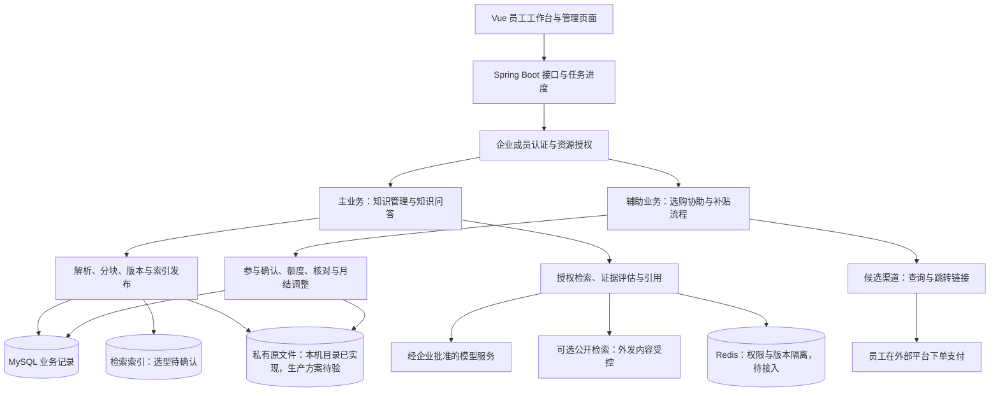

# 03 · 知序架构设计

## 当前有效 · 目标架构基线（2026-10-17）

产品为“知序 · 企业知识与工作助手”，以企业知识库与业务问答为主，员工事务与补贴结算为辅。业务范围以 02 的当前有效部分为准；本节定义目标职责和边界，不代表模块已经实现、依赖已经安装或数据库迁移已经执行。

### 1. 已有工程与演进约束

| 类别 | 当前事实或约束 |
|---|---|
| 后端 | 沿用 `backend/` 下 Java 17 编译目标、Spring Boot 3.3.5、Maven、MyBatis-Plus 与 MySQL |
| 前端 | 沿用 `frontend/` 下 Vue 3、TypeScript、Vite 问答工作台；新产品名称写入文档不代表页面文案已全部更新 |
| 现有调用链 | 已有 `QuestionPlanner`、`TavilyClient`、`EvidenceSelector`、`AnswerComposer`、`ResponsesClient` 等代码，可按企业场景逐项复核复用 |
| 当前入口 | 企业登录、空间治理、私有文字入库和授权关键词回答已接Vue；企业1/空间12的虚构资料真实MySQL＋模型页面15/15通过，测试版本已撤回，见[企业问答记录](docs/企业授权检索与回答最小闭环记录-2026-10-18.md)。`/api/chat`仍只供dev本机公开体验，不与企业知识混用。完整多角色实库矩阵及生产容量仍待验收 |
| 知识与身份存储 | 现有MySQL记录企业身份、授权、文档版本、发布指针和片段；首轮直接参数化LOCATE检索，无新增依赖或迁移。向量索引、持久任务与企业问答历史仍未实现；旧访客保留，不推定访客认证已实现 |
| Redis | 当前为目录预留，后续缓存、限流或会话存储按单元接入，不能写成已部署 |
| 文档定版状态 | 本节为目标架构，后续代码实施单独记录；旧测试记录不转算为企业产品验收 |

保留现有目录、Java 包名与通用设施，采用单个后端应用内按职责划分模块的演进方案。暂不拆微服务，不因引入 Agent 概念强制切换到 Python、LangGraph 或其他数据库。

### 2. 目标系统关系



图中均为目标关系。公开搜索、外部平台与模型服务各有独立授权和数据边界；选购链接不连接本系统的代下单或支付接口。

### 3. 分层与模块职责

沿用 `backend/src/main/java/com/ragqa`，业务按对应分层逐步新增；下表不是一次性新建全部目录或类的指令。

| 分层或现有扩展位置 | 目标职责 | 边界 |
|---|---|---|
| `controller` | 企业身份、知识空间、文档、问答、事务申请及财务接口 | 参数校验、身份接入与统一 `Result<T>`；不编排数据库事务或直接决定补贴 |
| `service` | 成员与资源授权、知识生命周期、问答用例、参与确认、额度及结算 | 事务、状态迁移与业务规则；业务异常使用 `BusinessException` |
| `mapper` | 参数化查询、权限条件、唯一约束对应操作及条件更新 | 不接受任意 SQL、表名、列名或模型生成的查询串 |
| `domain` | 实体、DTO、枚举、业务状态和接口契约 | 区分外部原始数据、员工填报、核验结果和最终业务事实 |
| `rag.ingest` | 原文件校验后的解析、分块、索引构建与发布协调 | 不识别扫描图像，不用分页插件代替文档切分 |
| `rag.retrieval` | 受权限和版本限制的企业检索、结果适配、去重与可选重排 | 外部公开搜索与内部检索分别标注，不混用原始相关性分数 |
| `rag.chat`、`rag.llm` | 意图分析、受控任务执行、预算、证据评估、提示模板和模型适配 | 不接管认证，不把模型输出作为金额、资格或授权事实 |
| `config`、`common`、`exception`、`utils` | 配置、统一响应、日志、异常和必要工具 | 复用已有设施，不为本次命名变更重构通用代码 |

渠道适配、财务导出等能力的具体接口和文件位置在对应实施单元确定；不提前生成“创建平台订单”工具。

### 4. 主业务的数据流与一致性

#### 4.1 文档入库与版本发布

授权上传 → 文件类型、大小及路径校验 → 私有保存原文件 → 提取文字 → 按内容结构分块 → 建立检索索引 → 校验完整性 → 发布可用版本。

文档、版本、分块、索引构建任务分别记录状态。原文件标识与内容摘要用于追溯和防重复处理，不能跨企业共用一个未经权限隔离的文档引用。解析和索引失败保留可重试原因，不让半成品进入正式问答。

MySQL 记录业务版本和发布指针，检索索引记录版本及企业、空间等过滤字段。索引准备完成后才切换有效发布指针；发布失败继续保留此前合法有效版本。过期或撤回后无可用版本时明确不可答，不为了可用性回退到已经失效的制度。

数据库与检索索引不依赖一个跨系统事务：采用可恢复任务、状态条件更新和补偿校验，处理重复执行、旧任务迟到、索引清理失败及应用重启。具体任务表和事务消息方案随入库单元评审，暂不引入 MQ。

2026-10-18文字入库已落地：`rag_document`记录负责人/revision/发布指针，`rag_document_version`记录不可变原件及解析、发布、有效期，`rag_chunk`按文档+版本+序号唯一。上传UUID及指纹防换参重传；片段和READY同事务；发布校验后原子切指针，撤回不回退旧版。READ仅访问当前有效发布版，MAINTAIN可治理草稿/历史；旧元数据入口不承接新文档。单节点4个入库/原件槽，解析循环5秒、写事务10秒；文件IO和整请求的生产硬时限仍待验。新增迁移已由用户逐段执行并提供三表定义核对；单维护者文字页面13/13为此前证据。随后在同一片段表接入下述关键词回答；向量与索引任务仍未实现，不能把文字发布等同向量索引发布。

#### 4.2 企业知识问答

**2026-10-18实际实现**：`KnowledgeRetriever`接口目前仅有MySQL关键词实现；中文双字词/拉丁词最多48个，SQL同时限制有效企业成员、明确空间授权、当前发布READY版本及有效期，24候选过滤重叠后最多6段。维护者可治理草稿，但回答同样只用发布版；无全文或向量索引。LOCATE可能扫描，LIMIT不等于容量保证。

`KnowledgeAnswerService`默认LOCAL_EVIDENCE；仅启动环境变量`KNOWLEDGE_SYNTHETIC_MODEL_SPACES`匹配的专用合成空间进入SYNTHETIC_MODEL。客户端先GET模式展示边界，再POST问题；一次knowledge:v1模型调用校验最多三问、原文覆盖、状态和逐字引用，调用前及返回前复核；模型失败保留原文并显式MODEL_UNAVAILABLE，不自动重试/转公开搜索。真实企业外发未批准，白名单空间不得混入真实资料。

后台两执行线程、SynchronousQueue零排队、30秒总等待；第三条拒绝503。前端最多两条独立在途、35秒等待、仅本页十条；Vite只为answers配置上游34秒/代理36秒，防原企业11秒代理提前断开。Future取消不保证上游停止或不计费，未实现持久任务、跨节点配额与历史恢复。真实页面15/15及四方面取舍见上述企业问答记录。以下描述保留完整目标，未逐项实现。

可信成员身份及企业范围 → 获准会话与请求时间上下文 → 问题理解和必要依赖排序 → 当前授权范围内检索 → 去重、预算内整理及可选重排 → 证据充分性评估 → 有依据回答及可核验引用。

企业制度类问题必须命中企业适用资料；没有资料不能用公开搜索或模型常识补成内部规定。公开信息补充使用独立来源标识，进入搜索请求前校验外发内容；未经批准不发送企业原文、员工资料、票据或私有对话。

证据状态至少区分“充分”“部分充分”“无匹配资料”“资料冲突或过期”“依赖服务失败”。部分充分时只生成有据部分并说明缺口；补检同时受整体截止时间、次数和成本预算限制。服务失败不能伪装为空结果。

引用的目标契约包含来源类型、文档和版本标识、片段或章节定位、生效信息及受控读取入口；精确 Java 字段在契约单元确认。检索、送模型前、返回引用和下载原文件时复核当前权限与版本；失效证据不得从旧上下文继续输出。已经发送给模型的数据不能靠后续拒绝响应撤回，因此外发授权须在调用前校验。

##### 4.2.1 同义召回评审与下一步实验建议（2026-10-18，尚未实施）

同一份20条虚构资料、24个场景在中英取词修复后，标注证据命中14/15、完整命中11/12，访问拒绝4/4。这是H2关键词基线，不是回答正确率或向量选型结论。剩余K03“夜里多干活的伙食津贴一天最多能领几块钱？”期望餐补资料1，实际返回无关请假资料4：候选非空仍可能漏召回，因此只在空结果时补检不适用于本例。

| 候选方法 | 本轮问题上的适用性与代价 | 评审建议 |
|---|---|---|
| 维护同义词/业务术语 | 无额外模型请求，但需知识负责人维护适用范围、版本与歧义；为一道题硬编码对应词会污染评估 | 有真实术语治理需求时采用，不作为本题补丁 |
| 全文索引/关键词排序 | 改进查询执行与字面相关性；缺少同义扩展或语义组件时，不能据此保证理解无字面重合的问法 | 待容量与排序证据，不直接当语义问题的解法 |
| 受控查询改写＋原始关键词检索 | 可复用现有模型与授权SQL，无需先迁库；每个启用请求最多增加一次模型调用，增加延迟、外发与漂移风险 | 建议作为下一步合成空间对照实验，不替代正式语义检索选型 |
| 本地Embedding＋关键词混合 | 可在本地验证语义匹配；需要模型、执行环境、模型许可/来源核验、向量构建与索引生命周期，CPU/内存和运维成本待测 | 保留为企业检索候选；先确认资源和代表性语料，不现在安装或指定向量库 |

本轮已按协作规则搜索GitHub中的pgvector、Elasticsearch及FlagEmbedding候选，搜索工具无有效结果，直接读取pgvector项目也超时。因此这些只是待核验项目清单，未引用其版本、许可、资源需求或跑分，不将访问失败包装成选型验证。

**建议的有界实验链路，未编码**：可信成员/空间复核 → 原始关键词检索 → 仅获准合成空间尝试一次问题改写 → 同一授权SQL检索补充候选 → 去重并保留原始命中 → 仍以原始问题及已授权原文生成/展示。改写文本只参与查找，不变成制度事实、问题替代品或引用；不能让模型输出企业编号、空间、SQL、URL、金额结论或工具调用。

外发许可覆盖问题本身，不能因未发送文档就认为员工问题不敏感。LOCAL_EVIDENCE继续不调用外部模型；现有SYNTHETIC_MODEL白名单只适用专用虚构空间，读取前复核并且不得混入真实资料。未来真实企业批准或本地模型接入另作决策。

改写最多一个备选查询，不自动重试；服务端校验结构、长度、控制字符及明显约束丢失，不宣称正则能证明语义等价。保留原问题和原检索候选，禁止用补充结果静默覆盖全部原始命中；融合后的数量仍受现有6片段约束，具体融合策略在实施单元用评估选择。

沿用当前30秒父任务截止时间，改写阶段初始建议不超过5秒，目的是避免可选增强占满生成时间，不是延迟承诺。调用前检查剩余预算并实际限制HTTP等待，不能仅调用`timeoutFor()`做前后检查就宣称有5秒硬上限。超时、401/403、限流、空值或格式错误均不重试，撤权则拒绝整个受保护操作；普通改写故障保留原始证据并明确提示“语义扩展未完成，本次仅按原问题检索”，不伪装成没有公司制度。

成本按实际请求计：额外费用为`N_r × (T_in × P_in + T_out × P_out) / 1_000_000`，其中N_r是发出的改写请求，Token与价格取中转实际usage/账单和报价。未知用量不填0；被取消的请求也可能计费。真实实验另定硬预算；本次文档评审未调用模型、下载模型或改变任何运行行为。

##### 4.2.2 原始与补充候选的融合及语义漂移边界（2026-10-18，设计待实现）

**先纠正一个前提**：保留原始命中只能避免被替换，不能阻止错误补充资料影响回答。当前8条手写错误改写中7条通过词法契约，不是模型错误率，却足以说明不能把`CANDIDATE`直接作为自动生成答案的准入信号。因此本单元只确定下述对照方案，不修改问答服务；此前4.2.1的最终生成链仍是待评审目标，不是本轮实施承诺。

**现状**：已有独立`QueryRewriter`，调用前后复核成员/空间，默认不许可外发；复用阶段5秒与父任务剩余时间的较小值、一次请求及严格输出契约。正式`KnowledgeAnswerService`仍只按原问题检索，尚未调用改写器，也没有补检或融合代码。阶段上限不为生成预留独占额度。

| 环节 | 下一最小实验的规则，尚未编码 | 不能由此推导的能力 |
|---|---|---|
| 输入与权限 | 仅接收同一可信成员、企业和空间下，通过既有授权检索取得的两份快照；原始及补充各最多6段。复用当前发布/有效期过滤，补检也必须走同一授权入口 | 纯融合函数不是授权器，不能接收客户端或模型伪造的片段 |
| 原始基线 | 原始问题、原始证据列表及顺序单独保留；正式回答暂时只使用这份基线 | 保留基线不代表基线相关、充分或正确 |
| 去重与一致性 | 按文档、版本、片段编号识别同一证据；相同编号须完整快照一致，双路命中只记来源，不用补充内容覆盖原件。同一片段编号出现不同快照、版本或文档关系时拒绝实验结果 | 不能把编号相同但内容变化默认为可接受更新 |
| 有界预览 | 先放原始命中，按补检原顺序补满空位，总数最多6；不跨路混用相关性分数。补充段与已选段同文档、同版本且UTF-16区间重叠超过120时跳过，沿用现有去重尺度 | 无空位时不会召回增益；不承诺每个问题都能覆盖，120也不是最佳阈值结论 |
| 来源记录 | 实验记录区分原始、补充、双路命中，记录被容量或重叠排除的数量；与正式`Answer.evidence`分离。审查预览前仍须复核保留证据的权限、版本和完整快照 | 不新增普通员工可随意开启的调试入口，不在日志打印问题、改写或正文 |
| 答案使用 | 预览仅供开发评测人员核对；补充命中不自动进入`KnowledgeAnswerComposer`，不成为正式引用。原始为空时仍保持正式无证据结果，并单独记录实验候选 | 加上“实验”提示不能代替语义准入；没有依据仍不能编出答案 |

该策略在后续纯函数实现中用确定性输入验证，不新增模型裁判、RRF融合或依赖。采用按原顺序追加，是为了先看清单条改写带来的变化；RRF等排序方法解决顺序问题，不能单靠排序排除语义漂移。也不采用“固定三条原始＋三条补充”，它会在原始满额时挤掉已有证据。若未来要分配固定名额或重排，须作为独立实验比较，不能悄悄改变本策略。

**验收样例与反例**：原始片段`[41,42]`、补充`[42,43]`且快照一致、区间不重叠时，预览应为`[41,42,43]`，来源分别为原始、双路、补充，正式回答仍只用`[41,42]`。原始`[41,42,43,44,45,46]`已满时，补充`[47]`只记容量排除；原始为空、补充`[47]`时预览可有47，但不能自动从无依据升级为已回答。R11“今天北京园区班车几点走？”误改为“明天上海园区班车发车时间？”即使搜到有效原文，也不得据此回答原问题；来源可追溯与语义适用是不同检查。

**异常、预算与启用门槛**：模型故障仅在父任务仍有效且授权未变时保留基线；改写`NOT_PERMITTED/UNCHANGED/UNAVAILABLE`不启动补检。补检的权限失败、存储失败、资料变化或父任务超时不能伪装为空列表或成功降级；取消不保证供应商停算或不计费。仅比较原始与补充的命中变化，不把预览数增加算答案正确率。下一单元先实现有界融合的纯函数和离线边界测试，再评审合成实验编排；真实16题调用的次数/费用硬预算仍待确认，本轮没有授权付费调用。将来让补充证据进入生成前，须固定并记录语义准入/拒用策略，以现有反例和独立样本验证，同时复核回答质量、权限、延迟与成本；当前没有这些实测证据，不能宣称上线可用。

#### 4.3 身份、权限与缓存

认证确定企业成员身份；资源授权确定其可访问的企业、空间、部门和文档。成员编号及企业范围由服务端可信身份得到，不接受前端、模型或 ThreadLocal 自报为授权依据。异步任务显式传递身份关联并在敏感操作时复核，不依赖工作线程自动继承请求线程状态。

查询、向量过滤、模型上下文、会话历史、引用、原文件链接和导出都必须带业务范围。不能先全库召回再只靠前端隐藏；文档管理权和通讯录可见性也不能替代会话或财务权限。

缓存键按数据类别包含企业、用户或授权范围、权限版本、知识版本、请求上下文及检索或模型配置；结果返回前仍校验当前访问资格。撤权、文档撤回、版本发布和适用日期变化触发失效或拒绝复用。不能只按问题文本缓存全企业答案，也不把企业私有回答放入公开搜索共享缓存。

#### 4.4 企业身份与资源授权（A1—A4初次交付记录，后续验收见4.1及入库记录）

2026-10-17用户授权连续完成四项，并选择“管理员开通账号＋账号密码登录”。已实现独立企业/成员、有效状态和版本复核、Spring Security会话认证，以及会话、消息、知识空间、文档元数据和任务归属锚点的授权读取。实现、文件清单、接口、四方面学习记录和测试证据见[企业身份与资源授权实施说明](docs/企业身份与资源授权实施说明.md)。

- 新增六张逻辑关联表；账号认证版本、会话企业/成员和文档企业/空间字段通过独立03迁移补齐，不建物理外键，不自动回填旧数据；脚本已生成，未执行到本机MySQL。
- `EnterpriseMemberContext`含企业、成员、账号、直属部门、角色和三类版本；只在服务器内部流转，不从请求JSON或用户头构建。成员查询继续绑定原认证版本，防止复核期间撤销登录后取得新版本上下文。
- `EnterpriseResourceMapper`在同一SQL复核有效账号、企业、成员、版本及资源范围。会话仅本人；知识空间要求成员或有效直属部门的明确授权。管理员不隐含私有内容读取权，文档视图不返回原件存储路径。
- 登录采用标准会话、BCrypt、CSRF、登录换号、退出和全部会话撤销；默认闲置30分钟、绝对8小时。prod会话Cookie开启Secure，敏感接口跳过正文日志并带请求编号；首版限流和会话为单节点设施。
- 本轮没有文档上传/下载、发布版本、正文检索、会话写入、后台任务执行或SSE。`rag_task_reference`只承载归属关联，不能据此宣称任务已执行或可断线恢复；原件/引用/导出须在对应入口实现时再次授权。
- 定向93项通过，含随机端口真实HTTP、真实MyBatis与隔离H2；全量结果见实施说明。H2不证明目标MySQL的DDL、锁语义或生产容量，企业资料没有外发到模型或搜索。

<details>
<summary>实施前盘点与契约草案（历史记录，完成状态以上文为准）</summary>

**现状盘点与复用边界**

| 当前位置 | 已有行为 | 尚缺能力 |
|---|---|---|
| `domain/dto/AuthenticatedUserPrincipal.java` | 不可变账号主键，拒绝非正数；没有密码、令牌或企业字段 | 仅是服务端身份载体，没有产生可信主体的登录入口 |
| `service/impl/CurrentUserServiceImpl.java` 的 `requireUserId()` | 只接受上述主体，按主键、正常状态和逻辑未删除复核账号，仅查编号 | 未校验密码/令牌/会话，不校验企业或部门；当前控制器未调用此入口 |
| `service/impl/ConversationServiceImpl.java` 的 `requireOwned()` | 同次参数化查询限定会话编号与账号编号，排除逻辑删除；无匹配统一404 | 实体没有企业或成员字段；同一账号在不同企业的隔离还不能保证 |
| `domain/entity/RagDocument.java` | 标题、来源、解析状态和上传者等元数据 | 上传者不等于访问授权，没有企业、空间、部门及版本发布关系 |
| `controller/WebChatController.java`、`ProductSearchController.java` | dev公开问答与Mock商品入口 | 未建立企业登录或企业私有资源入口，不改造成默认访问内部资料的入口 |
| `common/ResultCode.java`、`exception/GlobalExceptionHandler.java` | 业务异常通过`Result`表达，沿用业务异常HTTP200约定 | 新服务不能只检查HTTP是否200；权限错误和网络故障必须区别处理 |

**最小成员模型建议**

- `sys_user`继续作为系统账号，不添加一个全局`enterprise_id`来替代企业成员关系；即使首个试点只有一家企业，也在业务查询中明确企业范围。
- 拟新增`sys_enterprise`：`id`、`name`、`status`、`permission_version`及创建/更新时间。状态仅明确启用/停用；未知状态不视为启用。
- 拟新增`sys_enterprise_member`：`id`、`enterprise_id`、`user_id`、`status`、`permission_version`及创建/更新时间。成员状态明确有效/停用/离职；不因为账号仍有效就允许离职成员继续访问。
- 成员关系唯一约束为`(enterprise_id, user_id)`；状态变更更新同一关系，不通过重复插入绕开离职或停用。账号对应多个企业时，每次请求只选择其中一个已经核验的关系。
- 全部使用逻辑关联，不建物理外键；保留现有账号唯一性和旧表数据。成员所属部门、角色、知识空间及授权表在相应单元继续补齐；未实现部门授权前，不把“同一企业”当作全部文档可见。
- `permission_version`是未来权限快照失效依据，不是权限本身。没有权限缓存的首版每次读取有效状态，不预先引入Redis，也不使用长效身份快照绕开撤权检查。

**服务端输入输出契约建议**

1. 拟新增`EnterpriseMemberService.requireMember(Principal principal, Long enterpriseId)`：先复用`CurrentUserService.requireUserId()`核验账号，再以账号主键与企业编号限定有效成员，并确认企业启用。前端传入的企业编号只是选择条件，不是授权证明；不接收客户端自报的成员编号、角色或权限版本。
2. 成功返回不可变`EnterpriseMemberContext`，仅含`enterpriseId`、`memberId`、`userId`和企业/成员权限版本，不含密码、令牌或账号实体。上下文只由服务端校验结果生成，禁止从请求JSON或自定义用户头直接绑定为可信值。
3. 无可信主体或账号不可用沿用业务码401；已认证但企业不存在、停用或无有效成员关系，统一业务码404及“企业不存在或不可访问”，不暴露其他企业是否存在；非法企业编号返回400。存储故障继续交给异常处理器，不伪装为空资源或默认成员。
4. 此入口只证明当前有效成员关系，不证明能读某个文档、会话或财务记录。知识授权另设资源入口，先限定企业、资源编号及有效授权，再读取标题、片段、原件；禁止先全库读取再过滤。企业管理员也不自动拥有员工私有会话或财务权限。
5. 异步任务显式保存账号、企业、成员等关联，执行、检索、模型外发和返回敏感资料前重新校验有效资格。ThreadLocal只能传递已验证上下文，不提供认证；一次校验不能保证后续所有时刻都有权限，也不能撤回已经发给第三方的数据。

**旧数据兼容与后续边界**

- 先增加企业与成员模型，不修改既有`CurrentUserService`、`ConversationService`及访客代码的原契约。
- A3再为企业会话设计企业/成员归属字段及授权入口；旧会话缺少企业归属，保持历史状态，不能批量填成第一家企业。消息和任务按所属会话继承授权，不凭消息或任务编号单独放行。
- 知识空间和文档授权属于B阶段；旧文档的`created_by`不能推导完整组织授权，需经明确归属及发布流程后才进入企业检索。
- 登录来源仍待确认：本地管理员开通账号或对接企业身份系统均可适配已有账号主体。A1不擅自决定公开注册、SSO供应商、Cookie/JWT或新增安全依赖，也不把开发用身份模拟接到生产。

**实施文件与顺序（均待确认）**

| 后续单元 | 拟新增或精确修改文件 | 验证要求 |
|---|---|---|
| 企业/成员持久化模型 | `domain/entity/SysEnterprise.java`、`SysEnterpriseMember.java`；`mapper/SysEnterpriseMapper.java`、`SysEnterpriseMemberMapper.java`；相应映射测试 | 状态与表名、参数绑定、账号和企业联合条件；每次最多三文件，模型和映射分批确认 |
| 增量表结构 | `backend/sql/migrations/20261017_03_enterprise_membership.sql`、`backend/schema.sql` | 注释、唯一约束、索引、无物理外键；先检查目标库和备份，再单独批准执行，不重放整库脚本 |
| 有效成员服务 | `domain/dto/EnterpriseMemberContext.java`、`service/EnterpriseMemberService.java`、`service/impl/EnterpriseMemberServiceImpl.java`及对应服务测试 | 认证、企业状态、成员状态、跨企业、非法输入、撤权、故障与并发；接口/实现和测试按三文件上限拆批 |
| 真实身份接入 | A2选择登录方式后确定认证层、接口和安全测试 | 登录成功后才创建可信主体；无登录来源不开放企业私有入口 |
| 资源归属复用 | A3会话/消息/任务，B阶段知识空间/文档，再逐项细化文件 | 不改旧数据归属；跨企业、跨成员、撤权及管理角色越权均拒绝 |

表内Java路径相对`backend/src/main/java/com/ragqa/`；测试位于`backend/src/test/java/com/ragqa/`。文件清单是后续计划，不表示本轮已经新增这些类或脚本。

**必须覆盖的授权用例**

有效账号在企业A有成员关系才能进入A；仅在B有关系不能访问A；同一账号在A/B分别取得各自成员上下文；企业停用、成员停用/离职、账号停用/删除均拒绝；非法编号与无主体不继续探测资源；客户端伪造企业/成员/角色不授权；上下文过时后重新校验能阻断访问；并发A/B请求不串用条件；数据库异常不降级为默认身份。资源阶段另测同企业不同成员的私有会话、无权知识标题/片段/原件、撤回文档与异步在途撤权。缓存、写事务、回滚与真实MySQL约束在对应实现后验证，不能以本单元的模拟测试替代。

**四方面学习记录**

- **为何这样选**：账号解决“是谁”，企业成员解决“在哪家企业以什么有效关系工作”，资源授权解决“可以访问什么”。不用账号表单字段或全局管理员标记包办权限，避免多企业串读和管理角色越界。
- **代码与数据如何流转**：拟定链路是可信主体→账号状态复核→企业及成员联合校验→不可变上下文→具体资源授权→业务操作。已有两项服务只覆盖前述部分账号和个人会话读取，不是完整链路。
- **问题与解决**：旧数据没有企业范围、权限会变化、前端编号不可信；分别通过不自动回填、敏感阶段复核和服务端联合查询处理。异常保持可见终态，身份存储故障不能返回成功或假未登录。
- **还能怎样优化**：先用MySQL明确状态与索引，再按真实流量决定权限缓存；接SSO时只替换身份接入。缓存必须考虑企业、成员和权限版本、撤权及依赖故障，代价是更多失效与一致性处理，暂不提前实现。

**本轮验证记录**：2026-10-17以本机JDK21、Java17编译目标运行`CurrentUserServiceTest`和`ConversationServiceTest`，共34项通过，失败/错误/跳过均为0。使用真实MyBatis映射生成SQL和模拟Mapper，没有连接数据库、调用模型或搜索；仅证明既有账号复核和个人会话服务基线，没有证明企业授权已实现或全量后端已通过。历史HTTP并发用例失败仍保留待排查。

</details>

### 5. Agent 执行边界与任务交互

Agent 负责理解意图、选择获准工具和整理结果；服务端执行约束负责工具白名单、参数验证、权限、任务状态、时限、费用和审计。这些执行约束可称为 Harness，不意味着必须安装一个名为 Harness 的框架，也不能用模型自检代替它们。

- 问答、公开选购查询与提交申请分开。用户查询餐补政策不自动创建补贴申请；重要提交、人员和金额变更由用户确认后执行。
- 工具输入不得覆盖当前成员身份；模型只能提出候选参数，服务端重新校验可选员工、可用规则、金额和资源权限。
- 一句多问分开执行与展示排序，有前置依赖先处理前置问题；不要求用户决定哪个先答。必要字段缺失或重要操作确认仍可明确提示。
- 补充问题、消息、任务与连接分别建模。刷新或断网先按归属查询原任务，禁止重连就重新提交；合并检查点和后续任务策略需在调度单元验证。
- 所有阶段共享总截止时间、调用与并发预算；队列必须有容量上限。用户看到阶段与终态，不展示模型内部推理或敏感请求正文。
- 异常区分超时、权限或凭据失效、限流、第三方不可用、空结果和响应契约变化；只对可安全重试操作有限重试，不无限循环或重复提交未知结果的写操作。

目标交互可采用任务快照与 SSE 进度，具体接口、事件顺序、断线重放和终态去重另行评审；不能把历史 Python SSE 示例直接视为已有 Java 接口。

### 6. 辅助事务的数据流与可靠性

#### 6.1 平台查询与跳转

获准的选购需求 → 渠道适配器查询可用推广信息 → 结果规范化与安全链接校验 → 返回“前往平台下单”入口 → 员工在平台完成交易。

候选渠道为淘宝闪购联盟，准入、商品范围、订单报表、退款数据、员工归因和延迟均待实测。链接域名与协议需白名单校验，禁止任意跳转。点击记录只说明点击行为，不创建“已下单／已履约”的内部事实。

商品查询以 `ProductSearchService` 隔离渠道差异，统一返回商品摘要、数据来源、是否模拟、跳转类型与链接，以及能力说明。先提供仅dev可用的 `MockProductSearchService`，固定示例目录不读取企业数据、不调用第三方；未知关键词返回明确空列表，不编造匹配。演示链接使用固定平台首页并明确不对应真实商品，禁止输入指定任意跳转目标。

真实渠道适配器在获准后新增，保留统一契约并验证其字段限制、分页、限流、超时和错误分类；真实模式缺配置或调用失败必须明确失败，不切回Mock。当前Mock不承担企业认证或生产入口职责，也不接入自动下单、财务核验与补贴。它可作为独立开发单元先行，不改变企业知识主线优先级。

若后续取得可用报表，按渠道授权设计有界拉取、去重、断点、延迟与乱序处理，并与员工提交信息核对；报表到达不自动等于可结算。不假定存在实时回调，也不在本系统模拟外部平台支付成功。

#### 6.2 补贴申请、确认和结算

员工填报或渠道获授权数据 → 申请及证据版本 → 资格与额度规则校验 → 参与人确认 → 履约和凭证核对 → 财务核算与月结 → 退款及差错调整。

这些是独立业务状态：外部订单履约状态、材料核验状态、参与确认状态、申请审批状态、额度占用状态和实际结算状态不能用一个“成功”字段代替。员工填报记录需保留来源和核验人，不能标为平台认证。

付款人、消费参与人、额度归属人和结算收款人分别关联；多人确认绑定申请版本、本人分摊与预计额度占用。名单或金额变化后，受影响确认失效并重新发起。资格来源、额度周期、预占时机与释放条件在实现前评审。

金额使用 `BigDecimal` 和数据库定点金额类型，明确币种、金额精度、分摊与尾差规则；财务规则由业务代码执行并保留适用版本，模型不直接核算最终金额。

额度及结算以 MySQL 账本和业务状态为依据。依靠事务、幂等键、唯一约束和带版本或状态条件的更新处理并发；Redis 可辅助限流或缓存，不能成为财务余额唯一来源。具体防重键须覆盖企业、渠道、订单和补贴规则，防止换发起人重复申领；调整记录与正常申请分别追溯。

通知、导出或后续外部财务推送需可恢复与防重复。评审时可采用数据库任务或事务消息表实现提交后的可靠投递，不承诺跨系统一次网络调用恰好执行一次。超时先查询原操作，状态不明则挂起核对，不盲目重发。

取消和全额退款阻止有效补贴；部分退款重新核算，结算前阻断旧金额，结算后新增调整。退款同步与财务结算冲突须按业务版本和事务复核，保留核对证据及迟到数据的纠正流程，不覆盖历史账目。

#### 6.3 原始凭证

原始票据与电子原文件私有存储，业务表保存关联、类型、大小、内容摘要、提交人与核验状态。下载按当前权限校验，禁止公共永久链接；文件上传和预览需处理伪造类型、路径穿越、恶意文件及浏览器内容执行风险。

无任何 OCR 或模型读图步骤。必要结构化字段从可信渠道取得或手工填报，原文件、业务事实和确认审核链互相关联；三者齐全不自动等于票据合法有效。保留期限、删除与审计策略上线前确认。

### 7. 数据模型演进边界

| 目标数据域 | 计划记录 | 与现有工程的关系 |
|---|---|---|
| 企业与成员授权 | 企业、成员、部门、角色、空间及资源授权 | 现有 `sys_user` 不能直接当成完整企业成员模型；通过增量设计接入 |
| 知识生命周期 | 文档、版本、分块、索引任务、发布状态、引用定位及反馈 | 复用并评审 `rag_document`、`rag_chunk` 等现有结构，不无条件覆盖原表 |
| 会话与执行 | 企业归属、成员归属、消息、任务、预算和幂等操作记录 | 复用会话和消息能力，补齐真实认证及生产任务持久化 |
| 辅助事务与凭证 | 外部订单引用、核验、补贴申请版本、分摊、参与确认、原文件关联 | 新业务域，表名与字段待专门单元评审；本次未生成 SQL |
| 财务与可靠投递 | 规则快照、额度账本、结算与调整、审计和通知任务 | 需要增量迁移、并发与回滚验证，不提前安装支付 SDK 或 MQ |

坚持 MySQL 业务主库与无物理外键的现有约定；通过逻辑关联、索引、唯一约束、事务和服务校验保证引用完整性。`backend/schema.sql` 用于空库，已有库使用独立增量迁移。图和表中的目标实体不代表已有建表或真实数据库变更。

### 8. 选型状态与发布门槛

| 已沿用或已确定 | 仍需评审，未引入 |
|---|---|
| Java 17、Spring Boot 3.3.5、Maven、MyBatis-Plus、MySQL、Vue 3 与现有目录 | 向量与关键词索引：Qdrant、Milvus、pgvector、Elasticsearch 等仅为候选，结合资源、权限过滤、中文召回及成本选择 |
| 复用受控的意图、检索、证据与生成职责 | 文档解析库、分块策略、Embedding 与重排模型；以企业评估集决定，不先固定块长或相关性阈值 |
| 无 OCR；平台跳转购买；补贴由明确规则核算；首版管理员开户＋账号密码登录 | 试点规模、后续SSO、Redis配置、私有对象存储、可靠任务与财务对接方式 |
| 本地已有模型连通性只证明对应通道的技术调用 | 企业数据发送权限、模型和中转供应商、费用及留存条款需企业批准；未批准只用公开或虚构测试材料 |
| 小步实施、可验证、可回滚 | Spring AI、MCP、多 Agent、工作流引擎、微服务与 MQ 均按实际需求评审，不为名称或招聘要求堆依赖 |

企业产品发布前必须验证知识召回与引用、版本适用、部分证据处理、越权与撤权、注入及文件安全、任务超时和恢复、成本上限、备份恢复。辅助事务启用前另验真实渠道边界、多人确认、并发额度、退款竞态和财务追溯；未通过的模块保持不可用，不用演示数据冒充已上线能力。

监控应分主业务质量与辅助事务状态：问答成功和证据不足、引用错误、版本陈旧、检索与模型延迟、任务积压、调用成本，以及参与确认积压、核验积压、额度冲突、退款同步延迟和调整未结。容量指标与告警阈值根据试点和压测建立，不沿用历史的固定机器规格或秒数承诺。

---

## 历史参考区 · 原联网问答与访客设计

下方完整保留先前方案与讨论记录，供定位已有代码来源。其中公开访客优先、不做本地库、Python/FastAPI/LangGraph、SQLite、固定参数、价格和旧实施阶段均不是当前架构指令。原访客功能暂冻结，不将日切清理规则应用到企业资料或财务记录；与上方冲突时以当前有效部分为准。

<details>
<summary>展开原架构及访客方案（历史参考）</summary>

## 阅读说明与本轮补充边界（2026-10-16）

本轮参考用户提供的功能模块图，只吸收职责划分、边界控制和验收方法，保留原有「路由 → 改写 → 检索 → 评估 → 生成」的主流程，以及先跑通联网问答、再逐步增强的开发思路。下表是原模块的补充要求，不是新增一套架构，也不表示功能已经实现。

当前工程继续使用 Java 17、Spring Boot 3.3、Maven、MyBatis-Plus 与 MySQL，沿用 `backend/src/main/java/com/ragqa` 现有分层。下文保留的 Python、FastAPI、LangGraph、SQLite 示例用于理解原方案，不作为切换当前技术栈、目录或数据库的指令；实际建表以 `backend/schema.sql` 为准，不建物理外键。

下文「不做本地知识库」描述联网问答起步阶段的范围。用户已确认后续增加本地知识库，继续通过现有检索扩展位置接入，并在该阶段单独设计入库与索引；本轮不提前实现。

### 访客与账号的身份、保留期及额度（2026-10-17）

用户已选择访客优先、保留账号登录：打开网页即可使用，访客会话按北京时间日切清理，零点前已受理的任务允许限时收尾；账号历史保留，便于后续查看。本节是最新业务约束，不表示身份、额度、收尾或清理功能已经实现。

| 模式 | 访问与数据保留 | 消耗限制 |
|---|---|---|
| 访客 | 无需注册；北京时间次日00:00停止旧身份接收新问题；已受理任务沿用原截止时间限时收尾，结果仅在有限阅读期内可见。刷新、重连和修改展示时区不续期，页面不关闭也有服务端硬上限 | 按匿名额度主体与北京时间自然日分别记账，临时身份轮换不重新发额度；受理次数与累计模型token同时限制，具体限值待配置确认 |
| 账号 | 保留独立登录入口与账号身份；退出、登录会话失效及访客日切不删除账号历史。历史保留不等于登录凭据永久有效 | 使用独立账号额度，并受全局成本与并发上限保护；登录不表示无限调用 |

访客凭据、访客内部编号和业务会话编号分别承担认证、归属和资源定位职责，不能将公开会话编号当作访问凭据。访客与账号身份须明确区分，不能把访客编号直接交给仅校验sys_user的CurrentUserService，也不能共用一个默认用户编号。访客登录后的临时历史是否转存为账号历史，作为后续独立策略确认；本轮不自动迁移数据。

生命周期拟区分ACTIVE（正常使用）、DRAINING（收尾中）、EXPIRED（到期）与REVOKED（撤销），状态字段及时间字段的存储定义在后续单元评审，现有SQL尚未包含完整跨日收尾结构。日切时有已受理未结束任务的旧身份进入收尾期，只允许该任务及必要上下文的处理、状态查询、取消和结果读取，不开放旧历史的通用访问或新提问。任务原截止时间不因跨日延长，结果阅读期及整个收尾期另设可配置硬上限；任务超时后停止执行，阅读权限按各自期限关闭，待全部受保护任务及结果到期后身份最终失效。撤销优先于收尾，不能借收尾恢复已撤销身份。

关闭页面通知及在线心跳只能辅助观察，不作为唯一失效条件；断网、页面崩溃、多窗口及页面长期不关闭均由服务端时限兜底。后台分批清理临时会话、消息、任务结果及私有缓存，排除仍在合法收尾期内的任务及必要上下文；写回时复核任务范围、归属和截止时间，防止清理后被迟到结果复活。物理清理延迟或失败不扩大权限，也不承诺00:00瞬间完成全部删除。

额度在正式接纳任务前原子校验和预占，与接纳记录、幂等标识关联；并发不得先各自读取余额再无条件扣减。一次受理的原始提问算一次，拆出的子问题及规划、评估、生成等全部模型调用合计计入token；搜索调用次数单独受成本上限保护。参数校验失败和未接纳请求不扣次数，重复提交复用原预占；已经发生的外部消耗不能因失败、超时或取消自动全部退还。token按供应商可信usage结算，缺失或结果未知需保守记账与有界对账，不能按正文字符数推算或将未知消耗记零。

额度账本按服务端关联的匿名额度主体与Asia/Shanghai业务日期区分，不在零点覆盖清零旧账。跨日任务的次数、token及搜索成本始终归受理日，使用原预占预算，不挪用次日额度续跑；次日新问题使用当日账本和访问身份，旧任务继续以原任务归属收尾。匿名额度主体与临时身份分别设计，可信关联、防滥用数据的有限保留及账本结构仍待实现，不能接受前端自报编号作为余额依据。

刷新、新建会话及正常轮换临时身份不重置当天额度；删除Cookie、无痕窗口可能形成新访客，另以网络来源限流及全局预算控制滥用，不承诺仅凭Cookie识别同一自然人。额度耗尽保留获准历史读取能力，界面结束等待并显示登录入口；日切时仅保留获准收尾任务及必要上下文的展示，最终到期后清除对应本地正文，不静默重发原问题。匿名额度不足与第三方服务限流、密钥失效分别反馈。计量存储故障时拒绝新的付费调用，不绕过校验。

现有任务保留提案中的24小时不是访客数据的额外保留许可：访客私有数据按日切及有限收尾/阅读期限控制，不能自动延长到24小时。脱敏用量账本按独立且有限的防滥用与运维保留策略保存，不含问题、回答或凭据，不因清除聊天历史而重新发放当日额度。账号历史不纳入访客清理条件。

实施顺序：访客与账号身份及归属存储方案 → 访客签发与日切有效期 → 额度原子预占和结算 → 会话、历史接口及前端反馈 → 到期清理与跨日任务竞态 → 账号登录及临时历史转存策略。具体表结构、凭据载体及依赖在相应单元评审，不在此处更换现有表或提前安装组件。

### 原模块如何吸收参考图的优点

| 原有模块 | 可吸收的优点与补充边界 | 落点 |
|---|---|---|
| 路由、改写 | 区分一个问题的多个条件与多个独立问题；先满足必要依赖，再考虑用户指定顺序；执行顺序与答案展示顺序分开，不因优先级不明让用户选择 | 现有 `rag.chat` 内逐单元实现，保持受控流程 |
| 检索、结果整理 | 保留结果适配与去重；同时限制单条资料、单个子问题和整次问答的资料预算；为后续来源类型保留标识，不直接混用不同来源的原始分数 | 现有 `rag.retrieval`；具体字段和额度在对应单元确认 |
| 评估、生成 | 区分正常无结果、证据不足和供应商故障；无充分依据不强行生成事实；部分可答时保留有据答案，引用只能指向本次获准使用的资料 | 原 `grade`、`generate` 职责及现有 `rag.llm` |
| 会话、历史 | 历史按归属与长度读取，规划中间结果不混入用户可见回答；滑动窗口和摘要按评测决定，不照搬图中的固定轮数 | 现有会话服务及 `rag.chat`，不新增独立记忆框架 |
| 接口、任务、进度 | 消息、任务和连接分别管理；刷新或断网后优先查询原任务；补充消息按已约定的检查点合并或关联后续任务；成功、失败、取消及部分完成都有终态反馈 | 现有 `controller`、`service` 与任务契约，SSE 按后续单元接入 |
| 工程保障 | 把总时限、调用次数、并发额度与资料预算贯穿各阶段；按请求和任务关联耗时与安全错误分类，不能只记录日志而让用户等待 | 现有 `config`、`common`、`exception` 与各调用边界 |

上述要求与 `docs/开发待办.md` 已有多问题、可靠性、安全和缓存清单对应，已有项不重复建模块。当前已有客户端、预算类型和 DTO 不等于完整问答、生产调度或前端交互已经完成。

### 本轮不直接采纳的内容

- 图中的 ReAct 自主执行、Skills、Kafka、MinIO 和自动工具发现，不因出现在参考图中就纳入当前实现；原方案已有的 MCP 等扩展仍按原阶段评估。
- 双路检索、RRF、重排和父子块作为后续本地知识库的候选优化；只有基线评测暴露需求后再确认，不直接采用图中的参数。
- 不照搬子问题上限 4、最近 4 轮、RRF 参数 60、锁续租 10 秒等数值；阈值按预算、供应商约束与测试结果逐单元确认。
- 工具失败必须有安全、真实的用户反馈；可观测性只展示阶段与必要摘要，不输出密钥、敏感正文或模型内部推理。
- Redis 锁与 JVM 活动任务表属于并发控制候选措施，不能替代已约定的消息幂等、任务持久化和资源归属校验。

本轮仅补充文档阅读层次和验收边界，不调整后文原架构图、业务接口、包结构、依赖或实施阶段。具体待实现项见 `docs/开发待办.md` 的「参考功能图的吸收范围与验收补充」。

---

> **重要变更**：本版本已按「**不做本地笔记知识库**」重写。
> 系统定位从"本地知识库问答"变为「**联网检索增强问答**」——
> 知识来源是 **Tavily（实时网页）+ arXiv（学术论文）**，没有本地语料。
>
> **这个变更带来了大幅简化**，详见第一节。

---

## 一、这个变更简化了什么（先看这个）

不做本地知识库，意味着**整条"离线索引流水线"全部消失**：

| 原设计（有本地库） | 现在（无本地库） | 影响 |
|---|---|---|
| 笔记扫描 + 变更检测 | ❌ **不需要** | 少一个模块 |
| Markdown 切片（Chunking） | ❌ **不需要** | **少一个最难调的环节** |
| 向量化（Embedding） | ❌ **不需要** | **成本项消失** |
| 向量数据库（Chroma/pgvector） | ❌ **不需要** | 少一个组件 |
| BM25 关键词检索 | ❌ **不需要** | 少一个模块 |
| RRF 融合 | ❌ **不需要** | 少一个模块 |
| Rerank 精排 | ⚠️ **可选保留** | 见 ADR-3 |
| 增量索引 | ❌ **不需要** | 少一个模块 |

### 简化后的收益

| 维度 | 有本地库 | 无本地库 | 变化 |
|---|---|---|---|
| 核心模块数 | ~9 个 | **~5 个** | 减 45% |
| 需要运维的组件 | PG + 向量库 + Redis | **PG/SQLite + Redis** | 减一个 |
| 每周开发时间 | 25 小时 | **约 15-18 小时** | 减 30% |
| 每月 API 成本（3 万次） | ¥757 | **约 ¥500** | 减 35% |
| **最难调的部分** | 切片策略 | **检索查询质量** | 换了难点 |

> ✅ **对第一次做 RAG 的人来说，这是明显更友好的路径。**
> 原设计里最难、最容易做砸的就是"切片"，现在直接绕过了。
>
> ⚠️ **但难点只是转移了，没有消失**：新的难点是「**怎么把用户的问题转成好的搜索查询**」，
> 以及「**怎么判断搜到的东西够不够**」。这两件事的调优方法见 `04-实施指南.md`。

### 一个重要的认知

**这仍然是 RAG**（Retrieval-Augmented Generation）——只不过检索的语料从"你的本地文档"变成了"互联网"。

区别在于：
- **本地库**：语料是你筛选过的、干净的、结构化的 → 检索质量高，但需要自己维护
- **外部检索**：语料是开放的、参差不齐的 → 需要更强的**结果筛选和评估**能力

所以你的工程重心从"**索引质量**"转移到了"**检索查询质量 + 结果评估**"。

---

## 二、全局架构图

```
┌─────────────────────────────────────────────────────────────────────┐
│                          浏览器（原生 HTML/CSS/JS）                    │
│  ┌──────────┐  ┌──────────────┐  ┌───────────────┐  ┌────────────┐  │
│  │ 对话区    │  │ 进度时间线    │  │ 引用出处面板    │  │ 深度选择    │  │
│  └──────────┘  └──────────────┘  └───────────────┘  └────────────┘  │
└────────────────────────────┬────────────────────────────────────────┘
                             │ HTTP + SSE
┌────────────────────────────▼────────────────────────────────────────┐
│                        FastAPI 应用层                                │
│  ┌────────────────┐ ┌──────────────┐ ┌────────────┐ ┌────────────┐  │
│  │ /api/chat      │ │ /api/history │ │ /api/admin │ │ /health    │  │
│  │ (SSE 流式)      │ │ (会话读写)    │ │ (用量/封禁) │ │            │  │
│  └────────┬───────┘ └──────┬───────┘ └─────┬──────┘ └────────────┘  │
│  ┌────────▼────────────────▼───────────────▼──────────────────────┐ │
│  │      中间件：限流 / 鉴权 / CORS / 日志 / 异常兜底（公开上线必备）   │ │
│  └────────────────────────────┬───────────────────────────────────┘ │
└───────────────────────────────┼─────────────────────────────────────┘
                                │
┌───────────────────────────────▼─────────────────────────────────────┐
│                    LangGraph 编排层（StateGraph）                    │
│                                                                     │
│  START → route ─┬─(闲聊/常识)─────────────────────→ generate → END  │
│                 │                                                   │
│                 └─(需检索)→ rewrite → search ─┬→ grade → generate    │
│                                   ↑            │        → END        │
│                                   └──(不足,≤1轮)┘                    │
└───────────┬─────────────────────────────────────────────────────────┘
            │
┌───────────▼─────────────────────────────────────────────────────────┐
│                 工具层（MCP，长驻连接池）                              │
│  ┌──────────────────┐  ┌──────────────────┐  ┌──────────────────┐  │
│  │ Tavily Server    │  │ arXiv Server     │  │ (备用) 国内搜索    │  │
│  │ 可并行            │  │ ⚠️ 必须串行限速    │  │ 博查/SearXNG      │  │
│  └──────────────────┘  └──────────────────┘  └──────────────────┘  │
│                                                                     │
│            ⚠️ 检索结果缓存（Redis）← 最大的成本杠杆                    │
└───────────┬─────────────────────────────────────────────────────────┘
            │
┌───────────▼─────────────────────────────────────────────────────────┐
│                          数据层                                      │
│  ┌────────────────┐  ┌──────────────┐  ┌──────────────────────────┐ │
│  │ SQLite/Postgres│  │ Redis        │  │ Langfuse Cloud（外部）    │ │
│  │ 会话/消息/用量   │  │ 缓存/限流     │  │ 采样 10-20%              │ │
│  └────────────────┘  └──────────────┘  └──────────────────────────┘ │
└─────────────────────────────────────────────────────────────────────┘
            │
┌───────────▼─────────────────────────────────────────────────────────┐
│                     外部服务                                         │
│  千问 API（生成）│ 豆包/DeepSeek（路由/改写/评级）│ Tavily │ arXiv     │
└─────────────────────────────────────────────────────────────────────┘
```

> **对比原设计**：整个"离线索引流水线"和"向量库"都消失了，架构从两个数据流变成一个。

---

## 三、只有一条数据流了

原设计有「离线索引」和「在线问答」两条流水线。现在**只剩一条**：

```
用户提问
   ↓
① 意图路由（route）—— 闲聊还是需要检索？   ← 省钱关键
   ↓ 需要检索
② 查询改写（rewrite）—— 把问题变成好的搜索查询
   ↓
③ 检索（search）—— Tavily 可并行 / arXiv 必须串行
   ↓
④ 结果评估（grade）—— 搜到的东西够不够？
   ↓ 足够                    ↓ 不足（最多重试 1 次）
⑤ 生成（generate）←────────────┘
   ↓
带引用的答案
```

**5 个节点。** 这就是全部。

---

## 四、分层详细设计

### 4.1 配置层 `config/`

```
config/
├── settings.py          # Pydantic Settings，从环境变量读取
└── models.yaml          # 模型名、base_url、参数（不含 Key）
```

**关键原则**：密钥只从环境变量读，配置文件里只有非敏感项。

```python
# 概念示意
class Settings(BaseSettings):
    # 密钥（环境变量）
    dashscope_api_key: SecretStr
    tavily_api_key: SecretStr

    # 检索参数（要反复调的）
    tavily_max_results: int = 5
    arxiv_max_results: int = 5
    search_retry_limit: int = 1        # ⚠️ 必须设上限
    arxiv_qps_interval: float = 3.0    # ⚠️ arXiv 官方要求 3 秒

    # 模型分工（成本控制的关键）
    gen_model: str = "qwen3.7-plus"       # 生成：主力
    router_model: str = "qwen3.8-flash"   # 路由/改写/评级：便宜
```

> **把这些做成配置**，因为你会反复调 `max_results` 和重试策略。

### 4.2 编排层 `graph/`（LangGraph）

#### 4.2.1 节点设计（5 个节点）

| 节点 | 输入 | 输出 | 用什么模型 | 备注 |
|---|---|---|---|---|
| `route` | 用户问题 | `need_search: bool` | **最便宜** | 闲聊直接跳到 generate，**省一次检索** |
| `rewrite` | 问题 + 历史 | 搜索查询（1-3 条） | 便宜 | 多轮指代消解 + 查询扩展 |
| `search` | 查询列表 | `results: list` | **不用 LLM** | 走 MCP，含限速与去重 |
| `grade` | 问题 + 结果 | `sufficient: bool` | 便宜 | 判断"能不能回答" |
| `generate` | 问题 + 结果 | 答案（流式） | **主力** | 唯一用贵模型的地方 |

> **成本控制核心**：**只有 `generate` 用主力模型**，其他全用最便宜的。
> 因为只有"生成"需要聪明，路由/改写/评级都是简单判断。

#### 4.2.2 `rewrite` 节点是新的质量瓶颈（原设计里是切片）

这个节点要干两件事：

**① 多轮指代消解**

```
历史：用户问"量子纠缠是什么" → 助手回答了
当前：用户问"它有什么应用？"
  ↓ 改写
"量子纠缠有什么应用？"
```

**② 查询扩展（Multi-Query）**

```python
# 让模型生成 2-3 个不同角度的查询，分别检索，合并结果
"量子纠缠的应用" → [
    "量子纠缠 实际应用 量子通信",
    "quantum entanglement applications quantum computing",
    "量子纠缠 量子密钥分发 实验进展",
]
```

> **为什么重要**：搜索的质量**几乎完全取决于查询质量**。
> 一个模糊的查询会召回一堆泛泛的网页，后面怎么调 Prompt 都救不回来。
>
> **这是你新的调优重点**（原设计里的重点是切片策略）。

#### 4.2.3 State 设计

```python
class RAGState(TypedDict):
    # 输入
    query: str
    history: list
    session_id: str

    # 路由
    need_search: bool

    # 改写
    search_queries: list[str]      # 改写后的查询（1-3 条）

    # 检索
    tavily_results: list
    arxiv_results: list
    search_retry: int              # ⚠️ 重试计数，必须设上限

    # 评估
    sufficient: bool
    grade_reason: str

    # 生成
    answer: str
    citations: list
```

> ⚠️ **必须设重试上限**。被分析的 PhysicsAgent 就差点写成死循环，
> 后来加了 `MAX_LOOP_COUNT = 3` 硬拦截。你的 `search_retry` 应该**只允许 1 次**。

#### 4.2.4 重试策略（比 PhysicsAgent 更保守）

PhysicsAgent 允许重查 3 轮。**你只允许 1 轮**，理由：

- 每轮重查 = 一次改写 LLM 调用 + 一次搜索 API 调用（**要花钱**）
- 边际收益递减
- 用户等不起

```
search_retry == 0 → 允许重试一次
search_retry >= 1 → 停止补查；有依据的部分才进入 generate，核心证据不足则明确说明无法确认
```

### 4.3 检索层（在线核心）

#### 4.3.1 ⚠️ arXiv 限速：最重要的技术约束

这一条**直接推翻了 PhysicsAgent 的并行检索设计**，你必须知道。

**arXiv 官方[使用条款](https://info.arxiv.org/help/api/tou.html)明确规定**：

| 约束 | 内容 |
|---|---|
| **速率** | **每 3 秒最多 1 个请求** |
| **并发** | **同时只允许 1 个连接** |
| **绕过禁止** | 限制适用于**你控制的所有机器整体**，**不得通过增加机器绕过** |
| ✅ 允许 | 元数据（标题/摘要/作者）依 **CC0 1.0** 授权，**可自由商用** |
| ❌ 禁止 | 把论文全文（PDF/源文件）存到自有服务器对外提供 |
| ❌ 禁止 | 宣称获 arXiv 背书、绕过速率限制、使用他人凭证 |

**为什么这对你很重要**：

PhysicsAgent 用 LangGraph 的 `Send` 机制**并行**发起多个 arXiv 检索。
用在 arXiv 上，这会**直接违反官方条款，导致 IP 被封**。
而且它的异常被 `try/except` 吞掉了，所以**不会报错，只会静默返回空结果**。

**正确做法**：

```
所有 arXiv 请求 → 全局队列 → 限速器（1 请求 / 3 秒）→ 串行发出
                              ↑
                     全局单例，不随并发数增加
```

实现要点：
1. **全局单例限速器**（不能每请求建一个）
2. **串行队列**，不要 `asyncio.gather` 并发打 arXiv
3. **结果缓存**（Redis，按 query 哈希）——重复 query 不重复请求
4. **失败要能降级**——超时/被封时用 Tavily 兜底，别让整个请求失败

> **架构结论**：
> - **arXiv 串行，Tavily 并行** —— 两者分开调度
> - **如果你不需要学术论文，建议第一阶段直接不接 arXiv**
>   它带来的复杂度（限速队列、缓存、降级）对第一次做 RAG 的人来说不划算
> - 需要学术源时可考虑 **Semantic Scholar API**（限速宽松得多）

#### 4.3.2 Tavily 的设计要点

| 项 | 建议 |
|---|---|
| **search_depth** | 首选 `basic`（1 credit）；`advanced`（2 credits）只在必要时用 |
| **max_results** | 5 条足够；给太多会稀释有效信息、增加 Token |
| **并行** | ✅ Tavily 无 arXiv 那种限制，多查询可并行 |
| **缓存** | ✅ 必须做。相同/相似 query 直接命中缓存 |

#### 4.3.3 结果处理

```
Tavily 返回 → 去重（按 URL）→ 按 score 排序 → 截断正文 → 编号 [1][2][3]
arXiv 返回  → 去重（按 entry_id）→ 按相关性排序 → 摘要截断
   ↓
合并 → 统一编号（标注来源类型）→ 送 grade
```

**去重是必须的**：多查询扩展会导致同一个 URL 被多次召回。

**正文截断**：Tavily 返回的正文可能很长。每条截断到 ~800 字符，控制 Token 消耗。

> **可选：Rerank 精排**
> 如果你用多查询扩展召回了 20+ 条结果，可以用千问的 Rerank API（¥0.5/百万 tokens）
> 按"与问题的相关性"重排，取 Top-5 给模型。
> **这是可选优化**，第一版可以先不做（见 ADR-3）。

#### 4.3.4 检索结果缓存（最大的成本杠杆）

```python
# 概念示意
cache_key = hash(normalized_query + search_depth + max_results)
if cached := redis.get(cache_key):
    return cached          # 命中缓存：0 成本、0 延迟
results = await tavily_search(...)
redis.setex(cache_key, 3600 * 24, results)   # 缓存 24 小时
```

**为什么这是最大的杠杆**：
- 搜索 API **按次收费**（Tavily 免费额度只有 1,000 credits/月）
- 热门问题会被反复提问
- 命中缓存 = **完全免费 + 毫秒级返回**

> 📐 按经验，热门问题重复率可达 **20-40%**。缓存能直接省掉这部分成本。

### 4.4 生成层 `generation/`

#### 4.4.1 Prompt 结构

```
[System]
你是「阿里」，一个基于实时网络检索回答问题的助手。

## 铁律
1. 只使用【检索资料】中的内容回答
2. 资料中没有的，明确说"我在检索到的资料里没有找到相关信息"
3. 严禁用你自己的通用知识补充（这会误导用户）
4. 每个结论后标注来源编号 [n]

[User]
## 检索资料
[1] 来源：arxiv.org/abs/2301.12345（arXiv 论文）
    标题：……
    内容：……

[2] 来源：example.com/article（网页）
    标题：……
    内容：……

## 历史对话
用户：……
助手：……

## 当前问题
量子纠缠有什么应用？
```

> 🔑 **性能设计**：Prompt 按「**稳定内容在前，变化内容在后**」排列。
> 因为大模型的**上下文缓存是前缀匹配**的——System Prompt 每次都一样，可以命中缓存。
> 千问的缓存命中价是**输入价的 10%**。这个排序不是风格问题，是**省钱问题**。

#### 4.4.2 关于「未知拒答」—— 可信度的关键

**这是最容易做砸的地方。**

失败模式：
- ❌ 检索不到有用内容 → 模型用通用知识回答了 → 用户以为有来源支撑 → **信任崩塌**

三层防御：

| 层 | 措施 |
|---|---|
| **1. 检索层** | Tavily 的 `score` 低于阈值直接丢弃 |
| **2. 编排层** | `grade` 节点判定"完全无法回答"时，走"没找到"分支 |
| **3. 生成层** | Prompt 写死铁律，且**只给它检索到的内容** |

> ⚠️ **但对外部检索要有个现实预期**：互联网上几乎什么问题都能搜到点东西，
> 所以"拒答"会比本地库场景**少很多**。你要防的是另一种失败：
> **搜到的是相关但答非所问的内容，模型硬答**。所以 `grade` 节点要判"**能否回答**"，
> 而不只是"**是否相关**"。
>
> **测试方法**：准备 10 个"网上几乎不可能有明确答案"的问题（如"我邻居的猫叫什么"），
> 看系统是否诚实说"没找到"。

#### 4.4.3 引用的实现

```python
citations = [
    {
        "index": 1,
        "source_type": "arxiv" | "web",
        "title": "...",
        "url": "https://...",
        "snippet": "前 100 字",
        "score": 0.87,
    },
]
```

**前端要能点击引用跳原文。** 外部检索的引用比本地库更重要——用户无法自己核实，只能靠链接。

### 4.5 Web 层 `api/`

#### 4.5.1 SSE 事件协议（6 种事件）

| 事件 | 数据 | 用途 |
|---|---|---|
| `start` | `{query, session_id}` | 开始 |
| `stage` | `{stage: "routing"\|"rewriting"\|"searching"\|"grading"\|"generating"}` | 阶段切换 |
| `sources` | `{count, sources: [...]}` | **检索到的来源**（可实时展示） |
| `token` | `{content}` | 逐字输出 |
| `citations` | `{citations: [...]}` | 最终引用列表 |
| `done` / `error` | `{...}` | 结束/错误 |

> **借鉴 PhysicsAgent 的关键经验**：**并行节点的 token 流要丢弃**（多实例交叉会变成乱码）。
> 你的 `search` 节点如果并行调 Tavily，只推 `stage` 事件，不要推 token。

#### 4.5.2 接口清单

| 方法 | 路径 | 说明 |
|---|---|---|
| POST | `/api/chat` | 主对话（SSE 流式） |
| GET | `/api/history/{session_id}` | 拉历史 |
| DELETE | `/api/history/{session_id}` | 清空历史 |
| GET | `/api/health` | 健康检查 |
| GET | `/api/admin/stats` | 【管理员】用量与成本统计 |

#### 4.5.3 中间件（公开上线硬要求）

```
请求 → CORS → 限流 → 鉴权 → 输入校验 → 业务
                 ↓       ↓
              Redis    管理员校验
```

| 中间件 | 要点 |
|---|---|
| **限流** | Redis 滑动窗口。**按 IP + 全局双层**。搜索 API 额度有限，这个必须做 |
| **鉴权** | 访客使用服务端签发并验证有效期的临时凭据，业务session_id不代替认证；保留账号登录，访客日切与额度见本文开头；管理员用环境变量里的token |
| **CORS** | `allow_origins=["https://你的域名"]`，**绝不用 `*`** |
| **输入校验** | 问题长度上限（如 500 字） |
| **异常兜底** | 返回 SSE `error` 事件而不是 500 |
| **日志** | 结构化 JSON，**过滤敏感信息**（不打印 Key） |

#### 4.5.4 前端访客使用提示与跨日反馈（待实现）

本节对应当前Vue 3界面，先记录产品和交互要求；待后端身份、额度、收尾与清理接口完成后再实施前端，不表示网页已有提示或账号登录能力。

- 展示位置：访客首次打开网页时，在欢迎区域、输入框上方显示清晰的提示条，首次提问前即可看到；进入对话后保留输入区附近的简短提示，完整规则可从侧栏“使用指南”再次查看。沿用当前浅色和绿色风格，保证文字对比度、移动端换行及键盘可访问，不仅靠颜色传递状态。
- 提示不采用强制勾选或阻塞问答的弹窗，也不只放在折叠指南内；标题使用“访客使用提示”，说明实际保留行为，不能用免责话术代替权限校验或清理实现。

首屏建议文案：

> 您当前以访客身份使用，对话仅临时保存。北京时间每日00:00起将陆续清理上一日会话；正在处理的问题会在原时限内继续处理，结果仅短时保留。若需长期保存后续对话，请提前登录账号。当前访客记录不会自动转存，请及时复制重要内容。

对话页简短文案：

> 访客对话临时保存，每日00:00（北京时间）起清理；跨日问题限时收尾。如需保存后续对话，请先登录。

交互边界：

- 后端身份核验完成前，不猜测用户已登录或有多少剩余额度；身份及期限以服务端返回为准。确认访客后显示提示，账号用户不显示访客日切警告；后端就绪前不启用虚假的登录、历史转存或永久保存按钮。
- 进入收尾期时提示“上一日提问正按原处理时限继续执行；结果仅短时保留，请及时复制。”；任务完成后说明临时结果保留期限，具体时间由后端提供，不由浏览器时钟推算，不保证生成成功或无限等待。
- 最终到期时提示“本次访客会话已到期，临时记录已不可访问。您可以开始新的访客会话，或登录账号保存后续对话。”；先停止旧任务重连和展示，清理已失效正文，不误删仍获准收尾的内容，不静默重提问题。
- 登录入口保留原问题输入和仍获准访问的任务进度；不自动把访客记录归入账号，是否提供主动转存另行确认。切换账号或临时身份时，消息与进度始终按各自归属隔离。
- 验收包括首次进入、刷新、多窗口、移动端、账号/访客切换、23:59提交后跨日、读取期限结束及后端不可用；提示文案、实际权限与后台清理规则必须一致，不能显示“零点立即全部删除”或“登录即可找回旧记录”。

### 4.6 工具层 `tools/`（MCP）

#### 4.6.1 哪些走 MCP

| 能力 | 走 MCP？ | 理由 |
|---|---|---|
| Tavily 检索 | ✅ 走 | 外部依赖、可隔离、可替换 |
| arXiv 检索 | ✅ 走 | 同上，且**限速逻辑集中在 Server 侧**更好 |
| 备用搜索源 | ✅ 走 | 便于切换 |

> **注意**：现在没有"本地检索"了，所以**不存在"本地 vs MCP"的取舍**。
> 全部外部检索都走 MCP 是合理的。

#### 4.6.2 ⚠️ 但要用长驻连接，不要每次拉子进程

**PhysicsAgent 的教训**：它每次调用都拉起一个新的 MCP 子进程（Python 解释器），
启动开销 **1-2 秒**。对"每天上千次提问"是明显瓶颈。

**改进方案（推荐 A）**：

**A. 长驻连接池**
```
服务启动时建立 N 个 MCP 连接放进池子
请求来了取，用完还回
```

**B. MCP Server 常驻（streamable-http）**
用 `streamable-http` transport 代替 `stdio`，MCP Server 作为独立长驻服务。

> **对 arXiv 尤其重要**：限速器必须**全局单例**。
> 如果每次调用都拉新子进程，限速器就是每个子进程一个，**完全失效**。

#### 4.6.3 stdio 模式的铁律

> **stdio 模式下 stdout 只能写协议消息，所有日志必须走 stderr。**

```python
print(f"[检索] 找到 {n} 条", file=sys.stderr)   # ✅ 正确
print(f"[检索] 找到 {n} 条")                    # ❌ 会崩溃
```

因为 MCP 用 stdout 传 JSON-RPC，你 print 一行日志，客户端会当成协议帧解析。

### 4.7 数据层

#### 4.7.1 数据库表（比原设计简单，没有向量表了）

```sql
-- 会话表
CREATE TABLE sessions (
    id           TEXT PRIMARY KEY,        -- UUID4
    created_at   TIMESTAMP DEFAULT CURRENT_TIMESTAMP,
    last_active  TIMESTAMP,
    user_ip_hash TEXT,                    -- 存 hash 不存原始 IP
    turn_count   INT DEFAULT 0
);

-- 消息表
CREATE TABLE messages (
    id          INTEGER PRIMARY KEY AUTOINCREMENT,
    session_id  TEXT REFERENCES sessions(id) ON DELETE CASCADE,
    role        TEXT,                     -- user / assistant
    content     TEXT,
    citations   TEXT,                     -- JSON
    tokens_used INT,
    latency_ms  INT,
    created_at  TIMESTAMP DEFAULT CURRENT_TIMESTAMP
);
CREATE INDEX idx_messages_session ON messages(session_id, created_at);

-- 用量统计（成本监控，必做）
CREATE TABLE usage_daily (
    date          TEXT,
    model         TEXT,
    call_count    INT,
    input_tokens  BIGINT,
    output_tokens BIGINT,
    search_calls  INT,                    -- 搜索 API 调用次数（额度有限！）
    PRIMARY KEY (date, model)
);
```

> `usage_daily` 表**很重要**。搜索 API 有额度限制，**必须知道每天用了多少次**。

#### 4.7.2 数据库选型：SQLite 就够

| 方案 | 适用 |
|---|---|
| **SQLite** | ✅ **推荐**。小规模并发（10-20）完全够用，零运维。**但没有向量表了，所以不需要 pgvector** |
| PostgreSQL | 如果你预期增长快、或需要多副本部署 |

> **变更说明**：原设计推荐 PostgreSQL + pgvector，是因为要存向量。
> **现在没有向量了**，SQLite 是更轻的选择。
> ⚠️ 但 SQLite **只能单进程写入**，所以 uvicorn 只能起 1 个 worker。

#### 4.7.3 Redis 用途

| 用途 | 说明 |
|---|---|
| **搜索结果缓存** | ★ 最大价值，直接省钱 |
| **限流计数** | 搜索 API 额度有限，必须限流 |
| 会话热数据 | 最近几轮对话，避免频繁查库 |

> **如果预算紧张，Redis 可以先不做**，用进程内 LRU 缓存 + 内存计数器代替。
> 但**上线时建议加上**，因为多 worker 时进程内缓存不共享。

### 4.8 可观测性

| 层次 | 工具 | 看什么 |
|---|---|---|
| **链路追踪** | Langfuse Cloud 免费档 + **10-20% 采样** | 每节点输入输出、耗时、Token |
| **应用日志** | 结构化 JSON | 请求、错误、异常堆栈 |
| **业务指标** | `usage_daily` 表 | 日提问量、搜索次数、延迟、拒答率 |
| **错误告警** | 邮件/飞书 webhook | 错误率突增、成本超阈值 |

**必须监控的 5 个指标**：
1. **搜索 API 调用次数**（额度有限，超了要花钱）★ 外部检索场景下最重要
2. **拒答率** —— 太高说明检索有问题，太低可能在硬答
3. **平均响应时间**
4. **每日 Token 消耗**
5. **错误率**

> ⚠️ **不要自建 Langfuse**：官方要求至少 4核/16GiB/100GiB，
> 对应服务器 ¥320/月，比云版 Core（$29 ≈ ¥209/月）**还贵**。
> **用云版免费档（Hobby，50,000 units/月）+ 采样 10-20% → ¥0/月。**

---

## 五、关键架构决策记录（ADR）

### ADR-1：不做本地知识库，对吗？

**在你的场景下是对的**，因为：
- 你的需求是"问什么答什么"，而不是"问我自己的笔记"
- 省掉了 RAG 里最难调的环节（切片）
- 成本更低、组件更少

**但你要接受两个代价**：
1. **答案质量受限于互联网内容的搜索质量**（本地库你能控制语料，互联网不能）
2. **引用可信度依赖来源**（本地库都是你自己的文档；现在是各种网站，质量参差）

**如果将来要做本地库**：架构预留了空间——`search` 节点加一路"本地向量检索"即可，
其他节点不用改。这就是**保持节点职责单一**的好处。

### ADR-2：要不要接 arXiv？

**建议第一阶段不接。**

理由：arXiv 官方限速 **1 请求 / 3 秒、单连接、禁止多机绕过**，
你需要做全局串行队列 + 缓存 + 降级，复杂度不低。

**建议顺序**：**Tavily 单源跑通 → 确认质量 → 再考虑 arXiv**。
需要学术源时可考虑 **Semantic Scholar API**（限速宽松）。

### ADR-3：要不要 Rerank？

**第一版不做，第二版加。**

- 第一版：Tavily 自带 `score`，按它排序就够
- 第二版：如果用多查询扩展召回了 20+ 条，用千问 Rerank（¥0.5/百万 tokens）精排到 Top-5

> 成本很低（📐 约 ¥63/月），收益明显，但**第一版先别加**——先把主链路跑通。

### ADR-4：要不要用 Agent 自主规划？

**不要。** 固定流程 + 少量条件分支（route/grade）足够。

**自主规划不可控、不可预测、成本不确定**，不适合一个要上线的答题系统。
PhysicsAgent 的 `planner` 拆子问题是因为物理学问题复杂且要交叉验证；
**你的场景一个问题配一次检索就够**。

### ADR-5：LangSmith 还是 Langfuse？

**Langfuse Cloud 免费档 + 采样 10-20%。** 不要自建（见 4.8）。

### ADR-6：数据库用 SQLite 还是 PostgreSQL？

**SQLite 起步**，因为不用存向量了。
⚠️ 代价：**只能单 worker**。如果你需要多 worker 抗并发，就上 PostgreSQL。

### ADR-7：会话历史怎么处理？

| 方案 | 评价 |
|---|---|
| 全量塞进 Prompt | ❌ 会爆上下文、贵 |
| **最近 N 轮原文 + 更早的压缩摘要** | ✅ **推荐** |
| 历史也做检索 | ⚠️ 过度设计 |

**建议**：最近 5 轮原文 + 更早的压缩摘要（"近详远略"，借鉴 PhysicsAgent）。

### ADR-8：搜索查询改写要做到什么程度？

| 级别 | 做法 | 成本 |
|---|---|---|
| L1 | 只做指代消解（"它"→"量子纠缠"） | 1 次便宜 LLM 调用 |
| **L2** | **指代消解 + 生成 2-3 个查询角度** | 1 次便宜 LLM 调用（**推荐**） |
| L3 | 多轮迭代检索（搜了再搜） | 多次调用，成本翻倍 |

**推荐 L2**：一次调用拿到多个查询角度，并行搜 Tavily，合并去重。
**性价比最高**——用一次便宜模型调用换明显更好的召回。

---

## 六、目录结构建议

```
my-rag/
├── config/
│   ├── settings.py              # 配置（Pydantic Settings）
│   └── models.yaml              # 模型定义
├── src/
│   ├── main.py                  # FastAPI 入口
│   ├── api/
│   │   ├── chat.py              # SSE 对话接口
│   │   ├── history.py           # 会话接口
│   │   ├── admin.py             # 管理接口（用量统计）
│   │   └── middleware.py        # 限流/鉴权/CORS
│   ├── graph/
│   │   ├── builder.py           # LangGraph 建图
│   │   ├── state.py             # State 定义
│   │   ├── nodes/
│   │   │   ├── route.py         # 意图路由
│   │   │   ├── rewrite.py       # 查询改写（★ 质量瓶颈）
│   │   │   ├── search.py        # 检索调度
│   │   │   ├── grade.py         # 结果评估
│   │   │   └── generate.py      # 生成
│   │   └── progress.py          # 进度事件推送
│   ├── retrieval/
│   │   ├── dedupe.py            # 结果去重/合并/截断
│   │   └── cache.py             # 检索缓存（★ 省钱）
│   ├── stores/
│   │   ├── db.py                # SQLite/Postgres 连接
│   │   └── redis_store.py       # 缓存 + 限流
│   ├── models/
│   │   ├── llm.py               # LLM 客户端工厂（模型可切换）
│   │   └── prompts.py           # 所有 Prompt 集中管理
│   ├── mcp/
│   │   ├── client.py            # MCP 客户端（长驻连接池）
│   │   └── servers/
│   │       ├── tavily_server.py # ★ 含全局限速与缓存
│   │       └── arxiv_server.py  # ⚠️ 含 3 秒串行限速
│   └── utils/
│       ├── logging.py
│       └── tokens.py            # Token 计数（成本统计）
├── frontend/
│   ├── index.html
│   ├── css/style.css
│   └── js/
│       ├── app.js               # 主逻辑
│       ├── sse.js               # SSE 客户端封装
│       └── render.js            # Markdown 渲染
├── scripts/
│   └── eval.py                  # 跑评估集
├── tests/
│   ├── test_rewrite.py
│   ├── test_search.py           # 含限速测试
│   ├── test_dedupe.py
│   └── test_refusal.py          # 未知拒答测试
├── eval/
│   └── questions.jsonl          # 评估集（★ 第一天就要有）
├── docker-compose.yml
├── pyproject.toml
├── .env.example                 # 模板（不含真实 Key）
└── .gitignore                   # 必须包含 .env
```

> **注意没有 `indexing/` 目录了** —— 这是本次变更最直接的体现。
> `retrieval/` 也从"向量检索 + BM25 + RRF"简化成了"去重合并 + 缓存"。

---

## 七、部署架构

```
                    ┌─────────────┐
   用户 ──HTTPS──→  │  Nginx      │  ← SSL 终止、静态文件、反向代理
                    └──────┬──────┘
                           │
                    ┌──────▼──────┐
                    │  FastAPI     │  ← ⚠️ SQLite 只能 1 个 worker
                    │  (uvicorn)   │
                    └──┬───────┬──┘
                       │       │
              ┌────────▼──┐  ┌─▼────────┐
              │ SQLite/PG │  │  Redis   │
              │ 会话/用量  │  │ 缓存/限流 │
              └───────────┘  └──────────┘

   全部跑在同一台 2核4G 服务器上（Docker Compose）
```

**最小配置**：**1 台 2核4G 云服务器**即可（原设计因为要跑向量库建议 4核8G，现在不需要了）。

### 7.1 部署细节

| 项 | 要点 |
|---|---|
| **SSE 与 Nginx** | 必须关缓冲：`proxy_buffering off;`、`X-Accel-Buffering: no`。**否则流式会变成一次性返回** |
| **SSE 超时** | `proxy_read_timeout` 调大（如 120s） |
| **worker 数** | **SQLite 只能 1 个 worker**；用 PG 才能多 worker |
| **健康检查** | `/api/health` 要真检查依赖（DB、Redis），不是只返回 ok |
| **日志** | Docker 日志限制大小（`max-size`），否则磁盘会满 |

---

## 八、三个阶段的技术栈对照

| 组件 | 阶段1（本地跑通） | 阶段2（质量提升） | 阶段3（上线） |
|---|---|---|---|
| 会话存储 | 内存 | SQLite | SQLite / PostgreSQL |
| 缓存/限流 | 无 | 无 | Redis |
| 检索 | 只 Tavily，单查询 | Tavily 多查询 + 去重 | + arXiv（可选）+ Rerank（可选） |
| 编排 | 直接函数调用 | LangGraph | LangGraph |
| 工具层 | 直接调 API | MCP 封装 | MCP + 长驻连接池 |
| 可观测 | print | Langfuse 免费档 | Langfuse + 采样 |
| 部署 | 本地 | 本地 | Docker + Nginx |

> **关键建议：不要一步到位。** 按阶段演进，每阶段都能跑。这是第一次做 RAG 最稳的路径。

---

## 九、架构评审：三个最容易踩的坑

### 坑 1：以为"调大 max_results"就能提升质量

**错。** 给模型 20 条搜索结果，只会：
- 增加 Token 成本
- **稀释有效信息**（模型被无关内容干扰）
- 让答案更泛泛

**正确做法**：**少而精**。Tavily 取 5 条，正文各截 800 字符。
如果质量不够，问题在**查询改写**，不在结果数量。

### 坑 2：忽视搜索 API 的额度限制

**Tavily 免费额度只有 1,000 credits/月。**

如果你做了"多轮迭代检索"（L3），一次提问可能消耗 3-5 次搜索。
3,000 次提问就把额度用完了。

**必须做**：
- 结果缓存（重复 query 不重复请求）
- 限流（防滥用）
- 用量监控（`usage_daily.search_calls`）
- 考虑国内搜索 API 备用

### 坑 3：没有评估集，靠感觉调 Query 改写

原设计的坑是"靠感觉调切片参数"。**现在变成"靠感觉调 Query 改写"**。

**从第一天就建立评估集**：`eval/questions.jsonl`

```jsonl
{"question": "量子纠缠有什么应用", "expected_keywords": ["量子通信", "量子密钥分发"], "should_refuse": false}
{"question": "我邻居的猫叫什么名字", "expected_keywords": [], "should_refuse": true}
```

每次改动后跑一遍，看三个指标：

| 指标 | 含义 |
|---|---|
| **来源命中率** | 是否搜到了相关来源（人工标注期望来源） |
| **关键词覆盖率** | 期望关键词是否出现在答案里 |
| **拒答正确率** | 该拒答的是否拒答了 |

> ⚠️ **外部检索场景下，评估比本地库更重要**——
> 因为互联网内容在变，同一个 query 今天和明天的结果可能不同。
> **你需要定期（比如每周）跑一次评估集，看质量有没有漂移。**

---

> 相关文档：
> - [01-项目分析-PhysicsAgent解读.md](01-项目分析-PhysicsAgent解读.md)
> - [02-需求分析.md](02-需求分析.md)
> - [04-实施指南.md](04-实施指南.md)
> - [05-预算分析.md](05-预算分析.md)

</details>
