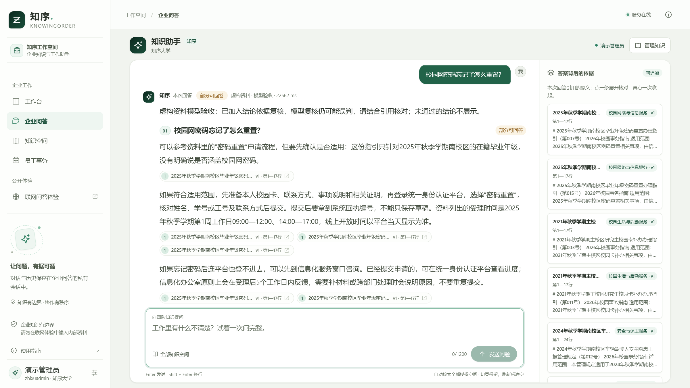
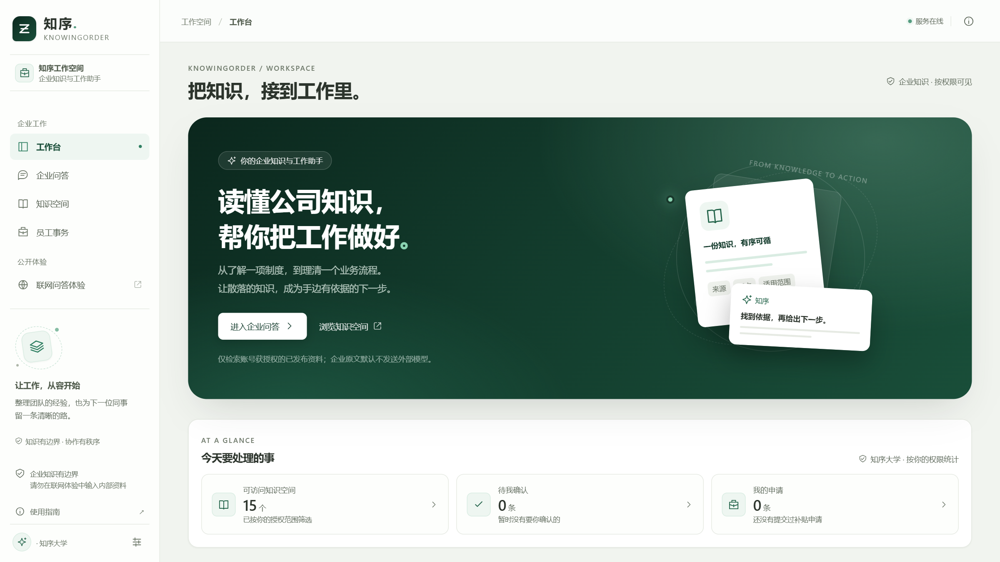
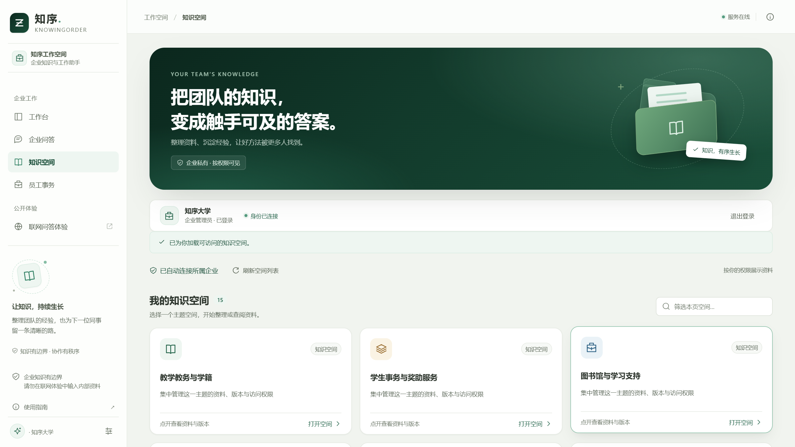
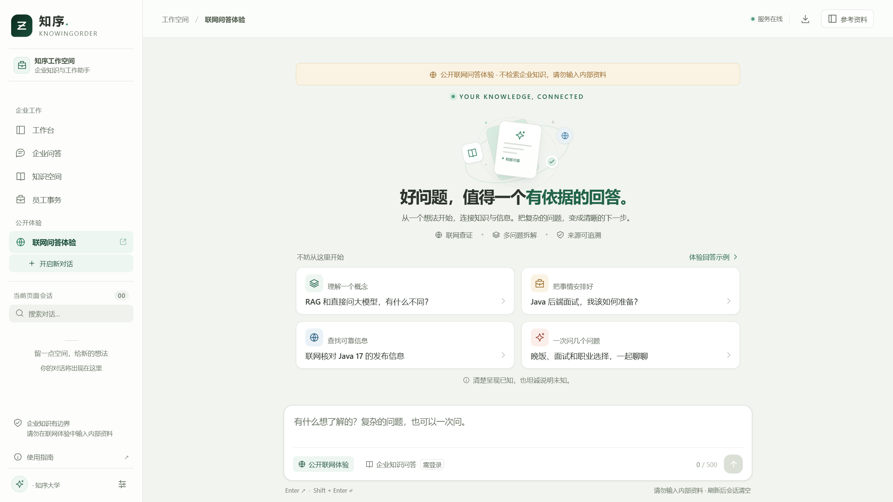
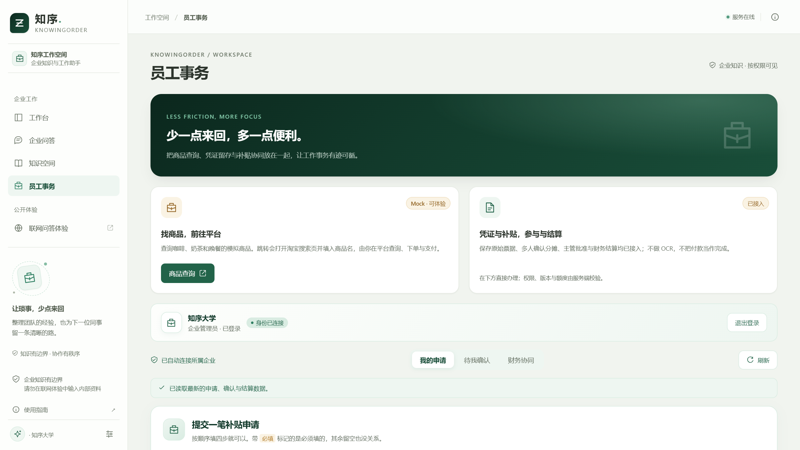
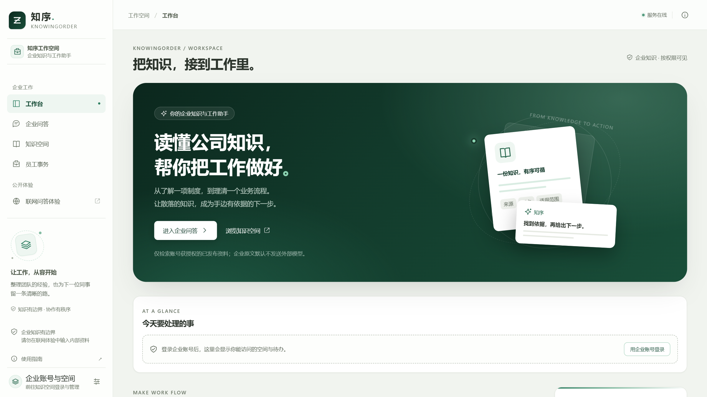
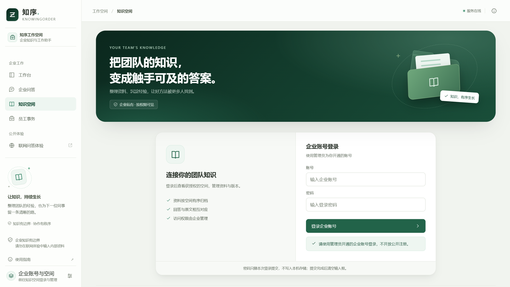
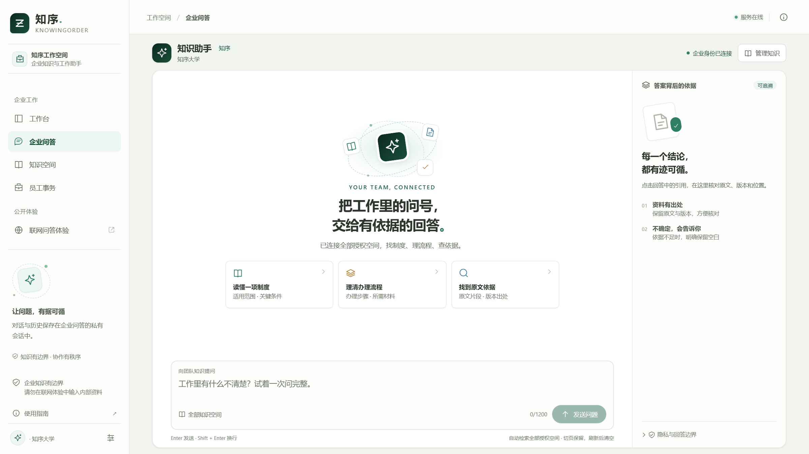

<div align="center">

# 知序 · KnowingOrder

**读懂公司知识，帮你把工作做好。**

*企业知识问答与事务协同平台 —— 让提问，有据可循*


</div>

---

知序是一个面向企业的**知识库问答与工作协同平台**：员工用自然语言提问，系统在**其获授权范围内**检索企业知识库，由大模型生成**口语化、带引用标注**的回答——每个结论都能点回原文出处，宁可说"资料里没有"，也不编造答案。

<div align="center">

<p><sub>企业问答：跨空间检索 → 模型生成口语化回答 → 引用可溯源、结论经复核</sub></p>
</div>

## ✨ 核心特性

| 能力 | 说明 |
|---|---|
| 🔍 **跨空间知识问答** | 一次提问自动检索全部已授权知识空间，无需手动选择；词频 + 标题加权 + tf-idf 重排保证真答案浮出 |
| 📎 **引用可溯源** | 回答中每个结论附带原文引用，点击可核对出处；"答案背后的依据"面板完整展示证据链 |
| 🛡️ **结论复核防编造** | 模型生成后经第二轮复核，引用不足以支撑的结论自动隐藏，宁可降级为"仅原文摘录"也不展示编造内容 |
| 🔐 **企业级权限隔离** | 账号 → 部门 → 知识空间的授权体系；检索、回答、外发模型全部按授权范围过滤，越权内容不可见 |
| 📚 **知识空间治理** | 文档上传、版本管理、发布/撤回生命周期、负责人与有效期；解析切分后按片段入库 |
| 💼 **员工事务协同** | 补贴申请、受理确认、结算与退款登记；事务单据全程留痕、可追溯 |
| 🌐 **联网问答体验** | 独立的公开问答入口（Tavily 搜索 + 模型整理，带来源链接），与企业内部知识**完全隔离**、互不掺和 |

## 📸 界面预览

| 工作台 | 知识空间 |
|---|---|
|  |  |
| **联网问答体验** | **员工事务** |
|  |  |

<details>
<summary><b>更多截图</b></summary>

| 访客首页 | 登录 | 企业问答欢迎页 |
|---|---|---|
|  |  |  |

</details>

## 🏗️ 架构一览

```text
┌─────────────────────────── 浏览器（Vue 3 + TS + Vite）───────────────────────────┐
│   工作台 · 企业问答 · 知识空间 · 员工事务 · 联网问答体验（公开入口，独立限流）      │
└──────────────────────────────────┬───────────────────────────────────────────────┘
                                   │ HTTPS / CSRF 防护
┌──────────────────────────────────▼───────────────────────────────────────────────┐
│                     Spring Boot 3 后端（Java 21，模块化分层）                      │
│  ┌─────────────┐  ┌──────────────┐  ┌───────────────┐  ┌──────────────────────┐  │
│  │ 认证与授权   │  │ 知识空间治理  │  │  跨空间问答    │  │  员工事务/结算        │  │
│  │ 会话·CSRF    │  │ 版本·发布     │  │  检索→生成→复核 │  │  幂等·留痕           │  │
│  └──────┬──────┘  └──────┬───────┘  └──────┬────────┘  └──────────┬───────────┘  │
└─────────┼────────────────┼─────────────────┼──────────────────────┼──────────────┘
          ▼                ▼                 ▼                      ▼
   ┌──────────┐    ┌──────────────┐   ┌─────────────┐      ┌──────────────┐
   │  MySQL   │    │ 解析/切分任务  │   │ 大模型中转站  │      │ Tavily 搜索  │
   │ 权限·语料 │    │ 片段入库      │   │ 生成·复核    │      │ （仅公开入口）│
   └──────────┘    └──────────────┘   └─────────────┘      └──────────────┘
```

- **检索链路**：问题分词 → 关键词命中 + 词频/标题加权打分 → 跨空间轮转合并 + tf-idf 全局重排 → 证据进入模型上下文
- **生成链路**：证据拼装 → 模型生成（Responses API）→ 第二轮引用复核 → 结论分级展示（完整回答 / 部分回答 / 仅原文摘录）
- **安全边界**：企业原文外发模型仅限白名单空间；复核未通过自动降级；公开联网入口与企业知识零交叉

## 🚀 快速开始

### 环境要求

- JDK 21、Maven（后端已带 Wrapper）
- Node.js 18+
- MySQL 8

### 后端

```powershell
cd backend
.\mvnw.cmd -B verify          # 全量测试
.\mvnw.cmd spring-boot:run    # 默认 8080 端口（dev profile）
```

数据库初始化见 `backend/schema.sql` 与 `backend/sql/demo/` 下的演示数据脚本；完整配置项见 [后端说明](backend/README.md)。

### 前端

```powershell
cd frontend
npm install
npm run dev        # 开发服务器，默认 5173 端口，已配置 API 代理
npm run build      # 生产构建到 dist/
```

### 演示账号

仓库内置演示语料与账号（详见 `backend/sql/demo/`），初始化后可用种子脚本中的演示口令登录体验完整问答流程。

> ⚠️ 演示账号与口令仅用于本地体验，生产部署务必更换并走 `backend/deploy/` 的初始化流程。

### 生产部署

`backend/deploy/` 提供 Linux 一键部署脚本：

| 脚本 | 用途 |
|---|---|
| `bootstrap.sh` / `finish.sh` | 建库、导数据、首建管理员、环境变量、启动与自检一条龙 |
| `update-app.sh` | 替换 jar 与前端产物（自动备份，可回滚） |
| `nginx-rag-qa.conf` | 反向代理与公开接口限流配置 |
| `rag-qa.service` | systemd 服务单元 |

## 📂 目录结构

```text
AnsweringSystem/
├── backend/                 Spring Boot 后端（Maven Wrapper + 全量测试）
│   ├── src/main/           Java 源码、Prompts 模板与应用配置
│   ├── src/test/           测试代码（账号安全、问答契约、检索、事务等）
│   ├── deploy/             一键部署、Nginx、systemd 配置
│   ├── sql/demo/           演示语料种子脚本
│   └── schema.sql          数据库初始化脚本
├── frontend/                Vue 3 + TypeScript + Vite 工作台
│   ├── src/                页面组件、i18n 文案、API 层
│   ├── scripts/            语料生成与批量导入脚本
│   └── tests/              前端回归脚本
├── docs/                    开发记录、实施指南与界面截图
├── redis/                   Redis 配置占位（规划中）
├── scripts/                 仓库级编码检查脚本
└── 01-*.md ～ 08-*.md       需求、架构与开发参考文档
```

## 📚 文档导航

| 文档 | 用途 |
|---|---|
| [02 · 需求分析](02-需求分析.md) | 产品范围、角色、用户流程、验收边界 |
| [03 · 架构设计](03-架构设计.md) | 目标模块、数据流、隔离与可靠性设计 |
| [06 · 企业级 RAG 与 Prompt 规范](06-企业级RAG与Prompt规范.md) | 企业权限、版本、证据质量与执行约束 |
| [05 · 预算分析](05-预算分析.md) | 成本规划参考 |
| [开发待办](docs/开发待办.md) | 当前进度与验证边界 |
| [前端说明](frontend/README.md) / [后端说明](backend/README.md) | 各端配置、启动与接口边界 |

## 🧭 当前状态

- ✅ 已实现：企业账号与资源授权、知识空间治理、文档版本与发布撤回、跨空间检索与引用回答、结论复核、员工事务与结算、公开联网问答入口
- 🚧 进行中：向量/混合召回评审、生产容量与完整权限矩阵验收、真实渠道接入
- 📌 设计原则：企业内部知识优先，公开搜索仅作为独立体验入口；不拿网页内容冒充企业制度

> 本仓库为课程/简历演示项目，演示数据均为虚构；请勿在生产环境使用演示口令。
