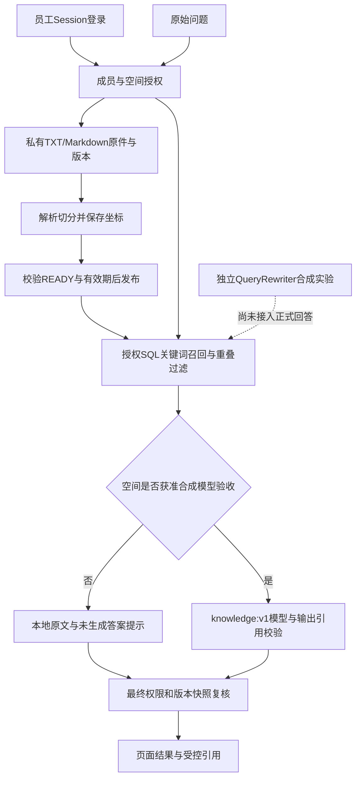

# 知序重定规划后业务与技术深挖笔记

## 2026-10-24专题：文件入库、结论依据复核、受控扩展与本人改密

**为什么采用、可用什么替代**：PDF复用PDFBox 3.0.8，DOCX只需正文就用JDK ZIP/StAX，减少POI依赖；代价是不支持复杂Word语义，无OCR。引用逐字真实不代表推导成立，所以生成后增加一次批量结论支持审核；也可完全只展示原文，本轮审核失败就这样降级。同模型审核仍可能共同误判，不能包装成独立模型验证或消除幻觉。改写只补召回、不替代原问，默认关闭；直接替换问题会传播对象、否定和条件漂移。

**代码数据怎么走**：`OfficeTextExtractor.extract`→`Utf8TextParser.parse(name,bytes)`→原入库事务和片段定位；PDF带页标记，位置针对提取文字。`KnowledgeAnswerService`生成→核权→`AnswerSupportReview.review`→核权，输入绑定问题、全部结论和引用的SHA-256快照，输出逐段SUPPORTED/UNSUPPORTED/UNKNOWN；一段不通过则整子问题隐藏，其他问题保留。`ReviewedQueryExpansion.expand`串联原问/候选补检、语义/适用性复核、既有准入与原始优先融合，完整候选重新核权。本人改密经旧口令BCrypt匹配→认证版本CAS更新，当前Session退出、其他旧版本下一请求被拒绝；前端只清空口令，不保存明文。

**可能出错、如何处理**：文件伪装、扫描件、ZIP炸弹、DTD/外链实体明确拒绝；PDF内部库处理仅协作超时，不是进程硬隔离。审核5秒、扩展8秒都受原30秒预算约束，不无限续期或重试；审核错绑/漏项/未知保留证据，权限变化不能普通降级吞掉。BCrypt在行锁外运行，CAS避免覆盖并发认证版本；两并发槽、30秒冷却及1024项上限属于单节点保护。首轮测试还暴露改密夹具未恢复原散列、扩展替身返回空、旧PDF非法用例及重复CSS定位问题，修复后2630项后端、92项前端、42项拦截页面通过；不是实库或模型语义证明。

**怎么优化及代价**：复杂文件换受限独立进程，增加部署/回收成本；用真实合成黄金集衡量审核准确率与漏拒，必要时另模型复核但增加隐私审批、费用和延迟；改写依据召回收益再启用，7条旧漂移未评测；长记忆可采用近期原问题＋带版本摘要＋话题召回，但摘要漂移、撤权失效和额外模型成本必须治理。多节点改密限流可用共享设施，不能把当前Map说成Redis。独立cross-encoder尚未实现，RRF融合/结论审核都不等于精排。

**面试口径与知识点**：这是受控RAG增强与账号安全，不是MCP或自主多Agent。用到适配器、PDF文字层、受限ZIP/StAX、来源定位、grounding支持判断、快照绑定、共享Deadline、CAS、BCrypt和Session/CSRF。精确文件/行号、输入输出、可复制命令和证据边界见[集中实施记录](知识库主线功能补齐与集中验证记录-2026-10-24.md)；真实模型质量、实库新功能和上线门槛仍待验，辅助补贴暂缓。

## 2026-10-24专题：学校业务范围与证据充分性为什么要分开

**为什么这样做、有什么替代**：学校问答先判断业务归属，再检索当前成员有权访问的资料。个人宠物保险可以范围外，本校开设相关课程则可以范围内，不能做关键词黑名单。向量命中只能说明相似，不能代替业务边界或资料充分性；本轮复用现有模型与严格契约，没有额外引入框架或答案审核器。

**代码与数据调用**：KnowledgeScopeResolver受服务端组织名单控制，独立knowledge-scope:v1单次识别并回传输入摘要；KnowledgeAnswerService保留原问题分段，校内部分授权检索后由composeFixed和knowledge-scoped:v1一次批量生成，逐字核对问题边界和引用，再按原序合并校外/未知提示。任务COMPLETED与分项ANSWERED分开；Vue切换公开问答只发无载荷导航事件，不复制内部问题、资料或历史。文件行号、真实离线数据样例和复验见[学校范围模块记录](学校业务范围识别与问答分流实施记录-2026-10-24.md)。

**问题和解决**：范围内没资料返回NO_EVIDENCE，不说学校没有政策；识别不确定SCOPE_UNKNOWN，失败SCOPE_UNAVAILABLE，不冒充范围外。5秒识别阶段与回答共用30秒父预算、不重试；前后核权防识别或生成期间撤权。只要没有实际生成答案，就不把校外＋未知混合结果标为“部分可回答”。当前模型仍可误分类，合法引文仍未必支持结论，不能夸大为语义安全证明。

**优化和代价**：先用学校合成调参/留出集量化误拒、误放、UNKNOWN率和p95；再评估本地轻量分类器、包含组织/范围/完整上下文的隔离缓存、分问题保底候选和范围版本审计。分别付出部署内存、失效治理、额外检索与数据库改造成本；这些尚未实现。现有bge-m3是Embedding而非生成模型；本模块没有用到MCP、Redis或OCR。

面试可说：“我把权限、业务归属、候选相关性和证据充分性分开，避免一个向量命中就生成制度结论；混合提问逐项处理，超时或未知要对用户可见。”必须补充：代码已接线但组织名单默认空，真实模型分类尚未验收，离线替身不能证明生产准确率。原7条改写漂移、校内误召回和错引支持风险仍是待办。

2026-10-19新增[第27节](#27-qdrant受控适配器契约范围隔离与未知写结果2026-10-19)：本机Qdrant1.19.2客户端、模型修订/维度校验、确定性点编号、未知写结果核对、共享时限及float32边界。新增离线71项、真实Qdrant8项与定向共180项通过；正式索引任务、代次发布和混合召回仍待接线，未下载Embedding模型。

2026-10-19入库任务模块增补见[第24节](#24-文档入库持久任务租约栅栏与幂等重建2026-10-19)：为什么不用只有@Async的任务、MySQL短受理锁、租约和迟到栅栏、事务成功终态、幂等与未知提交、草稿重建边界。后端1622项、前端49项、拦截页面28项及构建通过；新两表未在开发MySQL迁移，完整生产容量未验收。下方旧记录保留原时点。

2026-10-19面试专题增补：上下文窗口、完整问题裁剪、多轮记忆边界及8种扩展策略见[第22节](#22-上下文窗口压缩与多轮记忆业务结论及扩展追问2026-10-19)；数据库持久化风险、容量算例、7类优化路径和8种存储职责对比见[第23节](#23-多轮会话落数据库容量压力替代方案与排障2026-10-19)。本次仅补文档，扩展方案没有编码或压测；第21节为当前模块实现，下方更早记录保留原时点。

2026-10-19上下文读取增补见[第19节](#19-多轮上下文先做安全读取尚未接追问解析2026-10-19)：新增19项、相关回归共59项通过；只证明私有历史读取与预算边界，不代表正式问答已经理解指代。

2026-10-19本轮补充：私有会话、持久任务/恢复、反馈治理、本机Embedding协议适配及显式语义准入见[第18节](#18-持久会话任务反馈与本机embedding适配2026-10-19)。本轮全量1458项与后续定向86项、前端44项、拦截页面24＋18项均通过；随后本机补齐三表，真实MySQL＋HTTP＋页面18/18通过，未调用模型。真实Embedding效果、多角色完整矩阵和生产验收仍未完成。

整理日期：2026-10-18。范围是2026-10-17晚间重新确定产品方向后，完成的指导文档、Mock商品查询、企业工作台，以及企业身份、登录、成员管理和资源授权改造。不把更早的公开联网问答开发全部算入这一轮。

本文用于理解代码和面试复盘。每个模块回答：为什么这样做、可以怎样替代、代码与数据如何流转、问题如何处理、能怎样优化及代价。例子会区分测试库中的真实断言和用于解释的假设，不编造线上用户、容量、收益或部署经历。

2026-10-19增补：两份外部模型的面试建议已合并到[第17节](#17-面试展示与深挖准备2026-10-19增补)，补充当前事实、展示流程、架构图、必答问题、指标、失败案例和项目介绍。第1—16节保留历史时点；其中“尚未入库/检索/页面联调”等旧状态不能当作今天的结论，当前口径以第17节及其实施记录为准。本次只更新本文，未重新运行业务测试或外部API。

2026-10-18增补：B1知识空间创建及前端登录接入的面试材料见[知识空间创建与前后端联调记录](知识空间创建与前后端联调记录-2026-10-18.md)，包含Spring事务两表一致性、管理员加锁复核、Session/CSRF、Long编号精度、写入未知与幂等区别、MySQL及页面验收边界。下文表格和762项全量结果保留原时点；当前新增代码的定向回归为148项，并非再次完成全量。当前登录和创建页面已接通：真实MySQL创建事务四项由用户在IDEA运行反馈通过，AI未独立重跑；用户亲自登录后，AI真实页面脚本六项通过并保留空间5。该结果仅证明B1首条链路的本机验收；空间列表/编辑/授权管理、RAG入库检索与MCP仍未实现。

## 1. 先明确哪些可以讲成已实现

| 模块 | 当前事实 | 面试时必须补充的限制 |
|---|---|---|
| 产品与架构 | 知序以企业知识问答为主，员工事务和补贴为辅；指导文档已统一 | 定位和流程设计不是已经交付企业客户的证据 |
| 商品查询 | 统一接口、dev Mock目录、结果校验、前端查询与安全跳转已实现 | 只跳淘宝首页，未取得真实渠道商品或订单能力；未接Agent工具调度 |
| 企业工作台 | Vue首页、企业问答空态、知识空间结构及事务入口已实现 | 企业登录页面和企业知识服务尚未接入；页面展示不代表业务完成 |
| 企业身份 | 企业、成员、直属部门、账号认证版本和授权快照已实现 | 部门管理等写入口不全；实名及在职关系仍需企业核实 |
| 登录和开户 | 管理员开户、密码登录、会话、CSRF、退出、撤销登录、员工状态变更已实现 | 无公众注册、SSO、自助改密、找回、MFA或完整账号治理 |
| 资源授权 | 本人会话/消息/任务归属、明确授权的空间和文档元数据可查 | 未实现文档原件、发布、企业检索、会话写入或后台执行器 |
| 验证 | 10月17日最终后端构建762项通过；身份授权定向93项通过 | 隔离H2和本地HTTP不是目标MySQL、生产并发或真实企业试用 |
| 数据与部署 | 空库SQL及03增量脚本已生成 | 未执行本机MySQL迁移，未首建真实管理员，未部署验收 |

材料入口：[需求基线](../02-需求分析.md)、[架构基线](../03-架构设计.md)、[产品定版交接](开发上下文交接-知序产品定版-2026-10-17.md)、[身份授权实施说明](企业身份与资源授权实施说明.md)。下列行号按本次核对的代码记录，后续代码变化时需重新定位。

## 2. 产品重定：为什么主做企业知识问答

**为什么这样做**：旧公开聊天主要依赖模型与搜索，难以说明自己的业务价值。新目标是解决员工查制度、理解流程、找工作依据的问题，围绕企业授权、资料适用版本、引用和后续办理形成产品。辅助事务用于承接工作场景，不让商品功能抢走主线。

**可以用什么替代**：可以继续做通用问答，也可以直接使用企业文档搜索。前者需要面对成熟通用产品；后者对已知关键词有效，但跨文档整理和自然语言解释仍需要额外处理。通用AI也能接私有文档，因此不能把“只有我能读公司资料”当壁垒，差异要落在治理、权限和可靠业务流程上。

**这轮具体做了什么**：02确定角色、主辅流程和验收；03明确授权、入库、检索、执行约束与事务职责；08改为A—H推进。保留Java分层、旧公开体验及历史设计，冻结访客路线，不把旧资料覆盖掉。模型、中转、向量库和财务方案没有因写入文档就自动变成现有能力。

**问题与处理**：最大风险是“页面换名字，内核还是通用聊天”。当前企业示例不发公开搜索请求；下一步必须完成真实知识治理和授权检索。没有试点企业、样本和效果证据前，不承诺能提升多少效率。

**优化及代价**：首批聚焦入职、制度或单一业务流程，准备获授权材料和真实问题集，比较查找耗时、依据正确性和遗漏率。范围越小越容易证明价值，但不能据此宣称覆盖全部企业知识。

**面试追问**：“你这个和套一层大模型有什么区别？”可答：目标差异是企业身份、知识适用性和可追溯流程；目前身份与读取授权已实现，知识闭环仍在开发，不拿目标当成果。

## 3. 商品查询：统一接口与Mock适配器

**为什么这样做**：渠道权限尚未取得，先固定上层依赖的查询契约，开发和测试不依赖真实平台。`ProductSearchService`是查询端口，`MockProductSearchService`是当前实现，未来渠道适配器负责把供应商字段转换到统一结果。

**可以用什么替代**：直接在Controller拼假商品最快，但上层会混入渠道细节；立刻对接真实平台会被权限和网络阻塞。接口隔离适合当前演进，不过目前只有Mock实现，不能说两套适配器已经交付，也不需要额外工厂框架。

**代码与数据流**：[ProductSearchService](../backend/src/main/java/com/ragqa/service/ProductSearchService.java)定义`search()`；[Mock实现](../backend/src/main/java/com/ragqa/service/impl/MockProductSearchService.java)第35行校验、归一化并匹配目录；Controller返回`Result<ProductSearchResult>`。结果带`provider`、`simulated`、`notice`和`items`，Java集合用不可变副本，参考价用`BigDecimal`。

**已验证例子**：`{"keyword":"咖啡"}`返回2项，`provider=MOCK`、`simulated=true`、`linkType=PLATFORM_HOME`；“不存在商品”返回空列表。所有当前演示链接都是淘宝首页，不对应真实门店、库存或商品详情。商品查询不产生订单、支付和补贴事实。

**问题与处理**：Mock仅dev且选择mock时装配；真实模式缺实现不会静默回退假数据。关键词限制1—80字符且拒绝控制字符；合法但不匹配的注入外观文本只是空结果，不能执行成SQL或跳转地址。供应商故障与无匹配在接口语义上分开，但真实故障适配仍未实现。

**优化及代价**：有真实权限后增加适配器及契约测试，验证字段、分页、时限、限流和链接范围。当前前端严格只接受Mock来源及首页链接，接真实渠道时前端校验和文案也要演进，不能承诺“只改配置就上线”。商品参考价在前端只展示，不可拿浮点展示值做财务核算。

**面试追问**：“Mock有什么业务价值？”可答：它验证查询协议、失败反馈和界面链路，降低开发耦合；它不能证明渠道可用、订单真实或已经实现Function Calling。

## 4. 前端改造：企业工作台与公开体验分开

**为什么这样做**：首页要表达企业知识主线，并防止员工把内部问题误投到公开搜索或模型中转。企业服务未就绪时展示真实空态，比伪造文件数、登录身份或上传进度更可核对。

**可以用什么替代**：可以继续让聊天框占首页，或立即引入Vue Router、Pinia和组件库。当前页面少、状态主要在一个页面内，先沿用Vue3、TypeScript和既有样式；这是一种控制改动范围的取舍，不是路由或状态库没有价值。

**代码与数据流**：[App.vue](../frontend/src/App.vue)第22行定义页面类型，第176行`navigate()`切换；第283行接入[EnterpriseWorkspace.vue](../frontend/src/components/EnterpriseWorkspace.vue)。企业工作台只发导航与商品弹窗事件，不发企业HTTP请求；原聊天用`v-show`保留实例和在途请求，`canSend`要求位于公开体验页。

**商品请求**：[products.ts](../frontend/src/products.ts)第41行`searchProducts()`校验关键词、发请求并校验HTTP、业务码和响应结构；10秒上限、无自动重试，组件卸载时取消等待。第24行`productJumpUrl()`只接受固定首页，链接使用`noopener noreferrer`和不发送Referer策略。

**问题与处理**：接口不可用、超时或格式变化均结束等待，不在前端补假数据。切页保留状态不等于刷新可恢复；取消浏览器等待也不等于取消了第三方业务。企业区文案当前中文，原设置支持多语言不能推出新页面已经全部翻译。

**优化及代价**：需要地址分享、后退和深链接时再引入路由；状态跨页面复杂后再提取状态管理。登录接入需Cookie、CSRF以及HTTP/业务码双重判断。当前商品请求`credentials: omit`是公开dev契约，不能原样拿去调用企业私有接口。

**面试追问**：“隐藏菜单能防越权吗？”可答：不能。菜单只影响交互，资源权限必须由后端在数据库读取时控制；企业示例零请求和状态保留有浏览器检查，但企业登录尚未页面联调。

## 5. 企业模型：账号与成员为什么分表

**为什么这样做**：账号表示“是谁”，成员表示“在某个企业是什么身份”。同一账号在甲企业和乙企业可有不同部门、角色和状态；只在用户表加一个企业字段会把这些关系绑死。

**可以用什么替代**：可先做单企业用户表，业务更简单；也可每企业独立数据库，隔离更强但部署与运维成本更高。当前采用共享业务库、显式企业范围与独立成员关系，没有实现独立库或完整租户平台。

**代码与数据流**：`sys_user`关联`sys_enterprise_member`，后者再关联企业与可空直属部门；唯一约束是`(enterprise_id,user_id)`。`role`当前仅EMPLOYEE/ADMIN，状态0有效、1停用、2离职；成员重新启用更新同一关系，不创建重复身份。

**实际测试数据**：账号1在企业1是成员101，在企业2是成员201。账号主键不等于成员主键；查询企业1时不能拿成员201替代成员101。员工通讯录可见也不代表会话或订单互相可见。

**问题与处理**：部门首版不做层级继承，管理员身份不默认赋予私有内容权限。数据库没有物理外键，成员部门的企业一致性不能只靠一列编号保证；后续管理写入口必须校验，当前知识查询会复核有效部门及企业范围。

**优化及代价**：业务出现多角色组合后再拆角色和权限关系；需要层级部门时定义继承、例外和撤权规则。每企业账号命名空间也可作为后续选择，但现在用户名是全局唯一，开户不能把已存在账号自动加入另一企业。

**面试追问**：“ADMIN是不是Spring Security里的ROLE_ADMIN？”可答：不是。当前登录层统一ROLE_USER，企业角色来自目标企业的有效成员关系，业务操作再次校验；一个企业的管理员不会自动成为全局管理员。

## 6. 成员校验与权限版本：为什么不只登录时查一次

**为什么这样做**：账号登录后仍可能被停用，成员也可能离职、调部门或撤权。只相信登录时保存的角色，会继续使用旧权限。当前选择每次数据库复核，不提前缓存成员结果。

**可以用什么替代**：可把角色放进长期JWT，减少查库，但撤销需要额外机制；可用短期缓存减压，但会引入可接受的失效窗口。当前先保证拒绝路径明确，再依据测量决定缓存，不能只说“加Redis性能就解决了”。

**代码与数据流**：[requireMember()](../backend/src/main/java/com/ragqa/service/impl/EnterpriseMemberServiceImpl.java)第26行校验可信账号，再绑定企业、账号和原认证版本查询；第44行`requireCurrent()`重新取得并比较完整快照。[EnterpriseMemberContext](../backend/src/main/java/com/ragqa/domain/dto/EnterpriseMemberContext.java)第6行是不可变record，含企业、成员、账号、部门、角色及三类版本。

**三类版本**：账号`auth_version`用于本人登录撤销；企业`permission_version`表示企业级权限变化；成员`permission_version`用于成员关系变化。空间也有权限版本供后续演进，但目前读取仍直接检查有效授权表，尚未实现版本缓存。版本变化必须和对应业务写入保持一致，不会自动递增。

**解释竞态的假设例子**：旧登录版本4完成账号检查后，另一个请求将数据库版本改为5。若成员查询只按账号读取并接纳版本5，旧登录可能被升级；现在成员SQL仍要求版本4，查不到即拒绝。对应回归是`revalidationNeverUpgradesRevokedPrincipalToNewAuthVersion()`。

**问题与处理**：客户端编号、角色头或JSON不能生成可信上下文；缺失异步上下文直接拒绝。ThreadLocal只是线程内传递容器，当前成员上下文显式参数传递；框架的SecurityContext也不能代替资源授权。异步工作线程不得假设自动继承身份。

**优化及代价**：当前一次正常资源GET会经过会话账号检查、Controller成员检查、Service再次复核和最终资源SQL；按当前调用链通常有6次查询，尚未做性能基准。可先测量并合并同一请求内重复查询，但必须保留最终范围/版本条件；不能为少查一次就删掉撤权约束。已发出的响应无法收回，数据库读取的一致性边界也不是全程绝对实时撤权。

**面试追问**：“不可变record就安全吗？”可答：它减少共享可变状态和误改，不证明身份真实或权限仍有效；可信来源、状态复核和带范围SQL才承担授权。

## 7. 员工登录：Spring Security、会话、BCrypt与CSRF

**为什么这样做**：当前是企业员工浏览器使用，服务端会话便于退出和撤销。采用框架标准认证链，复用口令核验、认证上下文、登录换会话编号和退出，避免自行实现整套认证协议。

**可以用什么替代**：JWT适合一些跨服务场景，但撤销和版本检查仍需设计；企业SSO可减少重复账号管理，但当前没有统一身份来源。不是“JWT不安全、Session绝对安全”，而是会话更符合现阶段单体浏览器应用。

**代码与数据流**：[SecurityConfig](../backend/src/main/java/com/ragqa/config/SecurityConfig.java)第27行配置BCrypt强度12，第33行配置安全链；`AccountLoginService.loadUserByUsername()`第22行取正常未删除账号；`AccountDetails`携带主键及认证版本，不把企业角色当登录凭据。

**接口顺序**：`GET /api/auth/csrf`取得token和Cookie → `POST /api/auth/login`提交URL编码表单及CSRF头 → 成功换会话编号 → 重新取CSRF → 携Cookie访问私有接口。登录不是JSON接口；登录凭据不放查询串、前端长期存储或日志。

**口令与期限**：存BCrypt散列，不是可解密的密码；开户至少12字符，UTF-8最多72字节。强度12是当前成本参数，未声称完成目标机器压测。会话闲置30分钟、绝对8小时；`SessionIdentityFilter`复核起点、账号状态及认证版本。HttpOnly、SameSite=Lax，prod开启Secure，仍需HTTPS。

**问题与处理**：密码错误、未知和不可用账号返回统一401，降低响应内容中的账号探测信息，但没有证明所有路径耗时完全一致。身份存储故障返回503，不降级放行。Cookie可能随请求携带，因此修改类私有接口校验CSRF；SameSite不能替代全部CSRF保护，CSRF也不能解决XSS。

**优化及代价**：多实例需要共享会话或重新设计认证，SSO、MFA、改密找回、初始口令安全交付均是后续工作。调整散列成本须同时看登录延迟、并发CPU与抗猜测能力。Cookie方案仍需验证代理、同源部署、跨域和浏览器自然过期，不能用离线测试宣称生产验收完成。

**面试追问**：“撤销所有登录是不是遍历Session？”可答：当前递增账号认证版本，旧会话下次请求版本不匹配就失效，不逐个扫描；不是已经取消了所有正在执行的异步任务。

## 8. 管理员开户与员工状态：事务、锁和唯一约束

**为什么这样做**：账号与成员必须共同创建，不能出现“账号有了却没有企业关系”。管理操作又需要防止沿用已经撤销的管理员快照，所以既有业务事务，也有管理权限复核。

**可以用什么替代**：先查用户名再插入不能单独防并发重复；前端禁用按钮也不能阻挡重放。可用乐观版本条件控制部分管理操作；当前用数据库唯一约束、事务及`FOR UPDATE`复核，具体锁行为仍需真实MySQL验证。

**代码与数据流**：[EnterpriseAccountServiceImpl](../backend/src/main/java/com/ragqa/service/impl/EnterpriseAccountServiceImpl.java)第48行`createEmployee()`进入事务 → 第96行`requireAdminLock()`联合查询加锁并比较快照 → 第107行`insertAccount()`校验和散列 → 插入用户 → 插入成员 → 提交。Controller不接收创建ADMIN的角色参数。

**失败与并发例子**：测试故意让第二次成员写入违反约束，用户插入必须回滚；实际HTTP测试断言失败响应安全且没有残留新账号。两次并发同名开户只产生一组账号和成员，另一次失败。这是唯一约束防重复，不是相同请求返回原结果的幂等协议。

**员工状态**：第57行`setEmployeeStatus()`只修改目标企业的EMPLOYEE，同时递增成员权限版本；不借此接口停用或降级管理员。JSON保留原始类型，`{"status":1}`可进入业务校验，`{"status":1.5}`、字符串、布尔值或缺失均拒绝，避免强制转换成合法状态。

**首建管理员**：第80行`bootstrapFirstAdmin()`仅由独立命令显式触发，企业表为空才能首建；使用串行化事务并固定企业1号，以主键唯一约束防并发重复。没有默认密码，不在正常启动自动执行，也不收编旧同名用户。本轮未对真实库执行首建。

**优化及代价**：BCrypt目前在事务和管理员锁内执行，增加锁持有时间，同一管理员并发管理可能被串行化。可考虑先校验/散列，再在短事务内重新锁定和复核权限，需拆分事务入口并处理预计算浪费；不能把权限检查移到事务外后省略复核。死锁、锁等待、重复提交恢复仍需目标库与接口协议验证，不无限自动重试写操作。

**面试追问**：“有@Transactional就一定回滚吗？”可答：要通过Spring事务代理调用、异常满足回滚规则，且相关写入在同一事务内；本实现通过真实Spring调用和故障注入证明测试场景回滚，MySQL DDL不在这项保证内。

## 9. 资源授权：为什么把企业与归属写进SQL

**为什么这样做**：仅凭登录或资源编号无法证明资源归属。会话、消息、文档和任务不能“先按ID读取，再让前端决定是否显示”；数据库返回数据时就应限定访问范围。

**可以用什么替代**：先查对象再做服务判断能够实现权限，但容易漏掉下游读取或在变更期间使用旧判断；全局租户插件可减少漏写企业条件，但不能独立表达本人会话、部门授权和跨表关联。当前显式范围SQL更可审查，代价是查询重复和维护成本。

**代码与数据流**：[EnterpriseResourceMapper](../backend/src/main/java/com/ragqa/mapper/EnterpriseResourceMapper.java)第13行`ACTIVE_MEMBER`绑定账号、企业、成员、状态与版本；第24行`OWNED_CONVERSATION`限定本人且非访客；第29行`SPACE_GRANT`用`EXISTS`核对成员或有效直属部门授权。该Mapper不继承BaseMapper，避免在这个授权入口暴露无范围读取方法。

**对象规则**：消息继承会话权限；文档要求企业与空间一致，并且文档未删除、空间有效；任务锚点同时绑定同企业会话与属于该会话的消息。管理员没有私有会话旁路。文档DTO不返回原件存储路径；消息视图会返回获准消息内容，不能泛称所有返回都只是元数据。

**已验证例子**：账号1在企业1读取会话1001得到“本人甲企业会话”；读同企业他人1002或乙企业2001均业务码404；切到企业2自己的有效成员范围才可读2001。管理员账号3读1001仍404；错误关联其他会话消息的任务9003也404。

**问题与处理**：不存在和无权使用相同业务404，减少资源存在性暴露，但不宣称响应时间等侧信道全部消除。所有用户值用`#{}`绑定，字符串相加仅为编译期固定SQL片段。输入校验解决格式边界，不能拿手工转义替代参数绑定。其他旧Mapper仍存在，未来新入口也必须复用授权，不能说全仓库已不可能越权。

**优化及代价**：新增授权场景时可提取受限查询构造、策略或租户插件作为辅助，但要保留可检查的业务范围。先用目标MySQL执行计划找瓶颈，不能仅因写了联合索引就说查询更快。下载、引用、导出、向量检索、异步执行和模型外发都要在对应入口再次校验；当前只实现读取路径。

**面试追问**：“前面已经校验成员，SQL为什么再查？”可答：服务检查负责可信上下文和业务入口，SQL将当前权限与资源读取绑定，避免前置检查通过后无范围查询；它仍有数据库快照边界，不能收回已经发出的内容。

## 10. 数据演进：增量迁移、逻辑关联和最小视图

**为什么这样做**：已有账号、访客会话和文档不能在转型时猜测归属。空库用完整schema，已有库用独立增量；旧数据企业字段保持空，企业入口不会自动将其算到第一家企业。

**可以用什么替代**：全库重建简单但可能破坏已有数据；物理外键可加强引用完整性，但本项目明确不建。无外键不是更安全或天然更高性能的结论，而是把更多校验、写入顺序、清理和孤立数据排查责任交给服务与运维。

**具体结构**：[03迁移](../backend/sql/migrations/20261017_03_enterprise_membership.sql)补认证版本、会话企业/成员、文档企业/空间，并建企业、部门、成员、空间、授权、任务归属六表。唯一约束防重复成员/授权，CHECK限制状态及授权目标二选一，索引支持范围查找；CHECK不替代跨表归属校验。

**问题与处理**：03不是可反复执行的脚本，前提是目标旧库已完成01/02；不含USE、不自动执行。MySQL DDL失败不能假设整个脚本已事务回滚，需备份、核对已生效结构再处理。当前只在隔离H2验证可兼容部分，未完成真实库迁移。

**优化及代价**：后续可评审Flyway或Liquibase管理版本、校验和及执行记录，当前未引入。再做目标库`EXPLAIN`、锁等待和备份恢复验证；有索引不代表所有数据量和分布下都能满足延迟目标。

**面试追问**：“任务表都有了，为什么说没执行器？”可答：`rag_task_reference`只记录任务与会话/消息归属，不含可运行的调度、终态恢复或SSE实现；数据关联模型不能替代执行系统。

## 11. 安全与可观测：限流、日志和用户反馈

**为什么这样做**：口令校验有CPU成本，私有请求也不能无限读取或把凭据写日志。错误必须让调用方及时结束等待，并能用安全编号关联排查。

**可以用什么替代**：可由网关做统一限流，或Redis实现多实例共享计数；当前单节点先使用内存固定窗口，无需为这一点立即部署外部组件。固定窗口易解释，但窗口切换附近允许突发，不等于平滑限速或全套防刷。

**代码与数据流**：[LoginGuardFilter](../backend/src/main/java/com/ragqa/config/LoginGuardFilter.java)第73行同步执行检查与计数，默认每直连地址10次/分钟、全局120次，最多4096地址；只接受最多4KB的已知长度登录表单。[PrivateApiTraceFilter](../backend/src/main/java/com/ragqa/config/PrivateApiTraceFilter.java)生成`request_id`/`X-Request-Id`、设置no-store，私有POST最多16KB且长度已知，在finally记录方法、区域、HTTP状态、耗时并恢复MDC。

**问题与处理**：不信任用户传来的转发IP头，避免轻易绕过，但反向代理部署后可能把多人当一个地址；企业NAT也可能误伤。计数用同步方法是为了检查和增加原子完成，代价是锁竞争和最多4096项的过期扫描，尚未证明生产吞吐。

**日志边界**：敏感Controller用`@NoPayloadLog`，请求和实体也限制口令/散列进入字符串或序列化。访问日志不记正文、查询串、Cookie或token；业务异常仍由GlobalExceptionHandler记录错误码和堆栈。当前日志有请求编号但不是完整JSON结构化日志，也没有告警平台和完整业务审计账本。

**响应边界**：安全过滤器使用HTTP401/403/413/429/503及Result；原MVC业务异常仍可HTTP200但业务码失败。因此前端必须同时判断两层，当前访问日志只看HTTP状态不能统计全部业务失败。生产指标后续要补业务结果分类，不能把HTTP200数量直接算成功率。

**优化及代价**：先明确可信代理与试点NAT流量，再调限额；多节点再考虑网关或Redis原子计数。后续补业务失败指标、持久安全事件、告警和日志留存权限。写入审计需要业务对象/操作者/结果，不能靠打印更多请求正文实现。

**面试追问**：“有request_id就是分布式链路追踪吗？”可答：当前只是私有HTTP请求关联标识，尚未证明跨线程、跨服务、模型和搜索调用全链路贯通。

## 12. 测试：为什么不能只写正常路径和Mock断言

**为什么这样做**：权限与事务最容易出现“接口看起来成功，但读错企业或留下半条数据”。因此分别验证输入、服务决策、真实Mapper、事务与实际HTTP安全链，不用一种测试冒充全部证据。

**可以用什么替代**：纯Mockito很快，适合分支和竞态复现，但不能证明SQL与约束；全靠真实MySQL和外部平台更接近部署，却需要环境、凭据和更高运行成本。当前隔离H2加本地HTTP提供快速可复现证据，真实依赖验收仍保留。

**历史结果**：10月17日最终`mvn package`运行37个测试类、762项，全通过且无跳过；身份授权定向93项包含原身份/会话34项，不与762相加。商品后端25项在全量中；此前前端18项基础测试、工作台18项浏览器检查及构建通过，是对应时点证据，不代表本次重新运行。

**主动制造的问题**：第二次写入约束失败验证账号回滚；并发同名开户和并发首建验证唯一；隔离测试库账号表暂不可用验证503；错企业、他人资源、撤权、格式错误、注入外观文本、限流及硬过期均有覆盖。测试清理只作用于隔离库，不操作真实业务数据。

**过程暴露与修复**：真实HTTP测试曾因H2连接用户不一致出现6项失败，修正测试连接配置；日志切片曾被新增认证挡成401，隔离该切片的自动认证并保留日志断言，认证另由真实HTTP测试负责。不是删掉失败用例或放宽业务安全断言换通过。

**优化及代价**：目标MySQL补迁移、CHECK、排序规则、锁、死锁、事务和查询计划；页面补登录与CSRF；生产前补TLS/代理、多节点、真实规模压测和恢复。旧HTTP并发超时用例有历史偶发失败，最终通过不等于根因已解决。测试数量不能代表线上无漏洞或用户问题都能答好。

**面试追问**：“762项里多少是真实数据库？”可答：需要按测试类别说明；本轮新授权SQL和事务用隔离H2，不是已跑762项MySQL集成。旧目录还有IT历史报告，不能把它们凑进本轮数量。

## 13. 企业RAG主线：已经确定的设计，尚未完成的业务

**为什么这样规划**：先治理知识归属和版本，再做解析、切分和索引；没有这层约束，即使向量相似度高，也可能回答过期制度或泄露别部门资料。模型只负责理解和组织表达，不能替代权限与适用性判断。

**替代方案与取舍**：全文搜索可先建立基线，便于定位精确术语；向量检索适合补充语义匹配；混合检索与重排可能提升结果，但增加计算与调参成本。向量库、Embedding、解析库及块长尚未最终选型，不为展示技术名词预装全部组件。

**计划数据流**：获授权上传 → 原件与版本 → 可追溯解析片段 → 索引 → 发布适用版本 → 提问时验证成员与资源范围 → 检索/证据评估 → 回答和引用。当前只完成部分身份和授权读取，后续入口都必须复用边界，不能把权限仅放在最终展示。

**证据不足怎么处理**：充分则引用回答；部分充分就回答有依据部分并说明缺口；无资料、冲突/过期和依赖故障分别处理，不用一句“没查到”掩盖第三方失败。一句多问区分执行依赖和展示顺序，不把哪个先答的决策丢给用户，但真实办理必需字段和重要提交仍需确认。

**优化与代价**：获授权小语料先建立企业评估集，再决定混合召回、重排和缓存。缓存必须关联企业、范围、权限/知识版本及上下文，并在返回时复核资格；当前没有这套企业缓存实现。异步任务、总时限、断线恢复与外发许可也需独立验收，现有公开问答不能直接当企业链路使用。

**面试追问**：“你们怎么确保不幻觉？”可答：目标是用授权证据、适用版本、引用和不足状态降低无依据回答，再用评估集测量；目前企业链路未完成，不能承诺消除幻觉或编造准确率。

## 14. 补贴协同：已经确认的规则边界，尚未实现

**为什么这样规划**：系统辅助员工选购并连接行政财务，真实交易由平台处理。补贴可信度来自结构化业务事实、原始凭证与过程记录，而不是“模型觉得可以报销”。

**替代方案与取舍**：后端代下单需要真实平台开放能力和授权，当前没有；OCR可减少手填，但用户明确不做任何OCR，连模型读图也不能当替代。授权渠道取不到的字段由员工填报、财务核对，保留来源，不能伪装平台认证。

**计划数据流**：查询与跳转 → 员工填报/渠道材料 → 申请版本 → 资格和额度规则 → 参与人确认 → 履约与凭证核对 → 财务核算 → 结算/退款调整。付款人、参与人、额度归属人和收款人分开，业务规则未确认的部分不自动决定。

**边界问题**：点击不是下单，付款不是履约，报表不保证实时。多人确认需绑定名单、金额和分摊版本，改动后重确认；不回复不等于同意。取消/全退不能有效结算，部分退款重算，已结算后追加调整，不覆盖历史账目。

**优化与代价**：未来用事务、唯一约束和条件更新保护额度，结合业务幂等键防换发起人重复申领；可靠通知可评审事务消息表。Redis只能辅助，不能当财务金额唯一依据；跨系统超时先核对原操作，不能宣称网络调用天然恰好一次。这些均未开发，表结构、真实渠道和财务协议还要评审。

**面试追问**：“项目实现了支付并发和财务对账吗？”可答：没有。当前只有独立Mock商品查询；本系统不代支付，辅助协同是下一阶段业务，不用模拟支付回调冒充真实接入。

## 15. 可以复述的项目介绍与追问路线

推荐按“问题—选择—实现—证据—不足”表达：

> 我在做知序，定位是企业知识问答与事务协同。原型从公开联网问答转为企业知识主线后，我先实现企业账号、成员关系和资源授权，解决同一账号跨企业身份不同、员工离职撤权和私有会话越权的问题。登录用Spring Security会话，企业角色不直接塞成全局登录权限；服务端复核状态和版本，资源SQL再绑定企业和归属。管理员开户用事务、加锁复核和唯一约束，故意让第二次写入失败验证回滚。10月17日最终762项测试通过，但SQL与事务主要在隔离H2验证，目标MySQL和前端登录还待联调。企业知识入库检索与财务闭环正在后续计划，当前不宣称已经上线。

| 面试官继续追问 | 应定位的证据 | 不要说成什么 |
|---|---|---|
| 为什么不JWT、为什么有CSRF | 第7节、SecurityConfig和HTTP测试 | Session天然安全、JWT天然不安全 |
| 为什么用户和成员分开 | 第5节、成员唯一约束 | 只加enterpriseId就等于完整多租户 |
| 离职后旧登录还能不能看 | 第6/9节、版本固定与状态条件 | 所有在途响应都能瞬间撤回 |
| 查这么多次性能怎样 | 第6节当前查询链与待测项 | 未压测就报QPS或P99 |
| 事务失效、并发重复怎么办 | 第8节、失败回滚与并发测试 | 有注解就永远一致、有唯一键就完整幂等 |
| SQL安全、权限在哪校验 | 第9节、固定SQL与绑定参数 | 全靠转义、前端隐藏或ThreadLocal |
| 为什么不直接用Redis | 第11/13节、单节点与缓存边界 | Redis已部署或可独立保证账目正确 |
| Mock换真实是不是零改动 | 第3/4节、契约及白名单 | 只切一个配置就可生产上线 |
| 真正的RAG和Agent在哪 | 第13节、待办B—E | 元数据查询就是检索，任务锚点就是执行器 |

## 16. 如何复验、如何继续记笔记

如需重跑后端定向测试，从系统根目录执行；沿用本机既有Java/Maven路径，不读取settings内容，也不执行真实库迁移或首建命令：

```powershell
$env:JAVA_HOME = 'D:\JAVA\jdk-21'
$env:MAVEN_OPTS = '-Dstdout.encoding=UTF-8 -Dstderr.encoding=UTF-8'
& 'C:\Users\Administrator\.m2\wrapper\dists\apache-maven-3.9.9\937e263b\bin\mvn.cmd' -s 'C:\Users\Administrator\.m2\settings.xml' -o -B -f backend/pom.xml '-Dtest=EnterpriseAuthorizationTest,EnterpriseSecurityHttpTest,AccountSecurityFilterTest,EnterpriseMemberServiceTest,EnterpriseAccountTransactionTest,AccountDataSafetyTest,CurrentUserServiceTest,ConversationServiceTest' test
```

对应历史成功标准是93项、失败/错误/跳过0；完整构建将定向参数及`test`换为`package`，历史成功标准762项。命令需要相应本机缓存可用，不把过去结果当成每次运行的保证。本次仅整理文档，未重新运行测试或付费API。

后续每完成一个业务单元，继续记录：输入与真实结果、代码方法/行号、选择和替代、失败证据、优化触发条件、尚未验证的环境。简历只写已实现且能展示证据的能力，优化方案在真正落地和验证后才改成成果。

## 17. 面试展示与深挖准备（2026-10-19增补）

### 17.1 两份建议的共同结论与需要纠正的地方

可吸收的共同建议是：把企业知识场景做成能演示、能解释、能复验的闭环，围绕知识治理、服务端权限、证据引用和失败处理讲出工程取舍。这些内容比单纯罗列接口更便于深入讨论，但“中小厂一定认可”“中上水平”“大厂只能当辅助项目”都只是外部模型的主观评价，不能按企业人数推断招聘标准，也不保证获得面试或录用。

产品价值目前是待验证的假设：帮助员工查找适用制度、核对出处和识别资料缺口；尚无真实企业试点的节省工时、付费意愿或效率提升数据。Vue界面能帮助展示流程，不能据此认定全栈熟练度、用户体验或生产可用性已经达标。热点和技术数量可以成为话题，可信的实现、取舍与证据才是本项目的展示重点。

| 外部建议中的说法 | 当前应使用的准确口径 |
|---|---|
| 文档切块、向量化、向量库、混合召回都可讲 | 可深入讲已实现的文字切分与授权关键词检索；Embedding、向量库、混合检索尚未实现，不能编造型号或相似度阈值 |
| 知识库闭环还完全没有完成 | 已有私有TXT/Markdown原件、解析、发布、授权关键词检索与合成资料模型引用的最小闭环；不等于真实企业上线验收 |
| Token鉴权和数据表隔离 | 当前登录采用Spring Security的Session/Cookie＋CSRF；共享MySQL业务表，以企业/成员/空间范围SQL隔离，并非JWT或每企业独立表/库 |
| 有角色就等于完整RBAC | 当前组合企业角色、明确空间授权、成员/部门范围、状态与版本约束；不能把它简化成只判断ADMIN，也未交付任意角色权限管理平台 |
| 大文件慢就用异步队列解决了 | 当前原件最多1MiB、解析循环检查5秒、单节点工作槽有界；持久入库队列和重启恢复未实现，完整文件IO硬时限仍待验 |
| 多轮上下文和SSE是现成亮点 | 企业链路当前是有界等待后返回完整结果；企业会话持久化、多轮指代、SSE及断线任务恢复仍待实现，不能借旧公开问答能力充数 |
| 员工事务/报销已经Mock完成 | 只有商品查询与平台首页跳转是dev Mock；补贴确认、报销和财务结算尚未实现，不能说这些业务只差第三方联调 |
| 大厂差单元测试和并发，小厂能直接上线 | 已有测试、单节点并发上限和超时治理；不足在真实规模、完整角色矩阵、部署监控和试用证据，不按公司规模降低安全门槛 |

检索增强生成不要求底层一定是向量库；本项目现阶段可以解释为“授权关键词检索＋证据约束生成”的最小实现，但必须同时说明同义召回、答案质量和生产验收的边界。新增`QueryRewriter`仅是独立合成实验组件，正式服务尚未调用；融合目前仅完成设计，7条词法漏检仍保留，不能讲成已修复召回问题。

### 17.2 我可以怎样介绍项目，而不是堆技术名词

> 知序是我持续开发的企业知识问答与事务协同项目，主线是让员工查到有权限、当前生效且能核对出处的企业资料。我用Spring Boot和Vue实现了账号与企业成员分离、空间授权、私有文字原件、文档版本发布，以及授权关键词检索和引用回答。默认只展示本地原文，模型验收仅限获准的合成资料空间。难点主要是把权限和发布版本带进检索SQL，在模型调用前后复核，以及区分资料不足、资料冲突和模型故障。最小链路已有本机MySQL与现有模型的页面验证，但没有生产部署和真实企业使用成绩；向量检索、企业持久会话及财务业务还在后续计划。

这段介绍的关键词是“持续开发”“当前实现”和“验证范围”，不称已服务企业客户。谈工程深度时可以展开事务、锁、唯一约束、撤权竞态、SQL参数绑定和总预算；谈AI应用时展开切分、召回、上下文、引用、拒答与评测。Agent定位先讲受控问答编排，不称多Agent自治系统或已接MCP。

### 17.3 展示架构：讲清数据从哪里来、能去哪里

下图只表示当前主线及独立实验，不把目标架构画成已实现：



讲图时补一句：普通企业空间不外发；合成许可覆盖的是受控试验，不能混入真实内部问题和资料。引用路径由服务端映射，不接收模型伪造的原件路径。下次演示应使用专用合成空间、当场检查配置及资料状态，不依赖已经撤回的历史测试版本。

### 17.4 面试官必须能追问到底的八个问题

| 问题 | 当前能回答的实现与位置 | 替代方案、优化与风险 |
|---|---|---|
| 文档怎么切，1000和120怎么定？ | [Utf8TextParser.parse()](../backend/src/main/java/com/ragqa/rag/ingest/Utf8TextParser.java)第22—64行：块长上限1000个UTF-16单元、目标重叠120；优先在后半块找段落/换行，否则按长度切，避开代理对切断；保存offset与行号 | 是初始保护参数，不是Token数或最优结论；Markdown也未实现标题树/语义切分。可比较按标题/句子切分和语义方案，但要测表格完整性、证据命中及成本 |
| 用什么Embedding和向量库？ | 当前没有；[KeywordKnowledgeRetriever.retrieve()](../backend/src/main/java/com/ragqa/rag/retrieval/KeywordKnowledgeRetriever.java)第36—53行和[Mapper](../backend/src/main/java/com/ragqa/mapper/KnowledgeRetrievalMapper.java)第18—44行是实际入口 | 当前先建立可解释小语料基线；候选包括本地Embedding及全文/混合检索，须评估数据外发、权限过滤、索引版本、资源和运维，不随口指定Milvus/Chroma/pgvector |
| top-k、阈值、召回不准怎么调？ | 中文双字词/非汉字词、最多48个词，固定SQL绑定LOCATE，按命中词数排序，最多24候选、过滤重叠后最多6段；没有余弦相似度或阈值 | 先用标注集区分取词错误、候选排序和同义缺失，再决定优化；不能把返回非空算成功，也不能把LIMIT当查询性能保证 |
| 来源怎样保证，能彻底防幻觉吗？ | [KnowledgeAnswerComposer.compose()](../backend/src/main/java/com/ragqa/rag/chat/KnowledgeAnswerComposer.java)第23—78行：仅允许当前证据sourceId、逐字quote存在、每段有引用，校验最多三问及原文覆盖；[revalidate()](../backend/src/main/java/com/ragqa/service/KnowledgeAnswerService.java)第133—143行比对当前证据完整快照 | grounding指回答受提供证据约束；逐字引文存在不等于结论被支持或资料充分。须另外评估语义支持、遗漏、冲突和拒答，不能承诺消除幻觉 |
| A公司拿到B公司空间编号怎么办？ | 登录主体先取可信账号及认证版本，requireMember()绑定目标企业成员；资源SQL同时限制企业、有效身份、明确授权、当前发布和有效期，返回前复核；见第6/7/9节及[成员实现](../backend/src/main/java/com/ragqa/service/impl/EnterpriseMemberServiceImpl.java)第26—54行 | Session只证明身份链，ThreadLocal和客户端ID都不赋权；读时检查不能撤回已发送数据。后续缓存或向量过滤仍需保留相同边界及越权回归 |
| 多问、多轮、流式怎么管理？ | 当前企业模型一次处理最多三问，原文规范化覆盖校验防漏问；[execute()](../backend/src/main/java/com/ragqa/service/KnowledgeAnswerService.java)第95—131行是有界单次回答，不是多轮会话系统 | 多问题拆分不等于必要依赖调度；上下文持久化、摘要与SSE仍待做。SSE也不自动提供任务持久化，未验证内容若先流出就无法靠最后拒绝收回 |
| 并发和超时怎么办，重试会不会卡死？ | [answer()](../backend/src/main/java/com/ragqa/service/KnowledgeAnswerService.java)第66—93行：单节点两槽、零排队、总等待30秒，满载503、超时取消等待，不自动重试；模型故障与无资料分开 | 两槽是容量保护，不是QPS成绩；取消不保证供应商停算或不计费。扩容先测瓶颈，再评审共享配额、持久任务和恢复，不靠无限队列/重试堆积 |
| 大文件慢、上下文长怎样优化？ | [KnowledgeDocumentService.parse()](../backend/src/main/java/com/ragqa/service/KnowledgeDocumentService.java)第188—228行先读原件解析，再在事务内写片段和READY；原件最多1MiB、文字最多50万UTF-16单元，解析最多1000段，生成取最多6段 | 当前不是持久异步队列；6段也不是精确Token预算。后续评测后再做任务化、结构切分、重排或Token裁剪，不能随意截掉否定/条件，摘要还会增加信息损失风险 |

### 17.5 现场演示：短闭环、一个反例、一个安全边界

建议先用约30秒讲述核心流程，再按实际响应耗时操作；“30秒”是讲解目标，不是模型延迟保证。准备录屏作为现场网络故障的备用，并标注录制时间、配置和合成资料来源，不能用录像冒充当场调用。

1. 在获准合成空间上传一份UTF-8制度，原文写明“加班餐补每人每天上限30元”“申请需要直属主管审批”，演示草稿上传、解析、发布的区别。
2. 提问“餐补一天最多多少，谁审批，多久到账？”：历史真实验收已有30元和直属主管两项带各自引用、到账时间明确不足的结果；当场需重新验收，不保证模型每次相同。
3. 点开引用，核对文档/版本/原文片段；撤回或修改权限后再次查询，演示旧依据不能继续读取。仅用本次测试资料和获准测试身份，不动其他数据。
4. 若模型不可用，展示明确失败与保留原文；未获模型许可的空间只展示原文。可补充无依据/冲突案例，不让等待动画代替结果，也不把搜索故障说成没有制度。

历史[真实页面记录](企业授权检索与回答最小闭环记录-2026-10-18.md)的15/15是页面断言数，不是15道问答全部正确；该轮使用真实MySQL与中转模型，但只含合成资料，测试版本已撤回。讲业务价值时强调依据、适用版本和缺口反馈，而非“别的通用AI绝对做不到”。

### 17.6 量化结果：可以说什么，不能把什么混在一起

| 维度 | 已有证据与可复述口径 | 尚缺的证据 |
|---|---|---|
| 固定小语料检索 | [中英取词修复记录](开发待办.md)：20条合成资料、24场景，15条标注应召回证据12/15→14/15；12道有据题完整命中9/12→11/12，访问拒绝4/4 | H2关键词对照，不是新运行、真实企业成绩或答案准确率；同一资料/题集前后比较，不能将24场景当15条证据的分母 |
| 增益如何计算 | 证据命中80%→93.33%，增加2条、提升约13.33个百分点；完整命中75%→91.67%，提升约16.67个百分点 | 不是提升13.33%的相对增幅，也不能把取词修复说成向量/RAG相对纯模型的提升 |
| 端到端耗时 | 历史两次页面样本23.674秒与5.576秒，仅限当次合成资料、模型与本机环境 | 不是平均值、P95/P99或优化提升；需多次同条件测量，区分总请求、检索、模型及失败请求 |
| 文档与容量 | 首批UTF-8 TXT/Markdown，1MiB/原件；两条问答在途是代码上限 | 最大文档数、最大索引规模、QPS、CPU/内存与持续负载均未测；文件大小上限不是容量成绩 |
| 测试与改写安全 | 历史最新定向270项通过，其中改写入口59项；另有8条手写错误中7条通过词法契约的已知漏洞 | 测试数不是正确率，手写反例不是模型错误率；改写未接正式服务，不能称已提升召回 |

后续如比较“企业检索增强”与“纯模型”，先固定同一问题集、相同可见信息和模型参数，定义答案、引用支持、无依据拒答及冲突的人工判分规则，报告样本数和失败项。纯模型拿不到内部资料时，差异首先来自信息可见性，不能归结为模型推理能力更差；题目不得泄漏到Prompt，合成小样本不外推真实企业。耗时报告成功/失败、P50/P95及样本数，费用报告实际usage/账单，未知不填零。目前均未取得这项新对照成绩。

### 17.7 三个能被深挖的难点故事

**故事一：有结果不等于召回成功。** K22的CAB、K23的deployment混排曾被取词规则吞成一词。先补失败用例，10项中8项失败；定位Unicode字母集合包含汉字，在非汉字分支显式排除Han，保留重音字符支持，没有为题目硬编码同义词。修复后定向56项通过，小语料标注证据从12/15变为14/15。进一步追问：K03“夜里多干活的伙食津贴一天最多能领几块钱？”仍缺餐补资料1，却返回无关请假资料4；这说明同义缺失尚未解决，不能仅在空结果时补检。替代是分词/全文/语义方案；后续依据更广样本评审，避免为固定题过拟合。证据见[KnowledgeRetrievalTest](../backend/src/test/java/com/ragqa/mapper/KnowledgeRetrievalTest.java)、[KnowledgeGoldenSetTest](../backend/src/test/java/com/ragqa/mapper/KnowledgeGoldenSetTest.java)及待办。

**故事二：登录成功也可能在下一次读取前被撤权。** 旧登录持认证版本4，检查后数据库改为5，若成员查询读取新版本并直接接纳，就把旧登录升级成新身份。当前查询绑定原版本并比较完整成员快照，资源SQL再次限制有效范围；模型调用前后与引用读取继续复核。用[EnterpriseMemberServiceTest](../backend/src/test/java/com/ragqa/service/EnterpriseMemberServiceTest.java)第24—30行的`revalidationNeverUpgradesRevokedPrincipalToNewAuthVersion()`复现竞态。代价是更多查询；缓存只能在定义失效窗口和撤权策略后评审，不能为了快就取消复核，也不能承诺已外发的数据可收回。

**故事三：引用确实存在，回答仍可能错。** 当前契约能拒绝不存在的sourceId或捏造quote，但一句“上限30元”即使来自原文，也未必适用于用户说的今天、地区或员工范围。手写改写R11把“今天北京”变成“明天上海”仍能过词法检查，保留原始命中也无法阻止补充资料误导生成。现已设计原始优先、最多6段、补充只作独立预览的保守方案，但融合函数尚未实现。优化方向是分开评测召回、引用存在性和语义支持，再讨论语义准入或本地检索；加几个正则或让模型自评一次都不能证明安全。证据见[改写补充集](../backend/src/test/resources/eval/knowledge-rewrite-v1.json)及[融合边界](../03-架构设计.md#422-原始与补充候选的融合及语义漂移边界2026-10-18设计待实现)。

### 17.8 答错时怎么排查，后续怎样补强

排查顺序是：先确认身份/空间和当前发布有效版本，再查解析片段及坐标是否完整，随后看取词和候选是否包含标注依据；依据未召回属于检索问题，依据已召回但结论遗漏或误读再查上下文、Prompt与生成。引文存在性校验失败、模型超时/401/格式变更属于不同错误，不能都计作无资料。使用安全request_id关联时序，不为排查把原文、密码、Cookie或token写日志。

优先补强：可复现演示与反例 → 固定企业问题和人工标注 → 语义召回/答案质量改进 → 完整角色回归、部署监控、容量及恢复演练。缓存、异步队列、索引和摘要都是可选工具，必须对应测出的瓶颈与一致性要求，不能作为项目“高级”的装饰。真实企业资料对中转外发仍未获批，扩大评测不能擅自使用内部原文。

**知识点与服务**：文字切分/UTF-16与Token差异、检索增强生成、grounding、参数绑定、Session/CSRF、数据范围授权、版本状态机、事务/锁、故障注入、召回与答案质量分层评估。没有新增MCP、向量、Redis或其他服务。整理前已按规则搜索GitHub的Spring AI与RAG评估候选，工具未返回有效正文，因此本次不借其名义引用方法、许可或跑分，也不安装评测框架。

**本次核对与复验边界**：2026-10-19只核对代码、实施记录及本文链接/编码，未重跑历史测试、调用模型或新增业务成绩。后续需要离线验证时，可在`backend/`用已配置的Java/Maven环境执行`mvn -Djava.io.tmpdir=E:/Codex/home/tmp "-DargLine=-Djava.io.tmpdir=E:/Codex/home/tmp -Dfile.encoding=UTF-8" "-Dtest=Utf8TextParserTest,KnowledgeRetrievalTest,KnowledgeAnswerComposerTest,KnowledgeAnswerServiceTest,EnterpriseMemberServiceTest" test`；需已有依赖缓存与E盘临时目录，成功应见BUILD SUCCESS且失败/错误为0。该命令不包含真实MySQL、真实模型、线上并发或页面演示；本轮未执行它。

## 18. 持久会话、任务、反馈与本机Embedding适配（2026-10-19）

本节是本轮代码与测试口径，覆盖第1—17节相应“尚未持久化”等历史状态。完整文件清单、四方面、测试输入输出和迁移说明见[本轮实施记录](企业会话任务反馈与本机向量适配实施记录-2026-10-19.md)。用户选择先适配、不下载模型；本机补表后新功能真实页面18/18通过，不能讲成生产上线或真实向量检索。

**面试官：用户刷新了，你怎么避免再调一次模型？** 我把受理任务和结果保存在MySQL，前端生成requestId并一直复用。刷新后读本人原会话、原任务，不发新问题；响应丢失先GET查原任务，明确不存在才允许人工用原编号重发。服务端在成员行锁内检查同UUID的会话和问题，同参数返回旧任务、换参409。替代的纯内存方案简单，但进程重启丢状态；自动新POST可能重复计费。代价是持久表与事务，并非“模型恰好执行一次”。位置：KnowledgeWorkspaceService.submit约106行、Mapper.lockOwner约29行；Vue.retryOriginal约171行。

**追问：两个请求同时进来，上限2会不会超？** 同成员先锁同一行，再查在途并受理，H2两个线程验证已有1条时再并发2条，只能一个成功一个503；目标MySQL锁语义还要实测。不同成员的全局64条计数不是原子硬上限，我不会把它说成分布式限流。今后根据压测选单独配额行/租约/Redis原子操作，需同时说明故障释放和跨节点一致性。

**追问：任务执行了但进程崩溃，你怎么恢复？** PENDING没开始，可以在原deadline内重新调度；RUNNING可能已让模型计费，不自动重放，原截止后TIMED_OUT。替代方案是自动重跑提升成功率，但上游不支持幂等/查询时可能重复扣费。这里选择保守暴露失败；后续若服务商支持可查请求编号，再做带租约的恢复，不能承诺跨系统严格一次。

**追问：取消后模型又返回怎么办？** 先把任务从在途改为CANCELLED，再中断本地等待；保存结果必须`status='RUNNING' AND deadline_ms>now`，所以迟到更新影响0行。测试用Latch等到迟到finish确实执行后，再断言终态仍是CANCELLED且答案为空，避免只看取消瞬间的假通过。Future取消不保证上游停算或退款。方法：Service.cancel约156行、execute约164行，Mapper.finish约71行。

**面试官：有历史答案，撤回资料还能读吗？** 历史读取仍先验证企业/成员/账号/空间，随后逐条用现有引用接口重新授权和比完整快照；撤回/更新/无权则隐藏整份旧回答。只校验登录或只保存sourceId都可能漏掉版本/权限变化。代价是多次读取；可以按当前权限版本和发布版本批量核对，但不能加一个长TTL缓存就跳过撤权。方法：Service.view约192行。

**面试官：反馈怎么体现人机协同？** 员工反馈绑定本人已完成任务及可选真实引用；维护者只能在明确MAINTAIN空间里看到这条反馈对应的原问题，不能翻员工整段对话。OPEN＋revision条件处理，成功版本加一，避免两个人覆盖；处理说明不会自动改制度。替代的模型自动修库可能放大错误。后续补通知、完整分页和处理时效；当前最近100条有界读取，不能称为完整工单平台。方法：Service.feedback/feedbacks/resolve约224/247/255行，KnowledgeFeedbackPanel.vue。

**面试官：用Ollama就算向量检索做完了吗？** 不算。目前只是TextEmbeddings接口和默认关闭的本机HTTP协议适配器，29项测试用合成向量覆盖输入、超时、状态码、大小和格式。没有下载模型、生成真实向量、建立索引或测召回收益。暂不用完整向量框架是为了先固定边界，用户后续再选中文模型；真正接入还要验证Token长度、维度/模型版本、批量任务、权限过滤、索引重建与独立评测。LocalEmbeddingClient.embed约53行。

**面试官：有了语义准入函数，那7条错误改写修好了？** 没有。纯函数只是组合受控输入的PASS/BLOCK/UNKNOWN与逐段ACCEPT/REJECT/UNKNOWN，并核对问题和完整快照；判定未知只留基线。显式测试能证明分支，不证明自动识别语义，也没有接正式回答。自动判定仍需选型和独立样本，不能用手填BLOCK刷“识别准确率”。KnowledgeEvidenceAdmission.decide约23行。

**故障故事**：一开始H2测试暴露record构造按列序取值，`j.*`列顺序把中文question塞进long。改为与StoredJob参数一致的显式JOB_COLUMNS，保留失败报告，再跑并发/事务/HTTP/全量。这个故事说明“有表有类能编译”不等于映射正确；替代可用显式结果映射，但当前显式列最小且容易核对。另一边界是dev父日志DEBUG会输出SQL参数，因此新增WorkspaceMapper的INFO限制、Controller正文禁记及安全任务编号日志。

**可说与不可说**：本轮全量1458项通过；之后安全追踪与入口补丁相关86项复验通过，分母重叠不相加；最终前端44项、企业拦截24项、原页面18项及构建通过。随后本机真实MySQL＋页面18/18通过，验证持久任务、并发重复提交、刷新、反馈及撤回后隐藏旧回答；测试空间16合成原件已撤回，无模型/搜索调用。没有真实Embedding或生产P95成绩，没有MCP/Redis/MQ，也没有多轮语义上下文或完整财务业务。复验与新迁移步骤见实施记录第7—8节，不以旧模型15/15或拦截测试充当本轮实库成绩。

**排错追问：离线全过，为什么实库还会失败？** 本次真实接口500的末层异常是`Table 'rag_qa.rag_knowledge_chat' doesn't exist`。H2验证能证明给定DDL/SQL与用例，不能证明开发库已执行迁移；补齐目标库三表后原业务代码即通过。测试增加上传前预检和安全状态诊断，不用加重试掩盖缺表，也不重放全库schema。另一次浏览器截图超时属于测试设施问题，关闭可选截图后保留全部功能断言跑完。可继续优化为部署迁移校验与告警，代价是增加发布步骤和版本管理，不能把本次手工补表说成自动迁移能力。

## 19. 多轮上下文先做安全读取，尚未接追问解析（2026-10-19）

**为什么这样做，不能直接把历史全塞给模型吗？** 全量历史可能超长、夹带旧模型错误，还会在并发任务完成乱序时误导指代。本单元沿用现有MySQL、成员与空间授权，用有限原问题窗口提供话题线索；不新增Redis或记忆框架。没有模型调用，历史答案和旧引用不进入上下文。原问题也是不可信数据，不等于制度或指令权限。

**具体代码和数据怎么走？** [KnowledgeConversationContextService.read](../backend/src/main/java/com/ragqa/service/KnowledgeConversationContextService.java)约38行：可信账号→成员/空间→本人当前任务→[Mapper.contextQuestions](../backend/src/main/java/com/ragqa/mapper/KnowledgeWorkspaceMapper.java)约55行→最近4条/合计2400字符→读完再核权。返回requestId、chatId、当前原问题和不可变previous，每条有原问题/任务编号/createdMs。例如10ms受理“加班餐补上限多少？”，100ms受理“那要找谁审批？”，输出保留后者原文并附前者；前者仍RUNNING也可作为话题线索，不需用户先取消。

**会遇到什么坑？** 当前任务本身、后发及同毫秒问题排除；取消/失败/超时问题不纳入。更早两条历史同毫秒时保留时间，UUID只是稳定排序，不能据此推断谁先谁后。预算不足保留最近完整问题后停止，不截断否定或金额，也不跳过长问题去捡更旧话题。上下文读取中撤权则失败，数据库故障不变成空历史；复用父时限，不新开30秒。2秒JDBC超时不保证所有数据库/连接故障硬中断。

**还能怎样优化，代价是什么？** 当前按受理时间限制范围，未持久化历史版本；后来任务状态变化、系统时钟调整和同毫秒都有边界。可加入会话内受理序号、显式父任务关联或上下文快照，代价是表结构迁移、并发控制与重启恢复测试。摘要可降低Token成本，但可能丢失否定/对象/金额，因此要有独立质量评测；2400字符不是精确Token上限。

**追问：所以现在“刚才那个”能识别了吗？** 还不能。这一单元仅实现可调用的私有读取服务，未接现有后台执行/检索/生成，也没新增HTTP入口。下一单元先实现追问解析契约和反例，多候选不猜、话题切换不强行继承；只有获准合成空间才能进入外部模型，真实企业外发仍关闭，7条已知改写漂移没有因此修好。

**验证与知识点**：[新增测试](../backend/src/test/java/com/ragqa/service/KnowledgeConversationContextServiceTest.java)19项，合并原Workspace24、权限HTTP15、迁移一致性1，实际59项通过，失败/错误/跳过0。隔离H2和本机随机端口，不是新实库/前端/真实模型验收。首次测试因异常构造参数误用在编译阶段失败，修正为项目ResultCode后重跑通过。知识点是RAG对话记忆与证据分离、窗口控制、行范围授权、并发时间边界、不可变结果和敏感数据脱敏；没有MCP或新服务。可复制验证命令见[开发待办最新节](开发待办.md)。

## 20. 追问候选契约：输入绑定不等于理解正确（2026-10-19）

**为什么这样做，可以用什么替代？** 上一单元已经安全取得最多4条/2400字符历史原问题，本轮先定义可验证的候选接口，让模型将来只能提出“独立问题、追问、无法确定”。不允许它顺便生成新问题、SQL、权限或工具调用。替代方案是直接拼接全部历史进回答Prompt，代码少，但很难复核“刚才那个”引用了哪个话题，还可能混入历史错误。这里先把数据流固定，不等于已经有自动理解能力，也未引入记忆框架。

**具体代码、数据怎么走？** [FollowUpContract.snapshotId](../backend/src/main/java/com/ragqa/rag/chat/FollowUpContract.java)第33行：验证Context窗口、编号和时间正序，用带长度前缀的UTF-16编码对任务、会话、当前原文以及全部历史编号/正文/时间/顺序计算SHA-256。调用方以后用现有ChatModel严格解析JSON，再交[proposal](../backend/src/main/java/com/ragqa/rag/chat/FollowUpContract.java)第54行核对且仅返回Proposal。摘要只是校验值，不能压缩后再还原上下文，也不是签名、权限、持久化快照或幂等凭据。

真实离线样例在[keepsCurrentQuestionAndReturnsOnlyTheSelectedHistoryAsACandidate](../backend/src/test/java/com/ragqa/rag/chat/FollowUpContractTest.java)第45行：当前任务00000000-0000-0000-0000-000000000010原问题“那找谁审批？”，历史00000000-0000-0000-0000-000000000001是“加班餐补上限多少？”。JSON恰好包含snapshotId、relation=FOLLOW_UP、antecedentId三个字段；返回的question仍是“那找谁审批？”，antecedent是原历史对象。STANDALONE/UNRESOLVED要求antecedentId为null，不默认为最后一句，不把历史拼成新的检索词。这里展示的是合成测试真实断言，没有模型产出。

**会遇到什么问题，怎么处理？** 未知/当前任务编号、重复历史、额外字段、类型错误、错绑另一任务/会话/正文/历史时间/顺序均抛BusinessException，固定文案“追问候选数据校验未通过”，不把失败正文带进异常。摘要覆盖全部历史，防止只核对所选编号时漏掉上下文变化；选中的历史与另一条同毫秒则保守拒绝，不能拿UUID顺序伪造时间。Context没有当前createdMs，历史确实早于当前仍依赖授权SQL；调用方必须传已有服务的可信Context，不能让浏览器自造。Proposal的toString隐藏正文，原问题中金额、否定、中文数字、日期地点、换行、emoji保持原样。

**面试官：校验通过就算追问理解对了吗？** 不算。[validIdDoesNotProveTheModelSelectedTheRightTopic](../backend/src/test/java/com/ragqa/rag/chat/FollowUpContractTest.java)第212行故意把“那餐补找谁审批？”关联到合法的“年假怎么申请？”编号，结构校验仍通过。这个测试通过是为了证明能力边界，不能说系统已拦住该错选；同理，原文含“忽略之前指令”被保留为数据，不代表已识别恶意语义。真正的话题切换、多候选歧义及语义攻击需要独立标注和评测，不能用摘要、枚举或模型自信分数代替。

**能怎么优化，代价是什么？** 后续先做受控候选生成入口及离线故障测试，验证共享总预算、权限/外发许可、超时与无效输出如何退回保守处理；再测错选、漏选、未知与合法追问误拒，不能直接接正式检索。会话序号/明确父任务/受理时快照可改善并发和重启语义一致性，代价是数据库迁移与竞态测试。摘要只能发现内容变化，不阻止同一任务重复执行，也不能收回外发原文；已有受理幂等、权限复核和默认企业资料不外发继续保留。7条改写语义漂移没有因本单元修好，真实模型实验预算也未确认。

**本轮验证及知识点**：新增69项＋上下文19＋改写契约65＋ChatModel8，共161项通过，失败/错误/跳过0，BUILD SUCCESS。重复JSON键、尾随对象和代码围栏拒绝沿用现有ChatModel测试，不在新契约复制解析器；测试只用纯函数、隔离H2和模型替身，无真实数据库、页面、模型或搜索调用。可在backend目录用`mvn -o '-DargLine=-Djava.io.tmpdir=E:/Codex/home/tmp -Dfile.encoding=UTF-8' '-Dtest=FollowUpContractTest,KnowledgeConversationContextServiceTest,QueryRewriteContractTest,ChatModelTest' test`复验。涉及RAG话题与事实分离、不可变候选、严格JSON、SHA-256完整输入绑定、UTF-16与Token差异、反例测试；没有新增MCP、向量、Redis、依赖或外部服务。代码及测试为一批、待办/本文/08为文档批次；本轮正式问答行为保持原状。

## 21. 多轮上下文与追问模块：代码完成不等于语义质量达标（2026-10-19）

**为什么采用快照，而不是每次执行都查最新历史？** 一问还在处理时员工能再发追问，两条任务可能乱序完成；执行时重查会让旧任务读到后来变化的状态。本模块在原受理事务内冻结最多4条/2400字符完整历史原问题，保存JSON和SHA-256。重复POST复用原任务，旧任务没有快照就不补读。替代的全量历史代码少，但上下文可能漂移、超长或夹带旧模型错误；摘要只能发现变化，不能证明语义正确或产生权限。位置：[KnowledgeFollowUpService.capture](../backend/src/main/java/com/ragqa/service/KnowledgeFollowUpService.java)第45行、[WorkspaceService.submit](../backend/src/main/java/com/ragqa/service/KnowledgeWorkspaceService.java)第136行。

**为什么两次模型调用，不直接让模型改写成完整问题？** 首轮只提议STANDALONE/FOLLOW_UP/UNRESOLVED及一个历史编号，第二轮只看原始上下文和选中编号复核，不接首轮解释，减少沿用首轮辩护。当前question始终保持原话，历史antecedentQuestion独立传入，不能偷偷删掉否定、时间或金额。代价是输入重复、延迟和最多两次额外计费；同模型复核仍可能一起犯错，不能称为理解正确性证明。替代可用本地判定模型或人工标注对照，需额外成本和真实质量验收。位置：[FollowUpResolver.resolve](../backend/src/main/java/com/ragqa/rag/chat/FollowUpResolver.java)第24行、[KnowledgeAnswerComposer.compose](../backend/src/main/java/com/ragqa/rag/chat/KnowledgeAnswerComposer.java)第29行。

**代码、输入输出到底怎么走？** 用户可信身份→成员/空间授权→原成员行锁与UUID幂等→创建任务＋保存私有快照→提交事务→后台读取原快照/核对任务及摘要→许可检查→候选＋复核→当前和历史原问题分别授权检索→当前候选优先去重到最多6段→生成带来源答案→引用/权限再核对→原终态CAS。快照写失败回滚本次任务和新会话，事务里不调模型。模块测试历史是“加班餐补上限多少？”，当前是“那找谁审批？”，固定替身返回FOLLOW_UP/ACCEPT；制度“加班餐补每人每天30元，申请需主管审批。”支持“申请需主管审批。”和连续引用。此例证明实际测试调用链，不是实际模型理解成绩。方法：[FollowUpService.resolve](../backend/src/main/java/com/ragqa/service/KnowledgeFollowUpService.java)第60行、[AnswerService.answerWithin](../backend/src/main/java/com/ragqa/service/KnowledgeAnswerService.java)第79行。

**遇到模糊指代、模型宕机怎么办，会无限重试吗？** 不会。两轮用同一个5秒阶段预算，共享原30秒剩余总时限，各最多500输出Token且无重试；父任务截止或取消必须终止。UNKNOWN/REJECT、坏JSON、空值或上游失败时不让回答模型猜对象，只显示当前问题命中的原文（EVIDENCE_ONLY）或NO_EVIDENCE，并给固定原因。用户不需要选择“哪个问题优先”，仍能继续补充问题。5秒不是所有驱动阻塞的绝对硬界，也不保证供应商停算/退款；字符预算不是精确Token成本上限。

**两个人共享会话编号，或者识别途中被撤权呢？** 快照通过本人任务和会话JOIN读取，同时限制企业、成员、账号、空间；模型前后核权并重读完整快照比对，不能只比所选编号。历史用户问题只是对象线索，制度依据必须是本次仍授权、已发布并生效的片段；同片段编号完整快照冲突409。最后一次复核仍存在并发窗口，已外发数据不能收回，因此功能默认关闭且只允许原精确许可合成空间，真实企业资料继续禁止外发。

**还能怎样优化？为什么暂不引入记忆框架、Redis或MCP？** 现有MySQL授权/事务与版本化Prompt已能容纳这个模块，先增加框架不能解决错选话题。以后按独立标注集的错选率/漏选率/误拒率、P95和费用决定是否用不同模型复核、本地中文模型、精确Token预算、批量核权或会话受理序号；代价分别是质量集、部署内存、迁移与一致性验证。同毫秒保守排除不等于解决时钟回拨；持久快照不等于完成真实进程重启、多节点租约或自动留存清理。7条改写漂移仍保留，QueryRewriter没有接正式问答。

**有什么真实踩坑，测试能证明多少？** 首轮定向184项中2项ERROR是Mockito重设when触发原回调，匹配器null造成NPE；改用doThrow/doAnswer，未改生产分支或删断言。浏览器取消场景又暴露夹具每次读CSRF就作废旧令牌，两个在途写请求互相干扰；修正为同会话并发有效、登录/退出轮换，仍严格校验每次POST并等待任务确已受理后取消。后端最终1592项、前端45项、企业拦截25项及构建通过；新模块新增46项已计入1592，不叠加。隔离H2、HTTP/模型替身与页面拦截不能证明新MySQL迁移或真实语义质量，预算未确认前不开启。

**知识点和交付边界**：RAG会话记忆与事实证据分离、不可变快照、事务/行锁、UUID幂等、参数化SQL、SHA-256输入绑定、严格JSON、父/阶段预算、状态机/CAS、Prompt版本与Vue纯文字渲染。新增表rag_knowledge_context没有物理外键；20261019_02尚未在开发库执行，关闭开关不访问新表，旧knowledge:v1保持兼容。完整文件清单、复制可运行命令及启用步骤见[本模块实施记录](多轮上下文与追问处理模块实施记录-2026-10-19.md)，不能宣称真实企业多轮能力已上线。

## 22. 上下文窗口、压缩与多轮记忆：业务结论及扩展追问（2026-10-19）

本节是当前源码核对与后续优化设计，补充第19—21节。只有标注“当前”的能力已经编码；下列优化均未实施，不代表新增依赖、扩大外发许可或已经跑过性能评测。本轮只补文档，不修改4条/2400上限、不执行迁移或付费模型调用。

### 22.1 面试先讲清楚：现在到底实现了什么

**业务目标**：员工不必每次重说业务对象，前一问未完成也可继续追问；关联不确定时说明限制，不能把错误话题或旧模型回答当成企业制度。历史保存、模型输入选取、摘要压缩和长期记忆是四件不同的事。

| 概念 | 当前实现与边界 |
|---|---|
| 会话历史持久化 | MySQL保存本人会话、问题、任务状态和回答；不依赖ThreadLocal长期保存，数据库压力见第23节 |
| 短期上下文 | 同企业/成员/账号/空间/会话，读取当前任务受理时刻之前最近最多4条历史原问题 |
| 历史状态 | 取PENDING/RUNNING/COMPLETED，不取失败、取消、超时；旧问题未完成也可提供话题线索，不提供事实结论 |
| 时间顺序 | 按受理时间倒序选取，再反转为时间正序；同当前任务同毫秒的问题排除，UUID不证明因果顺序 |
| 长度预算 | 历史原问题合计最多2400个Java UTF-16代码单元；当前问题另有1200上限，均不是Token计数 |
| 整条裁剪 | 放不下下一条完整问题就停止，不裁掉句尾、不跳过它去挑更旧的短问题；恰好2400允许 |
| 受理快照 | 开关开启后，每个新任务在同一受理事务保存选中上下文及SHA-256；重复请求不更新，旧任务无快照不补读 |
| 追问处理 | 候选及复核通过后选一个历史原问题；最多两次识别调用，合计5秒，复用父任务剩余预算 |
| 最终回答 | 当前问题与选中历史问题分字段；两路授权检索合计最多6段，制度依据仍来自本次有效知识片段 |
| 未实现 | 摘要式压缩、按Token裁剪、任意远历史召回、长期偏好记忆、完整追问链展开、生产性能目标 |

**“放不下”的实际含义**：假设最近三条长度依次为900、900、700，选取前两条后为1800，再加第三条为2500，大于2400，停止并保留1800；这只是算例，不是新增测试成绩。即使数据库有100条历史，也不表示要把100条发送给模型。没选入本轮上下文不会删除原历史；2400只限制历史原问题，不能当作整个模型请求或费用上限。

**为什么先选4条？** 它是初始工程保护值，降低输入规模、隐私暴露面和无关话题干扰，尚无实验能证明4优于8或16。扩大窗口首先是提升记忆覆盖，可能增加模型延迟、费用和错关联，不能直接称为“性能优化”。

**SHA-256摘要是不是上下文压缩？** 不是。这里“摘要”指输入校验哈希，不能还原历史、不能替代历史发给模型，也不证明权限或语义；自然语言摘要才是内容压缩，两者不能混称。

### 22.2 代码、数据与可定位证据

| 位置 | 当前方法与职责 |
|---|---|
| [KnowledgeWorkspaceMapper](../backend/src/main/java/com/ragqa/mapper/KnowledgeWorkspaceMapper.java)第58行，contextQuestions | 参数化SQL、归属JOIN、时间/状态过滤和LIMIT 4；只投影编号、原问题、受理时间，不取answer_json |
| [KnowledgeConversationContextService](../backend/src/main/java/com/ragqa/service/KnowledgeConversationContextService.java)第39行，read | 最多4条/2400预算、完整问题裁剪、恢复正序、读取前后核权 |
| [FollowUpContract](../backend/src/main/java/com/ragqa/rag/chat/FollowUpContract.java)第81行，validate | 再次限制4条/2400、单问题1200、合法编号与顺序；不是只靠SQL保护 |
| [KnowledgeFollowUpService](../backend/src/main/java/com/ragqa/service/KnowledgeFollowUpService.java)第45/60行，capture/resolve | 事务内捕获；读取原快照、严格JSON/哈希与归属复核，当前context_json另有限长32000检查 |
| [FollowUpResolver](../backend/src/main/java/com/ragqa/rag/chat/FollowUpResolver.java)第24行，resolve | 首轮候选与第二轮复核，两次都读取有限历史；两轮同模型可能共同错选 |
| [KnowledgeAnswerService](../backend/src/main/java/com/ragqa/service/KnowledgeAnswerService.java)第109行，execute | 当前问题与选中历史分别检索；保留原问题优先，来源变化失败；不直接塞整段聊天作依据 |
| [KnowledgeAnswerComposer](../backend/src/main/java/com/ragqa/rag/chat/KnowledgeAnswerComposer.java)第29行，compose | 最终模型只额外接收选中的历史原问题，而不是全部4条；当前问题与历史分字段 |

输入“加班餐补上限多少？”→追问“那找谁审批？”的合成链路已由替身验证；不能据此报告真实模型准确率。若连续追问“那材料呢？”→“谁签字？”，选中的上一条本身可能仍是省略句，当前没有无限追溯所有前序对象的保证，这是后续结构化话题或有界关联链需要解决的缺口。

### 22.3 优化一：统一可配置窗口，而不是只把4改成40

**适用问题**：真实标注集证明跨4条的追问经常漏掉，且在可接受的输入/延迟预算内。**具体做法**：统一服务器端策略，分别规定数据库候选上限、模型实际输入上限、历史Token预算和硬字符上限，设置可接受范围；同步SQL LIMIT、读取服务、FollowUpContract、快照大小校验、Prompt与测试，不能只改其中一处。页面最近50条历史展示是独立限制，也不应跟着盲目扩大。

**替代与代价**：全量历史最直接，但成本随会话长度增长；仅增加条数又保留2400长度，也未必多带进有用问题。可先做4/8/16等候选方案离线对照，数字仅为实验分组。**验证**：长短混合、边界恰好/超限、非法配置、旧任务快照兼容、端到端Token和P95。新增策略版本要写入快照或有明确兼容规则，不能让旧任务因上线新阈值改变解释。

### 22.4 优化二：按每次模型调用做Token预算

**适用问题**：同样字符数在中文、英文、代码、emoji场景的Token差异导致预算粗糙。**具体做法**：选匹配实际模型协议/分词方式的计数器，对完整序列化请求和消息包装计数，预留输出和安全余量；最终回答预算可表达为“模型可用窗口－系统模板－当前问题－证据－输出预留－余量”，剩余才给历史话题。候选/复核没有相同证据输入，必须分别计算，不能共用一个不准确的字符换算式。

**替代与代价**：固定字符上限实现简单，可继续作为兜底；精确分词增加CPU、依赖及版本维护，中转模型ID未必公开可靠分词器，无法确认时只能保守估算并处理供应商超限，不能声称精确。**验证**：多语、代码、工具协议包装、大段证据、模型切换和输出预留；仍按整条问题取舍，不靠切掉否定来塞满。预算不足需有明确降级，不自动换更贵模型或无限重试。

### 22.5 优化三：近期原问＋结构化话题状态

**适用问题**：关键对象出现在很多轮以前，后续连续省略对象。**具体做法**：保留近期原问，同时维护带来源的问题状态，如“讨论对象=加班餐补、部门=研发、用户排除条件=不含出租车”；每个字段关联来源任务、受理序号、版本和有效范围。当前明确输入优先，同字段矛盾不静默合并；无法确定时保留冲突或未知。任务受理时冻结所用状态版本，不执行时临时取最新状态。

**替代与代价**：全量聊天更易实现，但噪声与重复多；结构化状态需要抽取和更新规则，容易把用户假设误当事实。状态只能是用户表达/业务对象，不能把“我有100元补贴”写成公司制度或审批结果。**验证**：金额/日期/否定更新、话题切换、相同名词不同对象、抽取失败、并发修改；状态错了可回查原问和重建。当前没有这张状态表或相关接口。

### 22.6 优化四：滚动摘要＋近期原文＋关键约束

**适用问题**：长会话反复回到同一业务，近期窗口和结构化少量字段仍不够。**具体做法**：只总结已确定受理序号之前的原问题，保存summary_version、覆盖到哪条、原问题来源和生成策略；近期内容保留原文，关键数字、否定和时间保留可回溯原句。摘要异步生成，用版本条件更新，旧摘要未完成不阻塞本次回答；任务只使用受理时已经存在且覆盖范围合法的摘要版本。

**替代与代价**：每轮同步重总结增加延迟和费用；只总结“上次摘要”会累积遗漏，应允许基于原记录重建。摘要中未提及的约束不能自动解释为不存在，摘要不能作为制度证据，也不能因要压缩就向未批准的中转模型发送真实资料。**验证**：摘要遗漏/捏造、否定丢失、版本乱序、失败回退、原记录删除后的派生摘要失效。摘要是有损方案，保留原文和来源并不保证模型一定理解正确。

### 22.7 优化五：远历史按需检索，而不是所有历史进Prompt

**适用问题**：用户明确回到很早的话题，近期窗口无法覆盖。**具体做法**：近期问题作为连续窗口，另在本人授权历史中按关键词、结构化标签或后续获准的本机Embedding查有限候选；先限定企业/账号/空间/会话和早于当前的受理范围，再作相关性筛选、去重及有界重排，最后装入统一Token预算。候选任务编号、选择规则与实际输入都进快照，重启不重新召回不同内容。

**替代与代价**：直接扩大窗口能缓解短距离遗漏，但仍找不到很早的相关内容；语义检索增加索引、同步和延迟，并可能把相似但不相同的事项混在一起。相似度不是指代正确性证明，召回历史也不等于召回企业制度。**验证**：跨十几轮回指、两个相似审批事项、时间否定冲突、无关话题、跨租户与撤权；真实向量未部署，当前不能宣称已支持远历史语义检索。

### 22.8 优化六：显式话题关联链与会话内受理序号

**适用问题**：需要处理多层省略、同毫秒并发、时钟回拨及可重复回放。**具体做法**：在受理事务内给同会话分配单调序号，选择祖先时只允许指向更早的本人任务；若保存话题关联，记录父任务/明确业务对象及策略版本。按总Token和最大深度有界展开，检查循环、断链、撤权和已删除来源；没有可靠祖先就停止，不猜。序号只定义服务端受理顺序，不证明用户语义因果或先发请求一定先被受理。

**替代与代价**：目前毫秒时间更轻量，但有歧义；序号需要迁移与锁竞争设计，不能用MAX(seq)+1裸写。隐式推断的父关系可能误选，因此不宜把它当不可纠正事实；也不能重写旧任务已冻结的输入。**验证**：并发受理、重复UUID、序号唯一性、事务回滚、迟到提交、多层追问及循环防护；总深度有界，不建立无限追溯链。

### 22.9 优化七：缓存稳定输入、去重计算与模型调用分级

**适用问题**：重复读取和相同快照重复解析，模型前置调用占较多延迟。**具体做法**：优先缓存静态模板/分词结果，以及按完整快照、模型/Prompt/策略版本绑定的可复用计算结果；同时用单任务状态机避免同任务并发执行。若将来缓存私有历史或解析结果，还要绑定完整身份/资源范围、失效版本，命中后仍执行当前授权和父截止检查。确定性服务端规则只有在对象充分明确且回归证明安全时才可减少模型调用，不能以低质量字符串规则强行判断独立问题。

**替代与代价**：每次重算最简单；缓存可能过期、串租户、击穿或形成大对象，还增加删除与撤权维护。Redis并不自动解决语义、权限或恰好一次计费；缓存故障只对安全可重建读取回源，已发模型调用结果未知时不盲目重发。**验证**：命中正确性、撤权即时失效、Prompt切版、并发相同请求、取消后迟到结果、缓存不可用及内存上限。当前没有新增Redis记忆缓存。

### 22.10 优化八：跨会话长期记忆要单独建业务边界

**适用问题**：用户主动希望跨会话保留工作偏好或长期事项，而非当前会话偶尔超过4条。**具体做法**：先明确允许记什么、企业/个人范围、来源、有效期、用户查看/纠正/删除入口，再保存独立版本记录；当前明确输入可覆盖旧偏好，业务事实仍重新查知识库，不自动从任意聊天提取敏感身份或审批结论。选择过程和本轮输入同样可追溯，删除原记录要处理派生摘要、索引和缓存。

**替代与代价**：继续只做会话内短期记忆最轻且更易控制；长期记忆增加隐私、错误固化、跨空间越权和留存治理成本。向量数据库只能提供检索手段，不能替代原文、授权或纠错机制。**验证**：跨用户隔离、离职/撤权、空间切换、偏好冲突、删除传播、过期不生效；该能力目前没有实施或获准自动采集。

### 22.11 如何证明优化有效，而不是“换个高级名词”

固定同一标注集对照原4条基线、扩窗、结构化状态、摘要和历史检索；质量看正确话题关联、错选、漏选、不确定及合法追问误拒，单列金额/否定/日期约束丢失和跨权限泄漏。性能分别记录上下文SQL/组装/分词/候选/复核/最终生成耗时、P50/P95、输入输出Token、外部调用次数与失败终态；分母、样本规模和并发条件一起报告，不凭单个成功样例报准确率提升。

必须加入：第5条/更远历史回指、单句同时承接多个旧事项、相关词相同但对象不同、同毫秒/后发/并发、取消和撤权、摘要出错、缓存过期、模型401/429/空值/超时、重启回放与未知计费结果。优化可提高覆盖也可能提高误关联，验收不能只看“回答了多少”。

**可直接口述**：“当前用最近4条完整原问题和2400字符预算做受控短期记忆，受理时保存快照。扩大覆盖时，先统一策略并做Token预算，再根据漏召回引入结构化话题、摘要或远历史检索；每一步都保留原问、来源、权限和总时限。我不会直接把全部聊天塞给模型，也不会把摘要当公司制度。当前这些扩展仍是候选方案，尚无性能提升实测值。”

复验已有边界可在backend执行`mvn -o '-DargLine=-Djava.io.tmpdir=E:/Codex/home/tmp -Dfile.encoding=UTF-8' '-Dtest=KnowledgeConversationContextServiceTest,FollowUpContractTest,FollowUpResolverTest,KnowledgeFollowUpModuleTest' test`，应失败/错误0；这是复验命令，本次文档任务未运行。现有源码测试包括完整问题裁剪、不跳旧话题、恰好2400、历史状态与权限，以及模块快照/回滚/取消反例，不代表上述优化已验证。

## 23. 多轮会话落数据库：容量、压力、替代方案与排障（2026-10-19）

### 23.1 先给业务结论，避免错误前提

**问：多轮历史都存MySQL，量大是不是一定撑不住？** 不能只看“用了MySQL”或总行数下结论。需要同时看每日新增、单条实际字节、保留周期、查询命中索引与否、并发/轮询、热点、写入次数、连接池、磁盘和备份恢复目标。历史量大主要增加容量与维护成本；高并发和低效访问才会直接放大在线负载，数据小也可能因锁或慢查询卡住。当前没有生产容量实测，不能承诺支持多少员工或多少并发。

**问：为什么当前仍选MySQL？** 项目已有MySQL、授权与事务，受理记录、幂等编号和任务终态需要可靠保存；同事务创建任务和上下文使失败能一起回滚，重启或刷新后可核对原任务。替代的仅进程内记忆更快但容易丢失且跨节点不共享；直接引入多个存储会增加同步、恢复和权限维护成本。该选择适合现阶段，不表示MySQL是所有规模的唯一最优解。

当前职责分为：rag_knowledge_chat保存私有会话；rag_knowledge_job保存问题、状态、时间和answer_json；rag_knowledge_context在新增功能开启后保存受理时话题快照；rag_knowledge_feedback保存人工反馈。上下文读取只投影问题，不读取回答正文；页面历史读取则会读取并校验回答。两种读负载不能混算，也不能把“窗口只有4条”说成“数据库只存4条”。

### 23.2 结合当前源码，哪些地方可能有压力

下表是代码可见的潜在风险，不是已经观测到的生产故障；先测再决定优化。

| 可能性 | 当前落点、发生方式及影响 |
|---|---|
| 数据持续增长 | job问题/回答、context快照、反馈都增加；当前没有完整自动留存清理/归档，备份体积与恢复时间也会增长 |
| 回答重复保存正文 | Answer.evidence和段落Citation都包含Evidence，JSON可能重复保存同一片段内容；代价是写入、传输、反序列化及备份开销 |
| 每任务重复历史 | context保存有限原问题副本，用空间换可重放输入；固定4条时为有界重复，不是每次复制全部前文 |
| 历史列表查询放大 | Mapper.history最多50条，Service.history逐条view；view对每段证据重新读取校验，可能形成随历史/片段数增长的额外数据库访问 |
| 频繁轮询 | 页面在途任务约每秒读取，后端调度也每秒检查；真实并发增长后，读状态、核权与到期处理的总次数会上升 |
| 查询入口不全是纯读 | Service.job/history都会调用expire，执行到期UPDATE；不能仅因为HTTP是GET就无条件路由只读副本 |
| 锁和连接等待 | 受理锁同成员行保护在途计数/幂等；事务内还读写快照和核权，重复返回已完成任务会在事务内view复核引用，可能延长锁持有；增大连接池不自动缩短锁等待 |
| 时间条件和状态扫描 | 过期更新、待调度读取、在途计数会随实际分布变化；即使有索引，LIMIT 4也不能保证只扫描4行，过滤掉的记录仍可能产生扫描工作 |
| 故障时重试放大 | 数据库不可用、提交响应丢失可能触发用户重复点击；若不核对原编号就新建任务，会增加写入甚至重复模型计费 |
| 无物理外键的治理 | 表间依赖靠逻辑维护；随意清掉任务可能留下context/feedback等孤儿，删除用户或撤权还必须处理缓存、摘要、索引与历史读取 |
| 多节点与全局计数 | 本机执行槽/内存running不等于分布式租约；全局64条计数只是粗准入，跨成员并发不保证原子硬上限，不能当成已完成生产限流 |
| 敏感数据副本增多 | 原问题、历史快照、回答引用可能含企业资料；持久化到数据库、备份或缓存都需要授权、访问控制和留存边界，不能只给模型接口脱敏 |

例如历史页返回50个回答、每个有6条证据，就有最多300次“逐证据复核”的候选工作量；这不等于实际执行了300条SQL，内部核权、去重和分支会改变查询数，需统计真实请求查询总数。不能为了少查而移除撤权/撤回校验。

源码定位：[KnowledgeWorkspaceService](../backend/src/main/java/com/ragqa/service/KnowledgeWorkspaceService.java)第108行submit、第146行history、第203行view；[Mapper](../backend/src/main/java/com/ragqa/mapper/KnowledgeWorkspaceMapper.java)的history/contextQuestions/expire/activeTotal；[数据结构](../backend/src/main/java/com/ragqa/domain/dto/KnowledgeAnswers.java)中的Evidence/Citation/Answer。已有idx_job_chat(chat_id,created_ms,id)、idx_job_dispatch(status,deadline_ms,created_ms)见[迁移20261019_01](../backend/sql/migrations/20261019_01_knowledge_workspace.sql)，不能面试时说“目前完全没索引”。

### 23.3 怎样估算容量，别凭感觉报能扛多少

逻辑新增量＝每日活跃人数×每人每日受理轮数×每轮实际平均存储字节。按成功、失败、取消分别采样，计入问题、回答、重复证据、上下文与元数据；另测索引、数据库实际页、事务日志、备份/副本及对象归档占用。LONGTEXT等字段声明的最大容量不是每行实际占用，不能直接拿最大值乘行数。

**纯假设算例，不是本项目流量或容量承诺**：1万日活×每人20轮＝每天20万任务；若平均每轮逻辑数据12KiB，则每天约2.29GiB，保留90天约206GiB。此数未计索引、数据库页/日志、备份与副本，不能直接据此买磁盘；12KiB必须用实际JSON字节替换，不能拿Java字符串长度当落盘字节。

固定最多4条原问的每任务快照，额外重复量随任务数近似线性增长；若改成“每个任务都复制从第1轮到当前的全部历史”，单会话N轮的累计复制量可能随N²增长。后续扩窗需一起评估快照量，但去重又不能破坏受理时输入不可变性。容量、读写吞吐和恢复时间是不同指标，不能只压测一个接口就说三者都达标。

### 23.4 优化一：减少读取量、复用索引与游标分页

**触发**：历史页、上下文或调度SQL的扫描/传输量和P95偏高。**做法**：先对真实参数和数据分布看执行计划/慢查询，复用现有联合索引；历史页面可先查标题、状态、时间等轻量元数据，再按需展开具体回答；更多历史用稳定游标(created_ms,id)，后续有受理序号则评审改用序号，结合本人会话与权限过滤，不用深OFFSET一次拉全量。上下文维持独立有界投影，不取answer_json。

**代价与替代**：无条件加索引增加写入、空间和维护；仅增大连接池可能把排队转成更多数据库并发。游标需要前后端契约、稳定排序和并发新增语义，页面不能漏条/重条；旧“最近50条”不是完整分页能力。**验证**：不同历史长度、已完成/失败分布、冷/热缓存、并发新增时翻页、跨用户游标及撤权；索引方案以执行计划和负载结果为准，不预先宣称某个新增索引必然有效。

### 23.5 优化二：批量权限与来源复核，解决查询放大

**触发**：单次history请求的SQL次数随回答数量上升，证据复核占主要耗时。**做法**：收集本页回答涉及的去重片段/版本编号，在同一企业、成员、空间范围内分批有界读取当前可访问来源并核对完整快照，复用本次请求已确认的权限上下文；任一证据撤回/变化仍按当前规则隐藏对应旧回答。批量查询不能无界IN，参数仍绑定，不拼接用户输入。

**代价与替代**：当前逐条核验简单、容易定位；批量化增加映射、部分失败、并发变更与一致性处理。不能只做一次登录校验，也不能只比chunk_id；优化不是删除安全步骤。**验证**：重复证据、部分撤权、同编号内容更新、版本切换、数据库中途失败和分页上限，比较实际SQL次数、返回字节和P95。最后校验后的并发窗口仍须诚实说明。

### 23.6 优化三：拆开大正文，规范化重复证据和快照引用

**触发**：answer_json重复正文显著，列表/状态更新触碰大记录，反序列化和备份开销偏高。**做法**：评审任务状态与回答正文分表；回答内部以唯一sourceId引用一次证据，而非每个段落重复完整Evidence。上下文可保存有版本的不可变原问题引用，必要时加内容校验；引用源被允许修改/清理时必须保留合法历史版本或明确失效，不能执行时读取一条已经变了的正文冒充原快照。

**代价与替代**：当前JSON自包含，回放简单但冗余；规范化增加JOIN、版本/删除协调和迁移成本。把大JSON压缩保存会减少可读性和可检索性，并引入解压CPU/大小边界；冷归档可考虑，热点不应未经测量就全量压缩。**验证**：新旧回答格式兼容、引用仍能定位、源删除/变更、损坏数据、最大解压大小、迁移回滚与真实字节收益。

### 23.7 优化四：热数据缓存或Redis，数据库保留权威记录

**触发**：重复读取活跃会话/任务且数据库读压力已可测。**做法**：MySQL保存受理与终态，Redis或有上限的本机缓存只缓存可重建热数据；键至少区分企业、成员/账号、空间、会话/任务和数据/权限版本，设置容量与有效期。提交事务成功后才更新/失效缓存，失败可对安全读回源；命中仍核当前身份和权限，不能仅靠TTL等待撤权。按任务合并重复轮询，可评审通知只提示“状态有变，请查询原任务”。

**代价与替代**：本机缓存简单但跨节点不一致；Redis多一个服务、网络/内存成本和双写失效竞态，缓存穿透/击穿需要有界回源与准入。把Redis完全当会话唯一存储时，需要另行选择持久化、复制、备份与故障语义，不能声称开启AOF就绝不丢数据。**验证**：缓存失效与撤权竞态、跨租户同编号、Redis断开、冷启动、热键、过期风暴和内存上限；不能把已提交模型调用重新计算当普通缓存回源。

### 23.8 优化五：有界异步写入和更轻的状态通知

**触发**：非关键审计/统计、频繁进度写入占用请求路径。**做法**：关键受理、原UUID幂等、上下文快照与任务终态仍可靠持久化；可合并中间进度、批量异步落非关键事件。若跨服务确需消息队列，采用与数据库事务协调的Outbox等机制，消费者按事件编号幂等并监控积压；队列满时有准入和用户可见失败，不无限堆内存。SSE/WebSocket可减少重复询问状态，但后台状态仍可查询且有原总时限。

**代价与替代**：纯内存队列延迟低但进程崩溃会丢；先返回受理成功再异步写唯一任务，容易出现刷新查无记录与重复计费。MQ增加部署、投递/重复/乱序/补偿复杂度，持久连接也增加连接资源；不证明整体更便宜。**验证**：写失败、进程中断、重复/乱序事件、队列满、断线重连和终态先后；真实上游已调用而结果未知时仍不盲目重放。当前未引入MQ/Outbox或新的持久连接方案。

### 23.9 优化六：冷热分层、留存与清理

**触发**：旧终态任务占主要空间、备份恢复变慢且业务允许按期归档。**做法**：按企业明确留存规则，把活跃/近期记录与老终态历史分开；归档大正文到受控冷表或私有对象存储，主库保留必要元数据、内容校验和授权引用。先复制并校验可恢复性，再标记归档，最后依批准策略分小批清理；保留反馈、事务审计或合法保留要求涉及的依赖，不动在途任务。

**代价与替代**：只留摘要省空间但丢失追溯与重建依据；永久保存全部原文成本与数据暴露面更高。无物理外键要显式维护context/feedback等关联，缓存/摘要/向量索引也要同步失效；备份中的历史数据还需单独规定保留和恢复后的再清理。**验证**：归档内容校验、孤儿巡检、恢复后仍核权、部分归档失败、清理中断及重跑幂等。尚未确定保留天数，示例90天不是当前产品规则；本次不执行任何删除。

### 23.10 优化七：读写分离、分区和分库分表最后再评审

**触发**：完成访问与存储优化后，单库实际读写/容量仍达不到明确目标。**做法**：可先扩展部署资源或给可容忍延迟的历史元数据读取加副本；提交后立即查询、当前授权/撤权、任务claim/取消/终态仍需满足主库一致性，不能把会执行expire的当前GET直接分流。时间分区更偏生命周期维护，要先核对目标MySQL版本、唯一键与UUID幂等约束；分片可评审企业或会话路由，同时识别大企业/热点会话倾斜。

**代价与替代**：副本延迟可能显示旧状态或旧权限；分区不保证所有查询更快，跨分片授权、全局任务调度、反馈与备份恢复更复杂。当前全局UUID冲突、跨成员准入与租约也要重新设计，不能只改连接地址。**验证**：副本落后/故障切换、读己之写、撤权及时性、跨分片拒绝、迁移校验和回滚。没有压测证据时，先保持单库架构更容易解释和运维。

### 23.11 还有哪些存储方法，为什么不能简单“一换就好”

| 方案 | 可承担的职责 | 主要收益与限制 | 当前状态 |
|---|---|---|---|
| MySQL＋索引/按需读取 | 权威会话、任务、权限关联、反馈 | 复用现有事务；仍需控制JSON、查询、锁与留存 | 已使用，优化项未实施 |
| MySQL＋Redis | 数据库权威、缓存热任务/历史 | 减少重复读；需要失效、容量、故障和撤权设计 | 候选，Redis目录仅占位 |
| 仅本机内存/ThreadLocal | 请求内临时数据或可丢缓存 | 简单；重启/跨线程/多节点无法作为可靠私有历史源 | 不作为当前持久化方案 |
| 文档数据库如MongoDB | 消息/回答JSON的候选权威或正文存储 | 文档模型可适配JSON；并非自动省资源，需要索引/事务/权限与迁移评估，避免整段无限长会话一个大文档 | 未选型、未部署 |
| MySQL＋私有对象存储 | 老回答/原件的冷归档 | 主库保留元数据；冷读、权限核验、对象/事务一致性与恢复更复杂 | 候选，非当前回答存储 |
| 向量索引 | 已授权历史或知识片段的语义召回 | 找相似内容；不替代精确历史、状态机、原文或事务，仍需权威来源和权限复核 | 真实索引未实现 |
| MQ/事件日志 | 异步事件传递、重建辅助 | 解耦并削峰但会积压，重复/乱序要处理；不自动成为可授权查询的会话数据库 | 未引入 |
| 浏览器本地存储 | 经明确允许的可丢展示缓存 | 不能作为跨设备权威来源，存在篡改/XSS/共享终端暴露；企业私有数据落本地需另审 | 当前不缓存私有会话 |

选择取决于瓶颈在哪：读重复先优化读取/缓存，正文大先规范化/冷热分层，长历史漏关联先改上下文策略。更换数据库不能自动解决模型延迟和误关联；更长模型窗口也不能自动减少数据库压力。

### 23.12 面试排障顺序、验收与可口述答案

先按request_id拆分等待：连接池获取、SQL执行、锁等待、JSON读写、模型阶段、前端轮询。看活跃连接/等待、慢查询与扫描行、每请求SQL数/返回字节、事务持续时间、数据库CPU/I/O、数据/索引增长、备份恢复耗时、任务在途/过期与后台积压；指标标签控制基数，不把原问题、密码或Token写日志。模型耗时高时只加数据库缓存可能没收益，要用阶段指标定位。

合成数据容量/负载测试应覆盖短/长会话、重复证据、不同状态比例、多个企业、热点成员、并发提问与刷新、读写混合和冷热数据；故障包含数据库断开/连接池满、锁等待/死锁、提交响应丢失、取消与完成竞态、缓存故障、清理中断/恢复、副本延迟及撤权。先定目标和数据规模再报告P95/错误率/资源占用，隔离H2测试和本机两槽不能冒充生产压测。

**问：数据库没空间或写入失败，能不能先在内存继续回答？** 关键受理失败应安全失败并提示稍后核对，不让模型先计费再“补记录”；提交是否成功未知时按原编号查询，不能凭异常就认定未写入。如果已调用模型但保存结果失败，属于结果与计费待核对，不能假装未执行后自动重试。日志只保留安全错误码/阶段/任务编号，用户看到终态或明确的核对提示，不无限等。

**问：能不能把已过窗口的记录都删掉？** 不能把模型输入裁剪直接当成数据删除。原记录可能关联快照、回答、反馈、用户历史或审计；若批准清理必须协调保留期、派生数据失效和恢复策略。用户删除、企业归档、数据库备份、模型本轮输入是不同生命周期。

**可直接口述**：“MySQL保存会话是为了可靠恢复、幂等和事务，不代表所有历史都进模型。当前上下文只投影最近有限原问题，但历史页有逐证据复核、大JSON及频繁状态查询等待测风险。扩容先统计实际字节、SQL次数和P95，优先按需读取、批量核权与游标分页；热点再考虑Redis，冷历史再考虑归档，最后才评审分库。任何优化都不能绕过撤权、修改原任务时限或用新请求重复调用模型。我还没有生产容量和优化收益成绩，所以不会报一个未经测试的并发数字。”

**实施优先级，仍属候选**：先建测量与合成负载基线→轻量列表/分页及批量复核→统一Token与窗口策略→按漏关联证据选择结构化状态/摘要/历史检索→按热点证据决定缓存→按容量与留存规则决定归档→确有单库瓶颈再评审副本/分片。这不是已经批准加入上述组件，也不改变现有下一开发模块。

### 23.13 参考核验与本轮文档验证边界

当前事实以本仓库上述Java、SQL和已有测试为准。本轮按规则先检索GitHub成熟窗口方案，尝试读取LangChain4j的TokenWindowChatMemory源码；网页工具未返回正文，本机网络两次连接被拒绝，因此没有把其当前API、性能或淘汰细节写成已核实事实，也没有下载或引入框架。后续选型需重新核实候选项目版本、许可证、存储/模型适配与安全边界；本节的优化是基于项目约束的设计建议，不是复制某框架即已具备的能力。

本次只补充面试笔记及相关索引文档，执行UTF-8无BOM/LF、原文前缀保留、本地链接和差异检查；不运行业务测试、压测、数据库操作或真实模型调用。1592/45/25等数字属于上一模块的历史验证，不是本次文档更新重新得到的成绩。涉及的知识点是上下文工程、Token预算、有损摘要、来源与版本、关系数据库事务/索引/锁、查询放大、缓存一致性、冷热分层、异步可靠性及可观测性，没有新增MCP、Redis或其他服务。

## 24. 文档入库持久任务、租约栅栏与幂等重建（2026-10-19）

实现和文件清单见[模块实施记录](文档入库持久任务与恢复模块实施记录-2026-10-19.md)。后端1622项、前端49项、拦截页面28项及构建通过；新20261019_03未在开发MySQL执行，没有生产压测或真实杀进程恢复证据。当前能力仅本机TXT/Markdown解析与片段事务，不能说成向量索引已经完成。

### 24.1 为什么这样做，为什么不用别的

**问：原来同步parse能用，为什么还加任务表？** 同步接口断开只说明没有收到响应，不能证明后台没提交。任务表先保存UUID受理，浏览器只查同一任务；刷新不新建解析，重启后也有依据。原接口保留兼容，新增功能不要求同时重构老设施。

**问：@Async不也能后台跑吗？** 它只解决把执行放另一个线程，不自动提供持久状态、重启恢复、幂等和取消后的写入保护。当前用有界线程池执行、MySQL作任务权威；ThreadLocal也只能存请求内上下文，不能替代这些职责。

**问：为什么不用MQ或Spring Batch？** 现在文件上限1MiB、仅文字、每节点两槽，复用Spring事务和MySQL可减少依赖与运维。成熟框架是候选，不能因为功能“看起来类似”就移植未核验API；本轮GitHub检索未获得可核验正文，没有引入依赖。后续多阶段/大文件、跨节点调度增长时，再基于容量、检查点、恢复和团队维护成本选型。

### 24.2 调用链、真实代码位置与数据例子

| 位置 | 关键方法和职责 |
|---|---|
| `backend/src/main/java/com/ragqa/service/KnowledgeIngestJobService.java:69` | submit：gate短事务内幂等、维护授权、revision和容量受理 |
| 同文件`:102`、`:111`、`:121` | history/read/cancel：本人任务、重新核权、终态核对与取消 |
| 同文件`:132`、`:150` | dispatch/execute：16候选/节点两槽、租约CAS、原认证版本恢复、事务回调 |
| `backend/src/main/java/com/ragqa/mapper/KnowledgeIngestJobMapper.java:48`、`:53` | owns/finish：状态、令牌、租约和首次截止必须同时满足 |
| `backend/src/main/java/com/ragqa/service/KnowledgeDocumentService.java:194` | parseWithin：事务外读原件解析，事务内写片段并完成任务 |
| `frontend/src/components/KnowledgeDocumentsPanel.vue:146`、`:157`、`:181` | readIngest/submitIngest/cancelIngest：有限查询、原UUID核对、取消反馈 |
| `backend/src/test/java/com/ragqa/service/KnowledgeIngestJobTest.java:238`、`:251`、`:258` | 旧worker迟到、提交成功后回执丢失、停机新实例恢复的离线故障用例 |

输入例子是`{requestId:"00000000-0000-4000-8000-000000000001",expectedRevision:1,action:"PARSE"}`，目标版本由私有路径限定，企业/成员身份不由JSON填写。受理返回QUEUED，后台RUNNING/attempts=1，片段及READY、文档revision=2和SUCCEEDED同事务落库。重复原UUID返回原任务；把action换成REBUILD复用同UUID会409。这是接口说明例子，数据库测试真实使用动态UUID/编号，不是开发库记录。

全库最多64个在途、每企业成员2个、同版本1个；每节点2个物理worker，无内存等待队列。gate唯一行锁让跨成员/节点的短受理计数原子化；它不是跨节点只允许运行两项的分布式信号量。文件读取/解析不持gate锁，否则一个慢磁盘会卡住所有企业受理。

### 24.3 故障追问：幂等、租约、取消、回滚

**问：什么是租约，过期了旧线程就消失吗？** 租约是数据库给执行者的一段限时所有权，15秒后可被新执行者抢占；旧线程可能仍在跑。所以每次抢占生成新令牌，最终写入必须检查该令牌仍有效，这叫栅栏。只用“线程停止了”或本机Map会在多节点和卡顿时出错。

**问：为什么令牌检查一定要和片段一起提交？** 如果先检查、再用独立事务写片段，中间可能被取消或换租约。现在clearChunks、每100条插入、READY/revision更新和任务SUCCEEDED条件更新都在同一事务，最后更新影响0行就抛异常，前面片段全部回滚。新任务表只有内部Mapper，控制器没有任意状态写入口。

**问：解析失败会不会把旧发布版弄坏？** 发布版拒绝重建，需要新草稿。普通解析失败标安全分类；就绪草稿显式重建失败时，保留旧片段和READY，只有重建成功才替换。既有发布指针不因任务成功自动切换，仍需人工发布。

**问：失败是不是一直重试？** 不是。首次受理起30秒包括排队、解析与恢复；15秒租约只对失联本地解析最多恢复一次，执行最多2次，不续总截止。文本错误、权限失效、revision冲突不自动重试。人工修好原因后刷新revision，以新UUID发新任务；网络结果未知先用旧UUID查询，不能把它当新业务重试。

**问：为什么模型任务不照这个重放？** 本地解析读取不可变原件、SHA-256校验、写片段可事务回滚，因此可以受限重复计算；模型可能已经计费、支付可能已经发生，结果未知时重放会重复副作用。不同任务必须分别定义恢复语义，不能统一“失败重试三次”。

**问：取消与完成同时发生怎么办？** 看数据库谁先成功提交。取消先成功则完成条件不满足、片段回滚；成功已提交则取消不把它改成CANCELLED。前端显示服务端实际终态，不承诺点击取消就撤销已完成工作。超时同样禁止迟到覆盖，不靠无限重试让用户一直等。

**问：任务已经提交成功，进程还报错呢？** 可能是提交后回执丢失。FAILED更新只接受仍在RUNNING且令牌有效的任务，不能覆盖SUCCEEDED；浏览器查原UUID恢复结果。若数据库当前不可用，只能提示状态待核对，不能凭异常保证“数据库什么也没写”。离线测试有提交成功后主动抛异常的分支。

**问：真实30秒就一定释放线程吗？** 这是逻辑状态和允许提交的截止，不等于OS强杀。阻塞磁盘/JDBC仍需独立超时、故障演练和进程隔离评估；数据库失联时终态也可能直到恢复才能收敛。不能以H2测试声称所有生产资源30秒必定释放。

### 24.4 后续优化怎么做，代价和验证是什么

| 触发问题 | 具体候选改法 | 代价及必须验证的边界 |
|---|---|---|
| gate锁等待高 | 按企业/配额分片受理锁，或专用队列/任务框架 | 全局硬上限如何协调、热点公平性、重复受理与死锁；先测真实MySQL锁等待/P95，不能无证据加MQ |
| 大文件/多格式解析超过租约 | 分阶段检查点、受限心跳续租，必要时进程隔离解析 | 续租不能延长用户总预算；状态/输出中间件一致性、恶意文件、重复阶段写入需要新契约 |
| 终态表和历史增长 | 先定保留期，再按状态/时间索引分批归档 | 未知结果核对、审计、幂等键有效期和私有数据删除必须协调；不能直接删除历史任务 |
| 多人高频轮询 | 有界退避或SSE只通知状态变化，断线仍查任务 | 新连接资源和鉴权、撤权推送、代理超时、重连风暴；不把SSE连接当任务存储 |
| 多节点/磁盘不共享 | 私有共享原件存储或按节点路由，数据库时间/时钟同步 | 路径ACL、节点离线恢复、时间偏移、数据库事务和对象存储一致性，要真实部署验证 |

本轮未实施这些扩展，也没有MCP/Redis/向量服务。可口述：“我做的是有边界的持久任务，而不是只有一个异步线程。任务提交幂等，成功状态与片段同事务；租约允许本地解析失联后有限恢复，令牌栅栏拒绝旧worker迟到。取消不覆盖已成功结果，未知提交先查原编号。当前完成离线验证，真实MySQL迁移和容量还待验收。”

## 25. 组织与成员治理：权限版本、事务和管理员边界（2026-10-19）

本节是组织与成员管理新模块的面试记录，覆盖旧第1/2节中“管理写入口不全”的对应范围，不将旧描述抹掉。部门分页、创建/改名/启停、成员分页、管理员开户、调直属部门与成员状态已接Java/Vue并通过开发MySQL页面；不代表部门树、任意角色治理或完整账号安全平台已完成。完整文件/接口/复验命令见[实施记录](企业组织与成员管理模块实施记录-2026-10-19.md)。

### 25.1 为什么用这个方法，可以用什么替代

**问：既然有账号，为何还要成员表？** 账号回答“谁登录”，成员回答“这个账号在这家企业是什么角色、状态和部门”。sys_user与sys_enterprise_member逻辑关联，同一账号可以有不同企业身份；直属部门允许为空。只给用户表加department_id会混淆跨企业身份，也会把“在一个企业离职”误处理成“全局账号停用”。企业成员权限不由ThreadLocal产生，前端填企业编号也不能自证归属。

**问：ADMIN为什么还不能随便读企业知识？** 管理部门/账号和读取知识内容是两种权力。新service先验证ADMIN才能写组织；正式知识读取仍需成员或有效直属部门的明确READ/MAINTAIN授权。管理员通讯录可见不表示他人会话公开。替代的“ADMIN直接放行所有接口”代码更少，但会把人员管理权变成私有资料读取权，违背产品权限边界。

**问：为什么不一次做部门树、多人多部门或完整RBAC？** 现有授权按一个有效直属部门工作，本轮先把可验证的调岗/停用闭环做实。部门树会额外引入祖先继承、例外、移动节点后的撤权和循环防护；多角色需要角色权限关系及ADMIN最后一人保护。不是这些方案不好，而是没有明确需求时不能只堆表、缺少撤权语义。

**问：为什么锁和版本都用？** 行锁让身份复核、关联条件和写入在约定的管理事务内串行；expectedVersion处理“用户看到旧页面后覆盖新数据”。两者解决不同问题。仅先查后改容易并发覆盖；只加一个版本号也无法独立约束部门停用与并发新增成员/授权。当前依赖管理写路径共同遵守企业锁协议，直接SQL绕过仍可能破坏应用约束。

### 25.2 具体代码、数据怎样调用

调用链为`OrganizationPanel → createEnterpriseClient → Session/CSRF → Controller → EnterpriseOrganizationService → EnterpriseDirectoryMapper/EnterpriseOrganizationMapper → MySQL`。Controller统一Result，服务抛BusinessException，由全局处理器记录；不在新切面重复打印正文。

| 位置与方法 | 做什么、输入输出和关键边界 |
|---|---|
| [Controller](../backend/src/main/java/com/ragqa/controller/EnterpriseOrganizationController.java)第20/35/49/60行 | 部门请求带expectedEnterpriseVersion，成员请求带expectedVersion；JsonNode拒绝小数/布尔/字符串强转，departmentId须明确为正整数字符串或null |
| [Service](../backend/src/main/java/com/ragqa/service/EnterpriseOrganizationService.java)第93行admin | requireMember后锁定查当前企业/账号/管理员成员并比较完整快照；不是只相信登录时角色 |
| 同Service第51/62行create/change | 部门名称、同名和状态校验；部门更新与企业权限版本递增同事务；无实际变化不递增 |
| 同Service第76行changeMember | 目标须同企业且为EMPLOYEE，目标部门须同企业有效；版本条件更新，status=0/1/2，部门可清空 |
| [Mapper](../backend/src/main/java/com/ragqa/mapper/EnterpriseOrganizationMapper.java)第29/31行 | 停用检查用LIMIT 1 FOR UPDATE读取关联成员/有效部门授权；任何状态的成员仍有关联就拒绝 |
| [页面](../frontend/src/components/OrganizationPanel.vue)第27/44/71/79行 | 状态/部门修改先确认；保存后重新读取；未知回执暂停写入，口令提交及卸载清空 |

**实际数据**：真实页面在企业1创建部门1和成员12（账号36，标记用户名org-test-1792391328887），分配部门后尝试停用部门，被拒绝且状态仍0；清空该员工部门并停用后，再改名/停用部门成功。最终部门status=1、成员status=1、departmentId=null，记录保留。没有修改既有员工/部门，没有调用模型或搜索。

**可复述的版本例子**：两个管理员都读到成员版本1，先提交者调岗成功并把版本变为2；后提交者仍带1，条件更新或前置版本核对失败返回409，提示刷新重新确认。不把后提交者静默变成“最后写入获胜”。同版本并发一胜一409已在隔离H2验证，开发MySQL只完成顺序页面闭环，真实并发不能拿H2成绩顶替。

### 25.3 会出什么问题，怎么处理和定位

**问：MySQL为什么有事务还会读旧数据？** 管理事务首次普通查询可能建立一致性快照，随后等待其他管理事务提交。如果停用条件继续用普通查询，就可能基于旧视图漏看新关联。当前成员/授权存在性用锁定当前读，且管理写路径共享企业锁协议；这是本轮代码采取的防护理由，不等于H2证明了MySQL隔离与锁等待。上线前仍需真实数据库并发和锁顺序测试。

**问：为什么停用部门连离职成员也要求先移出？** 本轮把停用定义为“无关联成员、无有效部门授权”，以免恢复成员时重新连到旧部门、恢复意外访问。替代方案是保留历史归属并在授权中始终检查部门状态，但要明确历史展示、重启用和继承规则；本轮选择严格、显式清理。成员移出和撤销授权由管理员分步确认，不代替他做级联操作。

**问：停用成员是不是删除账号和授权？** 不是。账号全局状态、企业成员状态分别检查，成员变更递增自己的权限版本，旧快照被拒绝；原明确授权行保留。重新启用可能恢复授权，页面先确认。若企业要求离职必须永久撤销全部授权，应单独设计事务和留痕，不能把当前实现说成已有这一能力。

**问：创建超时能再发一次吗？** 写请求发出后超时，不知道服务器有没有提交。页面显示结果未知并暂停写入，先刷新核对名称/账号；不自动重试。版本校验不是创建UUID幂等，前端防双击也挡不住刷新、双标签或直接请求。完善幂等要把请求编号与操作参数/结果同事务保存，另测并发及回执丢失。

**问：输入中带单引号或script怎么办？** SQL用固定语句和#{}参数，不把名称拼进查询；Vue用文本插值，不用v-html。不通过“替换引号”解决SQL注入，也不为了展示安全提前把原业务名称变成HTML实体；控制字符与长度在服务端校验。成员投影不返回口令/哈希，新Controller禁正文日志，新Mapper INFO避免dev SQL参数日志。

**问：为什么改一个部门名会影响其他任务？** 部门管理当前复用企业权限版本，所以创建/改名/启停会保守作废整企业旧权限快照，可能使无关在途任务失败。好处是复用所有已有复核路径、减少漏接；代价是范围较广。不是“只让这个部门失效”，也不是已经实现了精细缓存失效。前端提示保存后重新读取受影响资源。

**问：5秒事务和10秒页面是否保证资源释放？** 不保证强杀所有阻塞I/O。5秒是管理事务timeout，10秒是每个客户端操作的等待上限、包含该操作的CSRF；刷新有两次顺序读取，保存后再刷新还有写操作，整次动作不是10秒总预算。收尾已纠正提示文本，尚未改成整个页面动作共享截止。生产还需驱动/连接池/锁等待配置和故障演练。

**验证口径**：后端定向78项、全量1642项均失败/错误/跳过0；前端57项、组织拦截11项、原企业页面28项及构建通过；真实MySQL＋组织页面9/9。首次代理权限导致74 ERROR、命令参数拆分及E盘临时目录拒绝均在实施记录保留；没有删断言换通过。真实多角色、MySQL并发/死锁/撤权和容量尚未验收。

### 25.4 后期怎么优化，代价与验证是什么

| 触发问题 | 具体优化候选 | 不能忽略的代价/验收 |
|---|---|---|
| 组织读取和修改竞争企业锁 | 记录锁等待/事务时长，评审读侧前后核权及更小锁范围 | 数据变化窗口和撤权窗口、统一锁顺序；不能简单去掉FOR UPDATE或缓存身份 |
| 纯改名影响无关知识任务 | 拆组织修订和权限版本，权限变化才触发授权失效 | 增量迁移、worker/引用/入库/受理逐条兼容，模拟变更中的任务和撤权；不是仅改一个字段名 |
| 大企业深页变慢 | 企业范围内主键游标，EXPLAIN验证现有索引，减少不必要总数查询 | 页码式UI/接口需要改契约；稳定排序、筛选、撤权期间行为重新测试 |
| 创建结果核对频繁 | 服务端UUID幂等记录、明确同名冲突和结果查询 | 同事务落请求与结果，保留期、提交未知、并发重放、跨账号重用都要测试 |
| 并发提高或多实例 | 先真实MySQL锁竞争压测，观察连接池与事务P95，再考虑拆锁 | 不能用增加重试掩盖死锁，也不能自动重放未知写入；读快照和最后管理员规则需明确 |
| 组织管理需要追责 | 独立受控审计事件，记录操作者/目标/前后版本/安全结果 | 日志脱敏、可见范围、留存和写入原子性；当前request_id日志不是完整审计账本 |

知识点：RBAC与资源授权、账号/成员建模、乐观版本和悲观锁、MySQL当前读、CAS、事务回滚、Session/CSRF、严格JSON和端到端验证。没有MCP、Redis或向量检索；这部分为RAG提供可信企业权限上下文，不能据此宣称向量和语义质量完成。20261019_02及追问真实质量仍待核验、默认关闭，7条漂移和真实向量索引保留待办。

可口述：“我把组织治理和知识权限分开做。管理员能管理同企业普通成员，但不因ADMIN就能读取私有知识。写入时重新核权，行锁约束管理事务，版本防止旧页面覆盖；停用部门必须先清理关联，不隐式级联。当前复用企业权限版本实现保守失效，代价是范围较广。代码、离线和本机MySQL页面已验证，真实多角色、并发容量及精细失效仍有明确门槛。”

## 26. 向量排序与RRF：数学内核通过，不等于混合检索上线（2026-10-19）

**当前事实**：用户选择Qdrant、后续部署，本轮未安装服务/模型。新增排序纯函数与25项离线测试，正式问答仍是授权关键词检索；客户端、索引写入及混合接线尚未完成。完整范围、机器检查和复验见[接入准备记录](Qdrant接入准备与环境核对记录-2026-10-19.md)。

### 26.1 为什么这么选，替代方案是什么

**问：关键词已经能查，为什么还需要向量？** 关键词依赖文字重合，既有合成基线有同义表达漏召回；向量是待实测的语义召回途径，不保证消除遗漏。保留关键词能补专有名词和精确字面匹配，不能把“换成向量”当作必然更准。没有下载真实Embedding模型，本轮不能给召回提升百分比。

**问：为什么用余弦？** 本内核比较方向，减少幅值本身对相似度的影响；如果模型训练目标要求其他距离，应按模型契约调整，不能所有向量都默认余弦最好。点积和欧氏距离均是替代，是否等价取决于是否归一化及模型假设。当前数学函数允许对照测试，不是已核验Qdrant集合配置。

**问：为什么融合不直接相加？** 关键词计分和余弦不是同一种尺度，直接相加可能让某一路主导。RRF只使用各路名次，单路贡献为1/(k+rank)，同片段两路命中则相加；不需要先把两种原分数归一化。代价是丢失原始分差，不能区分第一名遥遥领先和勉强领先，常数/候选数仍要标注集调优。

**问：为什么不是上一个“原始优先融合”？** 旧融合用于受控改写的补充证据实验，要求不挤掉原问题基线；新RRF是关键词/向量名次融合的数学候选。两者用途与安全前提不同，本轮没有替换旧融合或允许改写结果进入正式回答，7条语义漂移仍未修复。

### 26.2 具体代码与数据怎样流转

[HybridRetrievalRanking](../backend/src/main/java/com/ragqa/rag/retrieval/HybridRetrievalRanking.java)第26行cosine接收两个TextEmbeddings.Vector；第35行rank接收查询向量、已授权Entry列表、阈值和limit；第57行fuse接收两路已排序Long编号、融合常数和limit，返回不可变列表及各路原名次。坏输入抛BusinessException code=400；函数无SQL、网络或模型调用。

真实离线样例：关键词[10,20]、向量[30,20]，k=60，输出[20,10,30]，20的分数为2/62，10和30各1/61，同分按编号升序。这是人工编号/向量的数学样例，不是“餐补问答已检索正确”的证据。余弦[1,0]与[3,4]为0.6，[1,0]与[0,1]为0，与[-1,0]为-1；阈值包含等号。

### 26.3 会出什么问题，怎么处理

**问：只要数组长度一样就能算吗？** 不能。拒绝模型字符串不同、空维度、维度超过2048、NaN/Infinity和零向量；先按最大绝对值缩放再归一化，避免平方溢出/下溢。即使模型名相同，换权重或预处理仍可能不兼容，持久索引将来还必须绑定模型修订与内容/代次，不把字符串相同说成充分证明。

**问：有top-k保护为什么还检查后面的坏条目？** 如果先截断，错误或重复编号可以藏在尾部，索引不完整也会假装成功。本内核先检查全部输入，再筛阈值/排序/截断；每路内部重复编号拒绝，防重复投票。并列固定按编号排序，避免HashMap遍历导致测试或页面偶发变化。

**问：512项以上怎么办？** 当前精确排序内核直接拒绝，不能偷偷只查前512项。512是防无界输入的保护，不是正式Qdrant查询容量；持久化方案已选Qdrant，后续查询在索引侧执行。纯函数既不负责拉数据，也不能替代数据库/索引的企业范围过滤。

**问：相似度高、两路都命中就能回答吗？** 仍不能。它可能只同主题，或者过期、撤回、无权访问、属于不同业务对象。后续必须在可访问的当前版本范围检索，并复核引用；RRF/余弦分不是“答案正确概率”。本轮没有证明语义漂移或资料充分性已经解决。

### 26.4 怎么优化，代价和验证是什么

先固定独立标注集和模型修订，比较纯关键词、纯向量与混合的证据命中、误召回、延迟及内存，再调候选数、阈值、融合常数或引入重排；不能为同义词反例硬编码答案。RRF权重可让某一路更强，但增加参数和过拟合风险；归一化分数融合保留分差，却更依赖分数分布校准。

规模增长时让Qdrant执行向量检索，小语料精确排序用于对照近似索引的漏召回；选择索引参数前要测真实集合、过滤条件和更新/撤回路径。分片、缓存、量化均会增加一致性与资源权衡，本轮未实施；缓存也必须绑定企业/成员/权限版本、文档版本及模型修订，不能跨权限复用。

25项测试覆盖坏输入、已知数学结果、极大极小数、阈值、容量、不可变/并行确定性，失败/错误/跳过0；不包含真实模型、Qdrant、MySQL或页面。本机未检出Docker安装，WSL仍在且Ubuntu停止；没有为了开发擅自安装软件。知识点为混合召回、余弦数值稳定性、RRF、边界与离线对照，未使用MCP。可口述：“排序算法验证和检索产品验收分开记录，数学结果正确不证明召回的资料适用于用户原问题。”

## 27. Qdrant受控适配器：契约、范围隔离与未知写结果（2026-10-19）

本节是第26节之后的新进展：用户自行部署Docker/Qdrant/Ollama，Docker数据磁盘在E:/Codex/data/docker；运行服务版本为Qdrant1.19.2，Ollama尚无模型。AI完成默认关闭的客户端、71项离线故障用例和8项真实服务契约用例；不是已经完成文档向量化、自动索引或正式混合检索。详见[实施记录第7节](Qdrant接入准备与环境核对记录-2026-10-19.md#7-本机qdrant受控客户端与契约验收接续)。

### 27.1 为什么用这个方法，可以用什么替代

**问：为什么自己写REST适配器，不直接使用官方SDK？** 不是认为官方SDK不好。本单元只需要几种有界操作，项目已有Spring RestClient、共享TaskDeadline、完整正文超时和响应限额；复用它们不增加依赖，并让向量存储与业务服务分开。代价是字段协议由项目维护，因此先从官方GitHub v1.19.2标签取得OpenAPI，再运行真实服务契约测试。以后需要更多接口、认证或高级集群能力时，可比较官方SDK的收益与接入成本。

**问：为什么先做适配器，不能直接把Qdrant调用塞进问答Service？** 协议错误、维度不符、超时与业务权限是不同职责。问答层应该拿到候选，再按当前权限/版本核对证据；不应该同时理解Qdrant的status=completed、HTTP媒体类型和点ID编码。适配器是把一个外部协议转换为项目类型的边界，不是只声明接口就自动有扩展性。

**问：为什么只允许本机地址？** 当前用户仅批准本机部署，真实企业资料未获外发许可。公网、带凭据或含路径的地址拒绝，重定向也不跟随；输入只允许明确回环地址，避免把配置错误变成企业数据外发。它不是完整网络安全方案，更不是将来支持远端Qdrant；远端需另行设计TLS、认证和许可。

**问：为什么模型名、修订、维度都要记录？** 相同维度不代表同一向量空间，相同模型标签也可能更新权重。集合元数据绑定schema、model和revision，集合向量配置核对维度及Cosine；任一不符返回409，不能悄悄复用已有集合。当前revision只校验64位十六进制格式与相等性，真正取得权重摘要/绑定分词和预处理仍属于后续索引服务，不能把格式校验说成验证了模型身份。

### 27.2 用什么知识，具体代码和数据怎么调

核心文件[QdrantVectorClient](../backend/src/main/java/com/ragqa/rag/retrieval/QdrantVectorClient.java)：Index第46行、Scope第54行；create第85行、inspect第94行、upsert第99行、read第122行、query第144行、deleteCollection第173行。类是Spring单例组件，配置默认关闭，没有新增Controller或替换KnowledgeRetriever。

**问：Collection、Point、Payload分别是什么？** Collection是带向量配置的集合；Point是一条向量及其编号；Payload是附在点上的过滤和定位字段。本实现只存编号、模型修订与摘要，不放企业原文。返回Hit只代表候选，正文仍须从MySQL的授权当前版本取得。

调用链为：未来上层先核权并构造Index/Scope → 客户端校验整批 → GET集合核对 → PUT写入或POST查询 → 严格校验响应 → 返回不可变项目类型。Scope里的企业、空间、文档、版本及代次来自未来可信服务端，不接收前端任意声明；“填了企业编号”不等于完成授权。

**问：真实测试数据怎样流转？** 合成向量10=[1,0]、20=[0.8,0.6]、30=[0,1]写入随机测试集合，查询[1,0]得到顺序[10,20,30]、分数约[1,0.8,0]；阈值0.5保留[10,20]。关键词[30,20]与向量[10,20]用k=60融合为[20,10,30]。这些是预先给定的二维数据，不证明模型懂“餐补”或真实检索更准。

**问：为什么点ID不用chunkId？** 同一编号在不同企业、版本或代次不应该互相覆盖。点UUID由集合、模型修订、企业/空间/文档/版本/代次及chunkId确定性生成，相同范围相同编号会得到同一个UUID，不同范围得到不同UUID。它主要解决稳定寻址与覆盖冲突，不是鉴权凭据、加密或密码散列。

查询must过滤包含七项：enterprise_id、space_id、document_id、version_id、generation、model、model_revision。响应再次核对七项、点UUID、chunkId、内容摘要和重复项；id或过滤范围异常就拒绝整份结果。实际成员权限、当前发布状态、有效期仍要在上层MySQL LIVE_SCOPE中核验，Qdrant过滤不能替代它。

### 27.3 会有什么坑，怎么处理

**问：HTTP 200就说明向量写好了？** 不够。根响应须是JSON、status=ok，upsert须返回completed；acknowledged不是已完成。PUT设置wait=true等待变更落地，ordering=strong提供服务端写入排序语义，但两者都不能让MySQL和Qdrant突然成为一个事务。

**问：写入超时可以直接重试吗？** 不能假定未写。服务可能已经处理成功，只是响应丢了。客户端不做应用层自动重试，返回“结果尚未确认，先读取核对，禁止盲目发布”；read按确定性ID核对内容和原始向量摘要，缺项保持缺项。后续索引任务还要核对完整批次、租约、当前版本和READY代次；当前没有实现这层发布状态机。

**问：同ID upsert不是天然幂等吗？** 只有相同目标和相同内容才是可重复效果。两个执行者向同一代次同一编号写不同内容仍可能互相覆盖；幂等寻址不解决并发业务仲裁。后续必须绑定不可变构建输入、任务租约/栅栏与代次发布条件。本轮真实测试只证明相同输入显式重传和不同范围的并发隔离，不证明多节点发布安全。

**问：先GET集合再PUT，会不会每步都等5秒？** 不会。一个公开操作只创建一个min(父任务余额,5秒)的阶段预算，校验、GET、后续HTTP和完整正文共用它；连接上限2秒，正文上限256KiB。测试让GET耗时100ms、写入继续变慢，合计到父预算就停止，不因进入第二步续期。跨多批次仍须由未来上层复用同一个总TaskDeadline，不能每批新建无限续命。

**问：空结果和服务失败怎么区分？** 正常points=[]才表示本次无候选；集合不存在明确404，格式错误/权限失败/超时是服务错误，不能降格成“知识库没有资料”。权限错误不重试、上游响应正文不进入异常信息。未来前端接线应分别展示“资料不足”和“检索服务暂不可用”，当前没有新增该页面流程。

**问：double已经是有限数，为什么还要归一化？** Qdrant这里按float32保存，Double.MAX_VALUE会溢出，Double.MIN_VALUE可能变零。先按最大绝对值缩放、再按二范数归一化，才得到安全方向；真实服务测试覆盖这两类极值。原始向量SHA-256用于输入核对，不能拿它与Qdrant内部归一化后的字节直接比较。

**问：Qdrant返回正确编号，就能保证用户没有越权？** 不能。客户端Scope不是授权证明；旧版本可能已经撤回，成员也可能刚被停用。本单元只做固定范围过滤和响应检查，正式集成还必须在送模型前、返回引用前复用现有权限/版本重核。否则“检索时有权、回答时撤权”的竞态仍会泄露。

**问：这次测试真跑了吗？** 新客户端离线71项、真实Qdrant8项；合并排序、Embedding协议、HTTP正文时限和TaskDeadline共180项通过。真实测试仅创建随机ko_contract_集合并清理，本机集合列表恢复测试前的空状态，无模型/搜索/MySQL调用。旧HTTP回归一度被E盘沙箱临时文件权限阻断，经平台许可原断言重跑通过；没有删除失败用例。故障注入与真实语义评测是两种不同证据。

### 27.4 能不能优化，怎样优化，代价是什么

| 方向 | 可采用的方法 | 风险、代价与触发条件 |
|---|---|---|
| 减少集合核对请求 | 按端点/集合/模型修订缓存已验证配置 | 服务重启、集合重建或代次切换要失效；没有失效策略就可能误接管，当前未缓存 |
| 减少点查/查询次数 | 空间级授权快照、批量过滤与统一有界查询 | 不能无界逐文档轮询；过滤表达式大小、权限变化与授权快照有效期需设计 |
| 向量检索性能 | 真实规模下评估payload索引、HNSW和批量参数 | 可能牺牲召回或增加内存，须测过滤负载、p95和撤回路径；二维样本不能证明容量 |
| 并发构建 | 有界持久任务、租约栅栏、不可变输入、完整核对后切换READY代次 | MySQL/Qdrant无单事务，要容忍部分成功、未知结果和孤儿代次；本轮尚未实现 |
| 降低运维成本 | 固定已验收镜像版本/摘要，升级前重跑契约和回滚演练 | 当前确认运行1.19.2，不代表镜像标签已固定或备份恢复已验收 |
| 真实质量 | 下载经确认的轻量中文Embedding，固定模型摘要和独立黄金集 | 模型占内存、首次加载耗时、阈值变化需实测；安装Ollama不等于模型已经准备好 |

本节知识点是协议适配、Qdrant范围过滤、模型与维度契约、确定性UUID、幂等/未知写结果、时限与响应限额、数值稳定性及测试分层。未使用MCP、Redis、OCR；不把本单元描述成“生产向量RAG已经完成”。可口述：“我把服务能返回结果、索引是否完整、成员能否使用证据分成三个检查层，避免把一个200误当成整个业务成功。”
